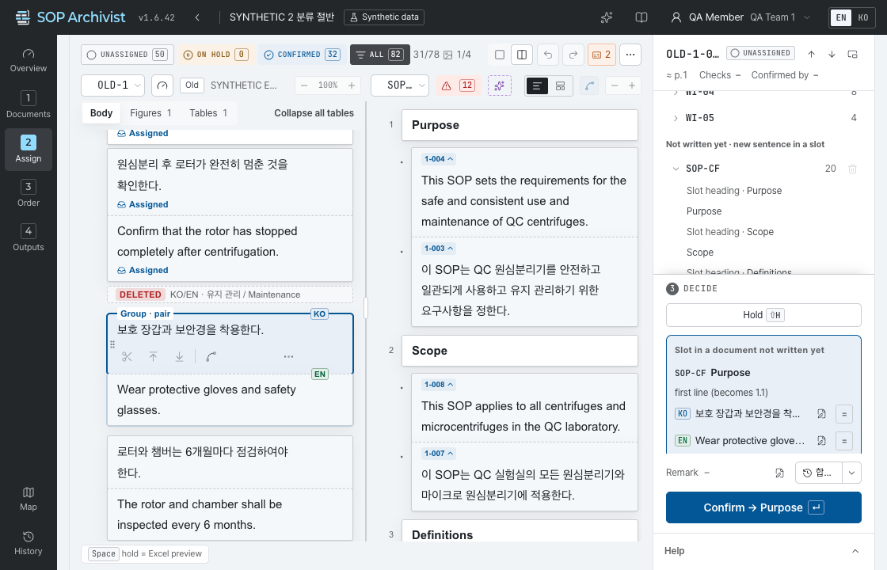
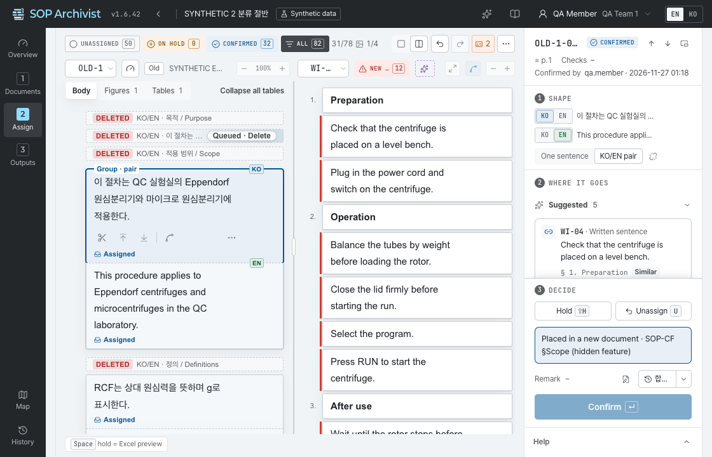
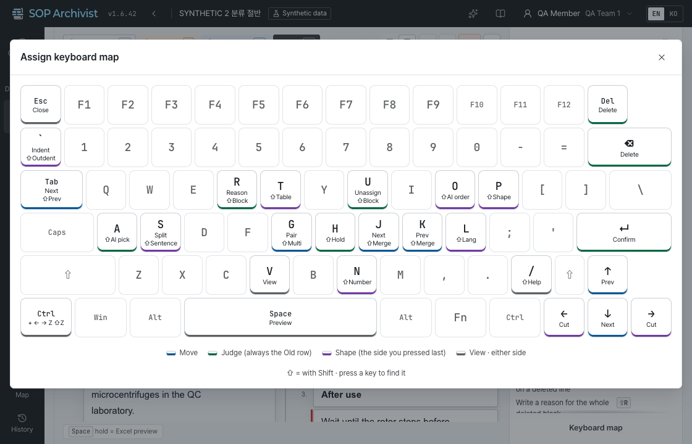
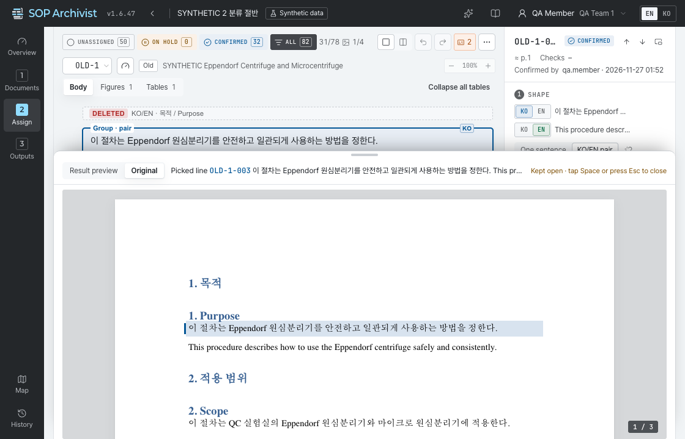
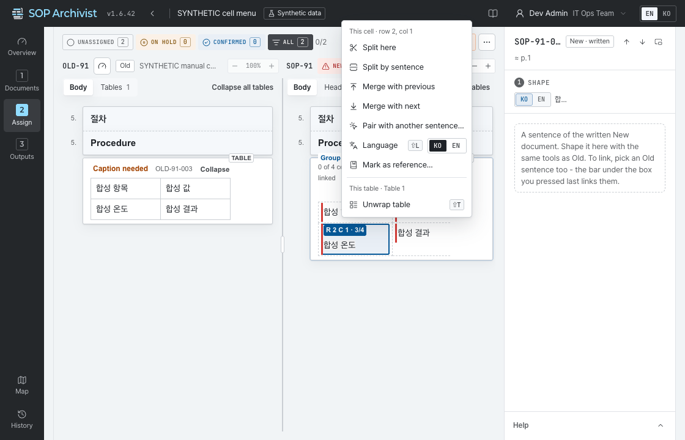
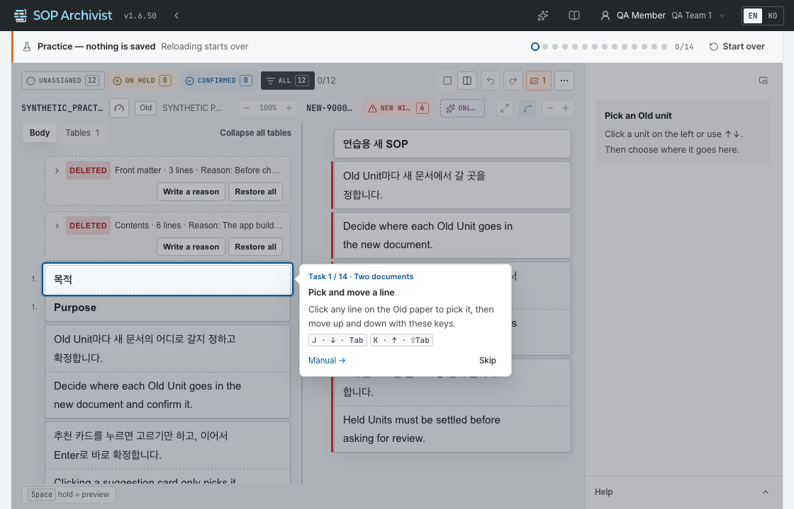

# 메일 초안 — SOP Archivist v1.6.50 업데이트 안내

> 임시 폴더입니다(보낸 뒤 지웁니다). 보내는 사람 · 받는 사람 · 배포 일시 · 접속 주소는 보낼 때 채웁니다.
> 그림은 `img/`에 있습니다 — 사용 설명서 그림과 같은 파일입니다.

---

**제목**: [SOP Archivist] v1.6.50 업데이트 안내 — 주신 의견이 이렇게 반영되었습니다

안녕하세요, SOP Restructuring T/F 여러분.

SOP Archivist가 v1.5.0에서 **v1.6.50**으로 업데이트됩니다(배포: `<배포 일시>`). 11월 23일에 처음 모아 주신 Assign 화면 의견부터 이번 주 사용 중에 주신 의견까지, 받은 순서대로 무엇이 어떻게 바뀌었는지 정리했습니다. 배포 뒤 상단 바에 v1.6.50이 보이면 적용된 것입니다.

## 먼저 알아 두실 것 세 가지

1. **글쇠가 바뀌었습니다.** 보류는 `H` → `Shift+H`, AI 카드 받기는 `A` → `Shift+A`입니다. 옮기기는 글쇠 하나, 내용을 바꾸는 일은 Shift와 함께라는 규칙으로 맞췄습니다. 옛 글쇠를 누르면 새 글쇠를 알려 줍니다.
2. **쪼개기 규칙은 새로 올리는 문서부터 적용됩니다.** 이미 올린 문서는 그대로이고, 새 규칙으로 보려면 다시 올려야 합니다.
3. **처음이시면 연습 화면부터.** 상단 바 사용자 메뉴의 "연습하기"에서 실제 화면을 저장 없이 따라 해 볼 수 있습니다.

## 1. 11월 23일에 주신 의견 (Assign 피드백)

| 주신 의견 | 바뀐 것 |
|---|---|
| 저장이 느릴 때 누른 글쇠가 먹지 않거나 사라진다 | 누른 것이 하나도 빠지지 않고 차례대로 저장됩니다. 삭제 · 확정은 누르는 즉시 다음 박스로 가고, 기다리는 일에는 "Queued" 칩이 붙습니다. |
| 긴 문서에서 반응이 느리다 | 필터를 켠 긴 문서에서 글쇠 반응이 빨라졌습니다. |
| Enter가 자리에 따라 다르게 동작한다 | Enter는 어디에 포커스가 있어도 오른쪽 칸의 확정 단추입니다. 고른 곳이 없으면 첫 추천 카드로 확정합니다. |
| 글쇠가 헷갈리고 도움말과 다르다 | 글쇠 목록을 하나로 모아 화면 · 도움말(`?`) · 설명서가 같은 것을 보입니다. 도움말 아래 **Keyboard map**에서 자판 그림으로 볼 수 있습니다. |
| 위 · 아래 박스와 바로 합치고 싶다 | `Shift+J` 두 번은 아래 박스와, `Shift+K` 두 번은 위 박스와 합칩니다. |
| 여러 줄을 한 번에 처리하고 싶다 | `Shift+G`로 여럿을 골라 합치기 · 표 벗기기 · 배정 취소 · 언어 바꾸기를 한 번에 합니다. |
| 번호 칸 창에 확인 · 취소가 없다 | 확인 · 취소 단추가 생겼습니다. |
| 무엇을 골랐는지 잘 안 보인다 | 누른 조각은 진하게, 그것이 든 짝 · 표는 얇은 테와 꼬리표로 보입니다. |
| 표 우클릭 메뉴가 어디에 적용되는지 모르겠다 | "이 칸"과 "이 표"로 나뉘고, 항목에 올리면 바뀌는 칸이 칠해집니다. |
| 진행 숫자가 실제와 다르게 느껴진다 | "정함"과 처분별 막대(배정 · 삭제 · 이동)로 바뀌었고 그림은 따로 셉니다. |
| Excel 미리보기가 복잡하다 | 목차는 한 줄로 접고 그림 자리 · 삭제 줄을 숨깁니다. 문단 Excel은 받을 때 넣을 것(표 · 삭제한 줄 · 그림 · 목차)을 고릅니다. |
| 다른 Bundle로 이동은 쓰지 않는다 | 없앴습니다. 이미 이동한 줄은 읽기 전용으로 남고 배정 취소로 풉니다. |
| 떨어진 한/영 짝을 알아보기 어렵다 | 한 화면에 있으면 왼쪽 괄호선으로 이어 보입니다. |
| 표만 따로 보고 싶다 | **Tables** 탭이 생겼고, 본문의 표는 한 줄로 접어 둘 수 있습니다. |
| 합치거나 나눈 줄에 옛 AI 제안이 남는다 | AI 제안은 아직 정하지 않은 줄에만 남습니다. |
| 표를 벗기면 번호가 끊긴다 | 벗긴 줄이 위 번호 아래로 이어지고(5.1 · 5.2 …), 합치면 뒤 번호가 당겨집니다. |
| 한글 표에서 한 손질을 영어 표에 또 해야 한다 | 벗긴 영어 표 머리의 "한글 표처럼 하기"가 같은 손질을 제안합니다. |

**이번에 넣지 않은 것**: "To-Be 문서로 이동 · 새 문서 추가"는 새 문서를 만드는 기능과 함께 숨겨 두었습니다(Order · 결과물 C · 템플릿 보기 포함). 이미 보낸 줄은 그대로 보입니다.

## 2. 회의에서 정한 것 — 쪼개기 먼저

- 새로 올리는 문서는 **한 문단을 언어마다 박스 하나**로 쪼갭니다.
- 표지 · 결재 표 · 목차 · 개정 이력은 저절로 제외되어 **DELETED** 접힌 블록으로 보입니다. 블록마다 사유를 적거나(`R`) 삭제를 취소(`U`)할 수 있습니다.
- 박스를 누르면 그 아래에 **단추 줄**(잇기 · 나누기 · 합치기 · 짝)이 뜹니다. 두 문서 보기에서는 Old와 New를 각각 고르고 Enter로 잇습니다.
- 두 문서 보기의 New 문서도 Old와 같은 용지로 보이고 같은 손질을 씁니다.

## 3. 11월 26일 사용 중에 주신 의견

| 주신 의견 | 바뀐 것 |
|---|---|
| 스크롤 막대가 안 보인다 | 마우스가 칸 오른쪽 끝 가까이에 오면 흐리게 보입니다. |
| Tab으로 옮기고 싶다 | `Tab` · `Shift+Tab`이 `J` · `K`처럼 다음 · 이전 박스로 갑니다. 들여쓰기는 숫자 1 왼쪽 글쇠입니다. |
| 떨어진 짝으로 가려다 빗나간다 | 짝 안내 줄을 두 번 누르면 그 짝으로 갑니다. |
| Forms · 서식 아래 줄이 참조로 잡히지 않는다 | 새로 올리는 문서에서 참조 줄이 됩니다. |
| 단추 줄의 아이콘만으로는 뜻을 모르겠다 | 자리가 되면 이름까지 보이고, 좁으면 덜 쓰는 것부터 아이콘으로 접습니다. |
| New 쪽 표에서는 우클릭 메뉴가 없다 | 두 문서 보기의 New 표 칸 · 표 머리 · 제목 · 캡션 · 그림에도 같은 메뉴가 뜹니다. |
| 따라 해 볼 곳이 필요하다 | **연습 화면**이 생겼습니다. 말풍선이 과제를 차례로 안내하고, 서버에는 아무것도 저장하지 않습니다. |
| 원본과 견줘 보고 싶다 | Space 시트에 **원본 보기** 탭이 생겼습니다. 올린 Word 원본을 인쇄 미리보기처럼 보여 주고 고른 박스의 자리를 따라갑니다. 시트 높이는 끌어서 조절합니다. |

## 4. 11월 27일에 주신 의견

| 주신 의견 | 바뀐 것 |
|---|---|
| 단추 줄에 마우스를 올리면 단추가 떨려 누를 수 없다 | 올려도 단추가 움직이지 않습니다. 접힌 단추의 이름은 툴팁으로 뜹니다. |
| 우클릭하면 단추 줄이 사라진다 | 줄이 떠 있는 박스를 우클릭해도 줄이 남습니다. ⋯에 "그 밖의 손질"뿐이면 누르는 즉시 우클릭 메뉴가 뜹니다. |
| 연습 화면에서 다른 글쇠를 눌러 길을 잃는다 | 그 과제의 글쇠만 통하고, 다른 글쇠는 말풍선이 알려 줍니다. 과제는 두 문서 보기 → `V` → 문서 하나 보기 → `V` 차례의 14개입니다. |
| 삭제된 표를 고르면 Space가 안 먹는다 | 접힌 삭제 줄 · 삭제 블록을 고른 채 Space를 눌러도 시트가 열립니다. |
| 두 문서 보기에서 New를 고르면 Space 시트가 닫힌다 | New를 골라도 시트가 켜져 있습니다. |
| 설명서에 맥 안내는 필요 없다 | 설명서와 화면 글에서 맥 글쇠 안내를 뺐습니다. |

## 아직 남은 것

- "한글 표처럼 하기"와 AI 제안은 합성 문서로만 확인했습니다. 실제 SOP에서 어긋나는 곳이 보이면 알려 주세요.
- 표 꼴 개정 이력, Reference 아래 줄이 참조로 잡히지 않는 경우는 다음 업데이트에서 봅니다.
- 원본 보기는 Word(DOCX) 원본만 됩니다. PDF로 올린 문서는 내려받기 링크가 보입니다.

접속: `http://<server-ip>:7777` · 사용법은 화면 오른쪽 위 설명서 아이콘에서 볼 수 있습니다.
쓰시다 불편한 점은 언제든 이 메일에 답장으로 알려 주세요.

감사합니다.
`<보내는 사람>` 드림
