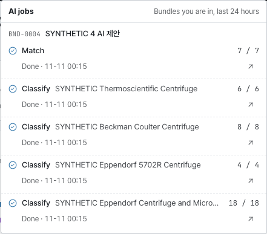

# SOP Archivist 사용 설명서

옛 SOP 묶음을 새 SOP·WI 구조로 다시 짜는 일을, 문서 올리기부터 검토까지 차례로 안내합니다. 화면에 보이는 단추·탭·열 이름은 영어 화면 그대로 **굵게** 적었습니다. 오른쪽 위 **EN** | **KO** 로 화면 말을 바꿔도 자리와 순서는 같습니다.

## 한눈에 보기 {#at-a-glance}

SOP Archivist는 옛 SOP 여러 편(Old)을 새 SOP·WI 구조(New)로 옮기는 작업대입니다. 관련 문서를 Bundle 하나로 묶어 올리면 문장 크기의 Unit으로 쪼개고, Unit마다 새 문서의 어느 자리로 갈지 정한 뒤, 그 결과를 표·흐름도·새 문서 초안·Excel로 뽑아 검토까지 마칩니다.

> [!NOTE]
> **제안은 연필로, 확정은 잉크로.** 점선은 아직 사람이 확인하지 않은 제안, 실선은 사람이 확정한 것, 보라색은 AI가 만든 것입니다. AI는 제안만 하고 줄마다 사람이 확정하며, 올린 원문의 글자는 어느 단계에서도 바뀌지 않습니다.

### 일의 흐름 {#flow}

왼쪽 단계 레일(또는 위쪽 탭)의 순서가 곧 일의 순서입니다. 앞 단계로는 언제든 돌아갈 수 있습니다.

| 순서 | 화면 | 하는 일 | 다음으로 넘어가는 때 |
|---|---|---|---|
| 준비 | **Documents** | Old SOP와 이미 써 둔 New 문서를 올린다 | 올린 문서가 모두 **Ready** |
| 1 | **Split** | 문서를 Unit으로 쪼개고 경계를 확인한다 | 모든 Unit의 경계와 누락 의심 경고를 확인했다 |
| 2 | **To-Be** | 새 SOP·WI 목록과 그 안의 칸을 만든다 | Unit을 보낼 곳이 생겼다 |
| 3 | **Assign** | Unit마다 보낼 곳을 정하고 확정한다 | 모든 Unit과 새 문장이 **Confirmed** |
| 4 | **Outputs** | 결과물 A·B·C와 Excel을 확인한다 | 의미 확인 네 가지를 마쳤다 |
| 검토 | **Review** | 검토자가 읽고 완료하거나 돌려보낸다 | **Review complete** |
| 기록 | **History** | 누가 언제 무엇을 했는지 본다 | 언제든 |

문서를 하나도 올리지 않은 Bundle에서는 **Split**·**Assign**·**Outputs**·**Review** 가 잠겨 있습니다. **Documents** 에서 문서를 올리면 열립니다.

### 상태 읽는 법 {#status}

상태 이름은 화면 말과 상관없이 항상 영어입니다.

| 대상 | 상태 | 뜻 |
|---|---|---|
| Unit | **Unassigned** | 아직 보낼 곳을 정하지 않았다 |
| Unit | **AI suggested** | AI가 제안했고 사람은 아직 확인하지 않았다 |
| Unit | **Confirmed** | 사람이 확정했다 |
| Unit | **On hold** | 사유를 적고 미뤄 두었다. 검토 요청 전에 풀어야 한다 |
| Bundle | **In progress** | 작성자가 작업 중이다 |
| Bundle | **In review** | 검토를 요청했다. 내용이 잠긴다 |
| Bundle | **Review complete** | 검토가 끝났다. 읽기 전용이다 |

### 역할 {#roles}

- **Author**: 문서를 올리고 쪼개기·배정·결과물 확인까지 하는 사람입니다. 검토 요청과 다시 열기도 작성자가 합니다.
- **Reviewer**: 검토 요청이 온 Bundle을 읽고 완료하거나 사유와 함께 돌려보냅니다. 내용은 고치지 않습니다.

> [!NOTE]
> 이 서비스의 검토는 재구성 결과를 서로 확인하는 절차입니다. 문서의 정식 승인은 EQUIS에서 합니다.

## 시작하기 {#start}

### 로그인 {#sign-in}

회사 계정으로 로그인합니다. 로그인 화면에서 **Sign in with company account** 를 누르면 사내 로그인 창을 거쳐 돌아옵니다. 한동안 쓰지 않아 세션이 끝나면 다시 로그인하라는 안내가 뜨고, 로그인하면 보던 화면으로 돌아옵니다.

### Bundle 목록 {#home}

- 첫 화면 **Bundles** 에는 내가 구성원(작성자·검토자)인 Bundle만 보입니다. 줄을 누르거나 줄에 초점을 두고 <kbd>Enter</kbd>를 누르면 열립니다.
- **View** 에서 **Table** 과 **Cards** 를 바꿉니다. 고른 보기는 이 브라우저에 기억됩니다. 카드 보기에서는 Synthetic data 표지가 늘 제목 아래 줄에 오고, 같은 줄의 카드는 아래 끝이 맞습니다.
- 제목을 아직 쓰지 않은 Bundle은 제목 자리에 흐린 **Untitled**(한국어 화면은 '이름 없음')가 보입니다. 목록 화면(Bundles·Documents·To-Be·History·관리)은 큰 화면에서 본문이 더 넓게 펼쳐집니다.
- **New bundle** 은 `bundle.create` 권한이 있을 때만 보입니다. 누르면 곧바로 새 Bundle이 만들어지고 **Overview** 가 열리니, 제목과 설명은 거기서 고칩니다.

### 화면 설정 {#settings}

| 메뉴 | 하는 일 |
|---|---|
| **My account** | 내 정보와 권한을 본다 |
| **Admin** | 관리 화면을 연다. 관리 권한이 있을 때만 보인다 |
| **Layout** | **Navigation** 에서 단계 이동을 **Left rail** 또는 **Top tabs** 로, **Theme** 에서 **Light** 또는 **Dark** 로 바꾼다 |
| **Manual** | 이 설명서를 새 탭으로 연다 |
| **Sign out** | 로그아웃한다 |

- 화면 말은 오른쪽 위 **EN** | **KO** 로 바꿉니다. 상태 이름과 Bundle·Old·New·Unit 같은 용어는 어느 쪽에서나 영어입니다.
- 상단 막대의 책 모양 단추 **Manual** 은 지금 보고 있는 화면을 설명하는 조각을 새 탭으로 엽니다.

### 이동할 때 {#moving}

- 링크를 누르면 잠깐 뒤에 이동합니다. 그 사이 같은 링크를 다시 누르거나 <kbd>Esc</kbd>를 누르면 이동이 취소됩니다.
- 저장하지 않은 변경이 있으면 떠나기 전에 먼저 묻습니다.
- 상단 막대의 화살표 **Back to bundles** 는 Bundle 목록으로 돌아갑니다.
- 창이 떠 있을 때 <kbd>Esc</kbd>는 맨 위의 창 하나만 닫고, 초점은 그 창을 연 곳으로 돌아갑니다.

## Bundle과 Overview {#bundle}

Bundle은 함께 재구성할 문서 묶음입니다. Old SOP 여러 편과 새로 만들 SOP·WI가 한 Bundle 안에 들어가고, Bundle마다 `BND-0001` 같은 번호가 붙습니다.

**Overview** 는 Bundle의 지금 상태를 한 화면에 모아 보여 줍니다.

| 카드 | 보는 것 |
|---|---|
| **Next action** | 지금 할 일 한 가지. **Start** 를 누르면 그 일을 하는 화면으로 간다 |
| **Coverage** | 한/영 짝을 한 줄로 센 숫자 한 벌 — 확정 비율과 상태별 줄 수. 한 언어만 있는 줄이 있으면 표 아래에 그 수를 따로 적는다(검토 요청 조건은 아니다) |
| **Review request** | 검토 요청 조건 여덟 가지. 빨간 줄을 누르면 고칠 화면으로 간다 |
| **AI job** | 진행 중인 AI 작업. **Cancel jobs** 로 멈추고 **Retry failed** 로 실패한 것만 다시 돌린다 |
| **Members** | 구성원과 역할. **Manage** 에서 추가·역할 변경·제외 |
| **Activity** | 최근 작업 기록. **View all** 은 **History** 로 간다 |

- 검토 요청 단추(**Request review**)는 조건 목록 바로 아래, 안내 위에 있습니다. 장비 SOP 칸이 빈 문서가 둘 이상이면 안내가 한 줄로 묶이고, 그 줄을 누르면 문서 코드가 펼쳐집니다.
- 문서가 아직 없는 Bundle은 조건 목록 대신 **Not started — add documents first** 한 줄만 보입니다.
- 검토자가 되돌린 사유가 길면 아래가 흐려지고 **Show more** 가 나타납니다. 누르면 전체가 펼쳐지고 **Show less** 로 다시 접습니다.

### 제목·설명·삭제 {#bundle-edit}

- 제목이나 설명에 마우스를 올리면 나오는 연필 단추를 눌러 그 자리에서 고칩니다. 제목은 <kbd>Enter</kbd>, 여러 줄인 설명은 <kbd>Ctrl</kbd>+<kbd>Enter</kbd>로 저장하고 <kbd>Esc</kbd>로 취소합니다.
- 제목 옆 **More** 메뉴의 **Mark as test data** 는 시험용 Bundle임을 표시합니다. 표시한 Bundle은 상단 막대에 **Synthetic data** 표지가 붙습니다.
- **More** 메뉴의 **Delete bundle** 은 Bundle과 그 안의 문서·판단을 모두 지웁니다. 되돌릴 수 없습니다.

### 구성원 {#members}

- **Manage** 를 누르면 **Bundle members** 창이 열립니다. **Add member** 에서 사람을 찾아 넣고 **Role** 에서 **Author** 또는 **Reviewer** 를 고릅니다.
- 사람은 이름·한글 이름·아이디로 찾습니다. 아무것도 입력하지 않으면 내 부서 사람이 먼저 나옵니다.
- 작성자는 한 명 이상 있어야 하고, 검토를 요청하려면 활동 중인 검토자가 한 명 이상 있어야 합니다.
- Bundle은 구성원에게만 보입니다. 구성원이 아닌 사람이 주소로 들어오면(개요·Documents·Split·To-Be·Assign·Outputs·Review·History 어느 단계 주소든) **Bundle not available** 화면이 뜹니다. 이때는 단계 이동 줄 없이 **Back to Bundles** 단추만 있습니다. 없는 주소로 들어와도 같은 단추가 있는 안내 화면이 뜹니다.

## Documents {#documents}

재구성할 원문을 올리는 화면입니다. 올린 파일은 바로 읽혀 글자와 표가 추출됩니다.

본문 폭이 좁아도 표의 뒤쪽 열은 한 줄을 유지합니다. 한 줄에 **Extraction**·**Aux check** 표시와 경고 개수 칩이(칩에 올리면 경고 목록이 뜹니다) 왼쪽에, 줄 단추가 오른쪽 끝에 놓입니다. **Language layout** 드롭다운은 폭이 고정이라 긴 이름은 말줄임(…)이 되고, 올리면 전체 이름이 뜹니다.

### 올리기 {#upload}

1. **Upload documents** 를 누릅니다.
2. **Choose files** 로 파일을 고릅니다. 여러 개를 한 번에 고를 수 있고, DOCX와 글자가 들어 있는 PDF를 받습니다.
3. 올리기 단추를 누르면 파일마다 결과가 표시됩니다. 다 올렸으면 **Go to Split** 으로 넘어갑니다.

여기서는 쪼개서 배정할 옛 문서(Old)만 올립니다. 이미 써 둔 새 문서는 [To-Be](#tobe-written)에서 올립니다.

> [!TIP]
> 파일 이름에 문서 번호와 버전이 들어 있으면 그대로 읽어 옵니다. 이름을 정리해 두고 올리면 고칠 일이 줄어듭니다.

### 목록의 열 {#document-columns}

| 열 | 뜻 |
|---|---|
| **Side** | **Old**(옛 문서) 또는 **New**(이미 쓴 새 문서) |
| **Doc no.** · **Version** · **Title** | 파일 이름과 본문에서 찾은 값. 틀리면 그 자리에서 고친다. 버전은 **Version up** · **Version down** 으로 올리고 내린다 |
| **Language layout** | **KO/EN interleaved**(한 줄씩 번갈아), **KO/EN separate**(한글 뒤 영어가 따로), **English only**, **Korean only** |
| **Extraction** | **Ready**(읽기 끝), **Rejected**(받을 수 없는 파일), **Failed**(읽다가 실패) |
| **Aux check** | 다른 방법으로 한 번 더 읽어 빠진 글이 없는지 견준 결과 |
| **Warnings** | 읽으면서 생긴 경고 수. **Split** 에서 확인한다 |

정상이면 글자 없이 체크 아이콘만 보입니다(**Ready**, **Checked**). 아이콘에 올리거나 Tab으로 가면 뜻이 툴팁으로 뜹니다. 거절·실패·보조 검사 불가처럼 살펴야 할 때만 글자가 있는 알약이 나타납니다.

- 목록은 **Old SOP** 구역과 **New SOP · WI** 구역으로 나뉘고, 구역 머리에 문서 수가 보입니다. 문서가 없는 구역은 나오지 않습니다.
- 줄 끝(카드 보기에서는 카드 맨 아래)의 단추로 **Preview**(읽힌 글 미리 보기), **Download**(원본 파일 내려받기), **Delete document** 를 합니다. 단추는 평소에도 제자리에 흐리게 보이고, 줄에 올리거나 Tab으로 들어가면 또렷해집니다. 단추에 올리면 이름이 툴팁으로 뜹니다. **Open in Split** 은 그 문서를 쪼개기 화면으로 엽니다.
- 판단이 이미 있는 문서를 지우려 하면 한 번 더 묻습니다. **Delete anyway** 를 누르면 그 문서의 Unit에 걸린 판단이 함께 풀립니다.
- 같은 파일을 두 번 올리면 받지 않습니다.
- AI가 켜져 있으면 규칙이 찾지 못한 문서 번호·버전을 AI가 제안합니다. 제안은 눌러야 저장됩니다.

### 받지 못한 파일 {#upload-rejected}

| 이유 | 할 일 |
|---|---|
| DOCX·PDF가 아니다 | DOCX나 PDF로 저장해 다시 올린다 |
| 파일이 너무 크다, 쪽이 너무 많다, 글이 너무 길다 | 문서를 나눠 올린다 |
| 암호가 걸려 있거나 파일이 깨졌다 | 암호를 풀거나 다시 저장해 올린다 |
| 스캔한 그림 PDF다 | 글자가 들어 있는 원본(DOCX나 글자 PDF)을 올린다 |
| 변경 내용 추적이 남아 있다 | Word에서 변경을 모두 적용하거나 취소한 뒤 올린다 |
| 다른 문서를 끼워 넣은 DOCX다 | Word에서 한 문서로 다시 저장해 올린다 |
| 글자가 없다 | 내용이 있는 파일인지 확인한다 |
| 읽는 데 너무 오래 걸렸다, 읽다가 멈췄다 | 다시 올려 보고, 되풀이되면 관리자에게 알린다 |

### 크기 한도 {#limits}

| 항목 | 기본 한도 |
|---|---|
| 파일 하나 | 25 MB |
| DOCX를 풀었을 때 | 200 MB |
| PDF 쪽수 | 500쪽 |
| 문서 하나의 글자 수 | 2,000,000자 |
| 문서 하나를 읽는 시간 | 60초 |

한도는 서버 설정에 따라 다를 수 있습니다.

### 경고 종류 {#warnings}

| 경고 | 뜻 |
|---|---|
| **Missing text** | 다시 읽은 결과와 견주니 빠진 글이 있을 수 있다. **Split** 에서 원문과 대조해 확인해야 검토를 요청할 수 있다 |
| **Reading order may differ** | PDF라서 읽는 순서가 원문과 다를 수 있다 |
| **Auto numbering** · **Clause numbers** | 자동 번호나 절 번호가 원문과 다르게 읽혔을 수 있다 |
| **Merged cells** · **Table position** | 병합된 칸이나 표의 자리가 원문과 다를 수 있다 |
| **Large image** | 큰 그림이 있는 자리. 원문과 견주어 본다 |
| **Check needed** | 그 밖에 사람이 한 번 봐야 하는 곳 |

## 1단계 Split {#split}

문서를 Unit으로 쪼개는 단계입니다. Unit은 **한곳으로 보낼 수 있는 가장 작은 조각**입니다. 올릴 때 규칙이 먼저 쪼개 두므로, 여기서는 경계가 맞는지 확인하고 틀린 곳만 고칩니다.

- 왼쪽: Bundle의 문서 목록. 맨 아래에는 **Help** 가 있습니다. **Shortcuts** 와 **Marks**(표시 풀이) 두 탭입니다. 처음에는 접혀 있어 문서 목록이 더 길게 보이고, 펼친 상태는 이 브라우저에 기억됩니다.
- 가운데: 원문 종이. Unit 하나가 종이 한 조각입니다. 글자뿐 아니라 조각의 빈 곳이나 왼쪽의 번호 칸을 눌러도 그 Unit이 골라집니다. 조각에 마우스를 올리거나 조각을 고르면 조각 위 테두리 오른쪽 끝에 작은 탭으로 시스템이 잡은 언어가 **KO** 또는 **EN** 으로 뜹니다(평소에는 숨어 있습니다). 한/영 짝이면 한 조각만 올리거나 골라도 짝 모두에 뜹니다. 표·그림처럼 언어가 없는 Unit에는 뜨지 않습니다. 조각 끝의 아이콘은 경계 확인·한/영 짝 같은 상태입니다. 아이콘에 마우스를 올리거나 <kbd>Tab</kbd>으로 가면 뜻이 뜹니다(설명은 마우스에 가리지 않게 아이콘 위에 뜨고, 위에 자리가 없을 때만 아래에 뜹니다). 경계를 확인하면 조각 끝에 확인 표시만 더해지고 모양은 그대로입니다.
- 가운데 위: **Body** · **Header** · **Footer** 탭과 **AI split whole document** · **AI pair** 단추.
- 오른쪽: 선택한 Unit의 글·언어·짝과 할 수 있는 일. 고른 Unit이 없을 때는 단추 대신 안내와 진행 요약(몇 개 중 몇 개를 확인했는지)만 보입니다.

**Body** 는 본문, **Header** 는 머리말, **Footer** 는 꼬리말과 각주·미주입니다. 머리말·꼬리말은 Word 파일에 든 것마다 종이 한 장으로 보이고, 장 위에 어느 구역의 어떤 머리말인지 적혀 있습니다. 글자가 똑같은 머리말·꼬리말은 한 번만 보이며, 그 경계를 확인하면 같은 것들이 함께 확인됩니다. 탭 이름 옆의 수는 그 탭에 남은 경계 수입니다. 다음 Unit으로 넘어가다 탭의 끝에 닿으면 다음 탭으로 이어집니다.

> [!NOTE]
> Word가 자동으로 매긴 번호(1., 가., (a) 등)는 글 앞에 글자로 붙어 읽힙니다. 한 문단 안에서 <kbd>Shift</kbd>+<kbd>Enter</kbd>로 줄을 바꾼 곳은 줄마다 Unit이 됩니다. 언어는 한글이 한 글자라도 있으면 **KO**, 없으면 **EN** 으로 잡습니다.

### 경계 확인하기 {#split-check}

결과물과 Excel은 Unit이 잘린 자리를 그대로 따릅니다. 그래서 **모든 Unit의 경계를 확인해야 검토를 요청할 수 있습니다.** 표와 표의 행처럼 다른 Unit을 묶기만 하는 것은 세지 않고, 글이 있는 Unit(문장·제목·그림·칸 문장)만 셉니다.

1. Unit을 읽고 경계가 맞으면 **Check boundary** 를 누르거나 <kbd>↵</kbd>를 누릅니다. 고른 Unit의 조각 아래에 펼쳐지는 **Check boundary** 단추를 눌러도 됩니다. 오른쪽 위 상태가 Not checked에서 Checked로 뒤집히고 조각 아래 단추가 **Uncheck boundary** 로 바뀌는 것을 보인 뒤(반 초쯤) 다음 확인 안 된 Unit으로 넘어갑니다. 기다리지 않으려면 그 사이 <kbd>↵</kbd>를 한 번 더 누릅니다 — 바로 넘어가기만 하고 다음 Unit을 확인하지는 않습니다.
2. 잘못 확인했으면 <kbd>U</kbd>(**Uncheck boundary**)로 되돌립니다. 확인한 Unit을 고르면 조각 아래에 **Uncheck boundary** 단추가 뜹니다. 한 번 누르면 같은 단추가 빨갛게 늘어나며 **Click again to uncheck** 로 바뀌고, 3초 안에 한 번 더 눌러야 취소됩니다.
3. 정할 수 없는 Unit은 <kbd>H</kbd>(**Hold**)를 누르고 사유를 적어 미룹니다. 미룬 Unit은 **Assign** 의 **On hold** 에 모입니다.

남은 수는 두 곳에 보입니다. 오른쪽 위에는 지금 문서에 남은 경계 수가, 왼쪽 문서 목록에는 문서마다 남은 수가 나옵니다. 다 확인한 문서는 **All boundaries checked** 로 바뀝니다.

끝까지 읽어 보고 더 고칠 곳이 없으면 **Check the rest** 를 누릅니다. 확인 창에서 한 번 더 누르면 지금 문서에 남은 Unit이 모두 확인됩니다. 하나씩 읽지 않고 넘기는 것이니, 문서를 훑어본 뒤에 씁니다. 한 번에 확인한 일은 **History** 에 남습니다.

> [!NOTE]
> 쪼개거나 합쳐서 새로 생긴 Unit은 확인하지 않은 상태로 시작합니다. **Assign** 에서 AI가 나눈 문장을 확정해 생긴 Unit도 같습니다. 검토를 요청하기 전에 **Split** 으로 돌아와 확인합니다.

### 쪼개기와 묶기 {#split-edit}

- **쪼개기**: 나눌 자리를 두 번 눌러 선을 놓습니다. 선은 끌어서 옮기거나, 선을 고른 채 <kbd>←</kbd> <kbd>→</kbd>로 옮깁니다(그 Unit 안에서만 움직입니다). 잠시 뒤 선 옆에 뜨는 **Split here** 를 누르거나 <kbd>S</kbd>(**Split**)를 누르면 조각이 바로 둘로 나뉩니다.
- **조각 사이 간격**: 조각 사이는 평소 좁고, 고른 조각 곁과 마우스를 잠깐 머문 자리만 살짝 넓어집니다(조각 사이를 지나가기만 하면 벌어지지 않습니다). 한/영 짝의 구성원이 이웃해 있으면 몇 줄이든(1:1, 1:2 …) 옅은 바탕의 한 카드로 붙고 줄 사이에는 점선 한 줄만 남습니다. 끝에는 고리 아이콘이 붙습니다. 떨어져 있는 짝은 카드가 되지 않고 고리 아이콘과 고를 때의 강조 테두리로만 보입니다.
- **조각 왼쪽 번호 칸**: 조각마다 왼쪽 바깥에 절 번호 칸이 붙어 있습니다. 보류인 줄은 번호 칸에 마우스를 올리면 "on hold"가 뜹니다. 절 번호(예: 5.2.1)는 그 절의 첫 조각 번호 칸에만 한 번 보이고(짝 카드면 첫 줄에만, 둘째 줄부터는 첫 줄과 같은 폭), 그 줄 글 앞에 같은 번호가 있으면 글에서는 빼고 보입니다(화면에서만 빼고 원문은 그대로입니다). 번호 칸의 폭은 절 깊이로만 정해져서 깊은 절일수록 조각이 오른쪽에서 시작합니다(같은 깊이는 폭이 같습니다). 창이 좁으면 깊은 번호는 "1.2.…"처럼 줄여 보이고, 번호 칸에 마우스를 올리면 전체 번호가 뜹니다. 보류인 줄은 글 첫머리에 ON HOLD 칩이 붙습니다.
- **묶기**: 위아래로 붙은 두 조각 사이(틈과 그 위아래 조각 가장자리)에 마우스를 잠깐 두면 틈이 벌어지며 옅은 바탕이 차오른 뒤 선이 그어지고, 글이 시작하는 자리 바로 아래에 **Join** 이 튀어나옵니다(키보드는 <kbd>Tab</kbd>으로 바로). 스쳐 지나가기만 하면 열리지 않습니다. 단추는 다 나타난 뒤에야 눌립니다. 묶으면 어떻게 될지는 두 조각의 언어로 시스템이 고릅니다 — 언어가 같으면 한 문장으로 합치고(단추에 접기 아이콘), 한글과 영어면 한/영 짝으로 묶습니다(단추에 고리 아이콘). 결과가 틀렸으면 오른쪽 칸 **Joined with** 에서 바꿉니다([묶인 문장과 한/영 짝](#split-pair)). 셋 이상은 차례로 합칩니다. 줄을 바꿔 나뉜 Unit을 합치면 줄 바꿈이 그대로 남습니다. 묶을 수 없는 자리는 단추가 흐리고, 마우스를 올리면 까닭이 뜹니다(문장·제목이 아님, 표의 다른 칸, 한쪽이 이미 다른 짝에 듦). 표와 그림 사이처럼 글이 아닌 것끼리와 한 짝 카드 안의 줄 사이는 단추가 없습니다(짝을 한 문장으로 합치려면 **Joined with** 의 **One sentence**).
- **조각 아래 단추**: Unit을 고르면 그 조각 상자가 아래로 늘어나며 글 바로 아래에 지금 할 수 있는 일만 단추로 펼쳐집니다(아래 조각들은 그만큼 밀려 내려갑니다). 확인 전이면 **Check boundary**, 확인했으면 **Uncheck boundary**(두 번 눌러야 취소), 짝이 있으면 보라색 **Separate**, 합쳐서 생긴 Unit이면 **Unmerge**. 다른 Unit을 고르면 접힙니다. 고른 조각의 위아래 틈은 고르자마자 벌어집니다(두 번 눌러 나눌 자리를 정할 때는 글이 밀려도 처음 누른 글자에서 나뉩니다). 단추를 눌러 단추 묶음이 바뀌면 옛 단추 줄이 브라운관 TV가 꺼지듯 가는 선으로 눌려 사라진 뒤 새 단추 줄이 거꾸로 켜집니다. **Check boundary** 를 누르면 그 조각의 줄이 꺼졌다 **Uncheck boundary** 로 켜진 뒤에 다음 Unit으로 넘어갑니다.
- **합치기 풀기**: **Unmerge** 는 합치기 전의 Unit들을 원래 ID 그대로 되살립니다(그 Unit의 합치기만 골라 되돌리는 것). 합친 뒤 그 Unit을 다시 나누거나 경계를 옮겼다면 풀 수 없으니 **Undo** 를 씁니다. 한글과 영어를 합친 것이면 되살린 Unit은 저마다 원래 언어로 돌아가고, 같은 언어끼리 합친 것이면 합친 Unit의 언어를 따릅니다. 짝은 되살아나지 않습니다.
- **글자를 골라 새 Unit**: 글자를 끌어 고르면 **New unit from selection** 이 나옵니다. **Make unit** 을 누르면 고른 글자만 새 Unit이 됩니다.
- **우클릭 메뉴**: 문장 줄을 오른쪽 단추로 누르면(키보드는 문장을 고른 채 <kbd>Shift</kbd>+<kbd>F10</kbd> 또는 메뉴 글쇠) 할 수 있는 동작이 뜹니다. 문장을 고른 채 **다른** 문장을 우클릭하면 두 문장 동작 — **Join**(틈의 단추와 같은 규칙. 짝이면 확인 없이 바로 확정, 같은 언어는 이웃한 두 문장만 합친다), **Separate**, **Check both boundaries** — 이 뜨고, 고른 문장 자신(또는 고른 것이 없을 때 아무 문장)을 우클릭하면 오른쪽 칸과 같은 동작(**Check boundary**, **Split**, **AI split this sentence**, **Hold**, **Language** 한 줄의 KO | EN, **Separate**)이 뜹니다. 지금 할 수 없는 항목은 흐리게 보이고, 마우스를 올리거나 포커스를 두면 까닭이 뜹니다. <kbd>Esc</kbd>로 닫습니다.
- **표**: 표는 통째로 Unit 하나입니다. 행마다 다른 곳으로 보내야 하면 **Split into rows**, 되돌리려면 **Merge rows back** 을 누릅니다. 자리만 잡으려고 쓴 표는 **Treat as layout table** 로 바꿔 칸의 글을 보통 문장으로 다룹니다.
- **Undo** 와 **Redo**: <kbd>Ctrl</kbd>+<kbd>Z</kbd>, 다시 하기는 <kbd>Shift</kbd>를 함께 누릅니다. 되돌리기 기록은 서버에 남아 화면을 다시 열어도 이어집니다.

> [!WARNING]
> 이미 판단이 있는 Unit을 쪼개거나 합치면 그 판단이 풀립니다. **Decisions will be cleared** 창에서 **Edit anyway** 를 눌러야 진행됩니다.

### 묶인 문장과 한/영 짝 {#split-pair}

- **KO/EN pair** 는 같은 뜻의 한글·영어 문장을 묶은 것입니다. 짝은 배정할 때 함께 움직입니다(이미 쓴 New 문장이 한 언어뿐일 때는 [확정·고쳐 쓰기·보류](#assign-confirm) 참고).
- 짝이 있는 Unit을 고르면 종이에서 짝인 조각이 옅은 강조색 바탕으로 칠해지고 그 조각에 강조색 테두리(2px)가 둘러집니다(이웃한 짝이면 카드 전체에 하나로). 오른쪽 칸 **Joined with** 에는 함께 묶인 문장이 나오고, 누르면 그 문장으로 갑니다.
- **Joined with** 의 **One sentence** · **KO/EN pair** 로 묶은 결과를 바꿉니다. 언어를 잘못 읽어 묶은 결과가 틀렸을 때 고치는 길입니다.
  - 짝에서 **One sentence** 를 누르면 짝을 풀고 그 문장들을 한 Unit으로 합칩니다. 짝의 문장들이 위아래로 붙어 있을 때만 쓸 수 있습니다 — 떨어져 있는 짝(한/영 따로 문서에서 흔합니다)은 단추가 흐리고 까닭이 뜹니다.
  - 합쳐서 생긴 Unit에서 **KO/EN pair** 를 누르면 합치기를 풀고 되살린 Unit들을 짝으로 묶습니다. 되살린 Unit들이 같은 언어로 잡혀 있으면 영어 글자가 많은 쪽을 EN으로 바꿔 묶습니다. 한 언어로만 된 문장이면 단추가 흐리고 까닭이 뜹니다. 풀기는 됐는데 짝을 묶지 못하면 알림으로 알려 주니 직접 묶습니다.
- 짝을 풀려면 **Separate** 를 누릅니다. 올릴 때 자동으로 잡힌 짝도 따로 확정하지 않습니다 — 그 줄을 **Assign** 에서 확정하면 짝도 함께 확정됩니다.
- 올릴 때 자동으로 잡는 짝은 위아래로 붙어 있고 서로 맞는 것이 분명한 한글·영어 문장뿐입니다. 나머지는 직접 묶거나 **AI pair** 로 제안을 받습니다.
- 이미 배정한 문장으로도 짝을 맺을 수 있지만, 한 줄의 처분은 하나라서 서로 다른 곳으로 보낸 문장끼리는 묶이지 않습니다(직접 묶으면 알림으로 거절되고, **AI pair** 나 자동 짝은 제안하지 않습니다). 먼저 한쪽 배정을 바꿉니다. 둘 다 같은 New 문서로 확정해 둔 문장이 짝이 되면 그 짝은 바로 확정됩니다.
- 떨어져 있는 문장과 묶으려면(**Not joined** 일 때) **Join with...** 를 누르고 같은 내용의 문장을 고른 뒤 **Join** 을 누릅니다. 떨어진 문장끼리는 한/영 짝만 묶습니다 — 같은 언어 문장은 위아래로 붙어 있을 때 틈의 **Join** 으로 합칩니다.
- Unit의 언어를 직접 고치려면 문장을 오른쪽 단추로 눌러 뜨는 메뉴의 **Language** 줄에서 KO | EN 중 다른 쪽을 누릅니다. 지금 언어 칸은 채워져 있고 누를 수 없습니다. 키보드로는 <kbd>↑</kbd> <kbd>↓</kbd>로 그 줄에 가고 <kbd>←</kbd> <kbd>→</kbd>로 칸을 옮겨 <kbd>↵</kbd>로 고릅니다.

### AI 나누기 제안 {#split-ai}

1. 문장 하나만 보내려면 문장을 골라 오른쪽 칸 글 아래 **AI split this sentence** 를 누르거나 그 문장을 우클릭해 같은 이름의 항목을 고릅니다. 문서의 모든 문장을 한꺼번에 보내려면 가운데 위의 **AI split whole document** 를 누릅니다(단추에 올리면 보낼 수 있는 문장 수가 나옵니다). 몇 건을 AI에 보냈는지와, 보내지 않은 것은 까닭별로 몇 건인지 알림으로 나옵니다. 30자보다 짧은 문장은 일괄로는 보내지 않습니다.
2. 제안이 오면 그 조각 끝에 AI 표시가 붙고, 오른쪽 칸 맨 위 **AI suggestions** 에 문장마다 탭이 쌓입니다(문서 순서). 아직 열어 보지 않은 탭에는 점이 붙고, 일괄로 보낸 것은 머리에 "Whole document · N left" 로 남은 수가 나옵니다. 탭 줄이 길면 옆으로 밀어 봅니다.
3. 탭을 누르면 그 문장으로 가고, 나눌 자리를 미리 볼 수 있습니다. **Apply split** 으로 적용하거나 **Dismiss** 로 버리고, 남은 것이 있으면 다음 제안으로 넘어갑니다.

### 누락 의심 경고 {#split-warnings}

문서에 **Missing-text warnings** 가 있으면 경고마다 원문과 견주어 본 뒤 **Mark checked** 를 누릅니다. 확인하지 않은 경고가 남아 있으면 검토를 요청할 수 없습니다.

### 단축키 {#split-keys}

| 글쇠 | 하는 일 |
|---|---|
| <kbd>↵</kbd> | 경계를 확인하고 다음 Unit으로 |
| <kbd>↑</kbd> <kbd>↓</kbd> <kbd>J</kbd> <kbd>K</kbd> | 다음·이전 Unit |
| 두 번 누르기 | 쪼갤 자리에 선 놓기 |
| 끌기, <kbd>←</kbd> <kbd>→</kbd> | 선 옮기기 |
| <kbd>S</kbd> | 선에서 쪼개기 |
| <kbd>U</kbd> | 경계 확인 취소 |
| <kbd>H</kbd> | 사유를 적고 보류 |
| <kbd>Ctrl</kbd>+<kbd>Z</kbd> | 되돌리기. <kbd>Shift</kbd>를 더하면 다시 하기 |

## 2단계 To-Be {#tobe}

새로 만들 SOP·WI의 목록을 적는 단계입니다. 여기 적은 문서와 그 안의 칸이 **Assign** 에서 Unit을 보낼 곳이 됩니다.

### 문서 적기 {#tobe-docs}

**Add document** 로 줄을 더하고 칸을 채웁니다.

| 열 | 뜻 |
|---|---|
| **Doc no.** · **Title** | 새 문서의 번호와 제목 |
| **Type** | SOP 또는 WI |
| **Parent SOP** | WI가 속한 SOP의 번호 |
| **Entrance** | **Assign** 은 아직 쓰지 않은 문서라 Old Unit을 칸에 보내 새 문장을 만든다. **Match** 는 이미 써서 올린 문서라 Old Unit을 그 문장에 잇는다 |
| **Equipment SOP** | 장비 SOP면 켠다. 장비 SOP에 있어야 하는 절차 칸(전자 기록 관리·문제 해결·유지 보수)이 비어 있으면 **Overview** 에 알려 준다. 검토 요청을 막지는 않는다 |
| **N/A or steps** | SOP는 쓰지 않는 칸의 수, WI는 단계의 수 |

### 이미 쓴 문서 올리기 {#tobe-written}

이미 써 둔 새 SOP·WI 파일은 **Upload written** 으로 올립니다. 먼저 옛 문서의 쪼개기를 끝내 두는 편이 좋습니다. 경계를 아직 확인하지 않은 Old Unit이 있으면 단추 곁에 안내가 보이지만, 올리는 것을 막지는 않습니다.

1. **Upload written** 을 누릅니다. 고친 것이 있으면 먼저 저장하거나 버립니다.
2. **Type** 을 고르고, WI라면 **Parent SOP number (WI only)** 에 이 목록에 있는 SOP의 번호를 적습니다.
3. **Choose files** 로 파일 하나를 고르고 **Upload** 를 누릅니다.

올린 문서는 **Documents** 에 **New** 로 나타나고, 이 목록에는 **Match** 줄이 생깁니다. 파일 이름의 문서 번호가 목록에 이미 있으면 올릴 수 없습니다.

### 칸과 단계 {#tobe-slots}

- 문서를 펼치면 **Sections and steps** 가 나옵니다.
- SOP는 칸이 정해져 있습니다. 이 SOP에 없는 칸은 N/A로 표시하고 **Reason** 을 적습니다.
- WI는 **Add step** 으로 단계를 더하고 **Step title** 을 적습니다. **Remove step** 으로 뺍니다. 단계 번호는 자동으로 다시 매기지 않습니다.
- 이미 문장을 배정한 문서·칸·단계는 뺄 수 없습니다. 먼저 **Assign** 에서 배정을 풉니다.
- **Match** 로 들어온 줄은 올린 새 문서에 묶여 있습니다. 빼려면 **Documents** 에서 그 문서를 지웁니다.

### 저장 {#tobe-save}

- 고친 뒤 **Save** 를 누르거나 <kbd>Ctrl</kbd>+<kbd>S</kbd>를 누릅니다. 저장 전에는 **Unsaved changes** 가 보이고, **Discard** 로 고친 것을 버립니다.
- 다른 사람이 먼저 저장했으면 **The To-Be list changed elsewhere** 창이 뜹니다. **Load the latest** 로 최신 목록을 받은 뒤 다시 고칩니다.

### Excel로 가져오기 {#tobe-excel}

1. **Excel template** 으로 양식을 내려받아 채웁니다.
2. **Import Excel** 로 올립니다. 목록 전체가 파일 내용으로 바뀌므로, 목록이 비어 있지 않으면 **Replace the To-Be list?** 창에서 한 번 더 묻습니다.
3. 이미 문장을 배정한 문서·칸·단계가 파일에 없으면 가져오기가 거절됩니다.

## 3단계 Assign {#assign}

Old Unit마다 새 문서의 어디로 갈지 정하고 확정하는 단계입니다. 가장 오래 머무는 화면입니다.

- 왼쪽: Old 원문. 원문 자체가 목록이라 문맥을 보면서 판단합니다. 문장마다 맨 앞에 **KO**·**EN** 표시가 늘 붙어 어느 언어인지 한눈에 읽힙니다(표시 모양은 **Split** 과 같고, 언어가 없는 표·그림에는 없습니다). 배정한 줄 아래에는 간 곳이 한 줄로 적힙니다. 글 앞의 아이콘이 종류를 말합니다(이어진 New 문장은 문서 아이콘, 지운 것은 휴지통, 다른 SOP로 보낸 것은 폴더, 아직 쓰지 않은 문서의 칸에 둔 것은 받은 편지함).
- 오른쪽: 이미 쓴 New 문서의 원문. Old와 같은 종이 조각이라 조각 왼쪽에 **KO**·**EN** 표시와 절 번호 칸이 붙고, 번호 칸 폭이 절 깊이를 따라 들여쓴 것처럼 읽힙니다. 절 번호는 절 머리 줄이 아니라 이 번호 칸에만 보이고, 이웃한 한/영 짝은 두 줄이 붙은 한 카드로 보입니다. 이어진 Old 출처(**출처 칩**)는 본문 위 줄에 붙습니다. 그 Old Unit이 왼쪽 칸 화면 위쪽 밖에 있으면 칩 오른쪽에 위 갈매기, 아래쪽 밖이면 아래 갈매기가 붙습니다. 출처가 넷 이상이면 둘만 보이고 "+2"처럼 남은 수가 나오며, 누르면 모두 펼쳐집니다.
- 오른쪽 칸의 문서 고르기에는 아직 쓰지 않은 To-Be 문서도 있습니다(이름 옆 "not written"). 고르면 머리 표지가 **New · from Assign** 이 되고, 지금까지 그 문서의 칸에 배정한 문장이 칸 순서대로 보입니다(결과물 C와 같은 칸, 한글·영어 함께, 고쳐 쓴 글이 있으면 그 글). 아직 받은 문장이 없는 칸은 **Nothing assigned yet**, N/A 칸은 **N/A** 로 옅게 보입니다. 칸 제목에 이은 옛 제목은 문장 줄이 아니라 그 칸 이름 뒤에 "← OLD-1 §5"처럼 옅게 보입니다(결과물 C의 칸 머리와 같고, 칸 제목은 줄로 세지 않아 칸 번호도 C와 같습니다). 이 문서는 미리 보기라 문장을 눌러 잇지 않고, 출처 칩을 누르면 Old의 그 Unit으로 갑니다.
- 문장을 확정하면 오른쪽 칸이 보낸 문서로 바로 옮겨 가고(그 줄에서 손으로 다른 문서를 골라 두었으면 그대로), 새 문장이 제 칸에 펼치며 나타나 화면 안으로 들어오고 Old 문장과 잇는 선이 진하게 그려집니다. 이미 쓴 문장에 이었을 때는 그 문장이 잠깐 번쩍입니다. **Clear assignment** 를 하면 그 문장이 접히며 빠집니다. 다음 줄로 옮겨 가면 오른쪽 칸은 다시 그 줄을 따라갑니다(칸에 확정한 줄을 고르면 그 문서가 열립니다).
- 화면은 항상 두 칸입니다. To-Be에 문서가 하나도 없으면 오른쪽 칸에 안내가 뜨고, **Go to To-Be** 로 올리는 곳에 갑니다.
- Old 문서에 머리말·꼬리말이 있으면 Old 칸 위에 **Body**·**Header**·**Footer** 탭이 생깁니다(Split과 같습니다). 고른 조각이 다른 탭에 있으면 그 탭으로 저절로 넘어갑니다.
- New 문장에 이어진 Old 조각에는 조각 오른쪽 아래 모서리에 배지가 붙습니다. 오른쪽에 열린 New 문서와 이어졌으면 아이콘만 보입니다 — 그 문장이 오른쪽 칸 화면 안에 있으면 연결 아이콘, 위쪽 화면 밖이면 위 갈매기, 아래쪽이면 아래 갈매기입니다. 다른 New 문서와만 이어졌으면 옅은 글자로 그 문서 번호가 보이고, 문서가 여럿이면 "+1"처럼 수가 붙습니다. AI가 제안만 한 연결(아직 확정하지 않음)은 배지가 점선 테두리와 AI 색으로 보이고, 마우스를 올리면 AI 제안이라는 설명이 뜹니다. 배지를 누르면 오른쪽 칸이 그 문장으로 갑니다.

### 목록 거르기 {#assign-filters}

| 탭 | 보이는 것 |
|---|---|
| **Unassigned** | 아직 정하지 않은 Unit |
| **AI suggested** | AI 제안이 있는 Unit. 제안이 있을 때만 보인다 |
| **On hold** | 미뤄 둔 Unit |
| **Confirmed** | 확정한 Unit |
| **All** | 전부. 처음 열면 이 탭이다(Old 원문 전부, 접지 않음) |
| **New without source** | 어느 Old Unit과도 이어지지 않은 새 문장. 남아 있으면 검토를 요청할 수 없다 |

- 상태 탭을 누르면 Old 원문이 그 탭으로 접힙니다. 맞는 문장만 제 모양으로 보이고, 바로 앞뒤 문장은 옅은 한 줄로, 나머지 이어진 문장들은 "문장 12개 § 5.1–5.2"처럼 점선 한 줄로 묶입니다. 묶음 줄을 누르면(오른쪽 **Expand**) 그 문장들이 한 줄씩 펼쳐지고 위에 **Collapse** 가 생깁니다. 한 줄을 누르면 그 문장이 제 모양으로 펼쳐집니다(바탕이 가라앉고 테두리가 점선 — 탭 밖이라는 뜻). 펼친 문장도 눌러 고르고 배정할 수 있습니다. 고른 문장은 **Collapse** 를 눌러도 펼친 채 남고, 그 앞뒤만 다시 묶음 줄로 접힙니다.
- 목록은 탭을 누른 순간에 정해집니다. 확정·보류로 상태가 바뀌어도 그 자리에서 사라지거나 접히지 않고, 같은 탭을 다시 누르면 새로 세고 펼친 것이 모두 접힙니다. <kbd>J</kbd>·<kbd>K</kbd>는 이 목록만 밟고, 펼친 문장에서 누르면 문서 순서로 가장 가까운 목록 문장으로 갑니다.
- New 문장의 **출처 칩** 으로 접힌 Old 문장에 가면 그 문장만 저절로 펼쳐지고 앞뒤는 접힌 채 남습니다.
- 지금 문서·부분에 맞는 문장이 없으면 원문 대신 안내와 맞는 문장이 있는 곳(문서·부분·수)이 뜹니다. 누르면 그리로 옮깁니다.
- **New without source** 탭에서는 Old를 넓게 훑어 출처를 골라야 하니 접지 않습니다.

### 보낼 곳 고르기 {#assign-destination}

오른쪽 아래 목록에서 보낼 곳을 누릅니다.

| 묶음 | 내용 |
|---|---|
| **Suggested** | 같은 글·비슷한 글·AI가 고른 후보. 카드마다 종류 아이콘(잇기·칸·옮기기·지우기)이 붙고, 아래 줄에 절 번호와 **Same text**, **Similar**, **AI** 표지가 붙는다. 묶음 제목 옆에는 개수가 보인다. 한/영 짝 줄에서 New 문장도 한/영 짝이면 두 문장이 카드 하나로 묶여 함께 골라진다 |
| **Nearby** | 지금 고른 곳의 바로 옆 문장이나 옆 칸 |
| **All** | To-Be의 모든 문서와 칸 |
| **Delete or move** | 새 문서로 가지 않는 처분. 지우기와 다른 문서로 옮기기 |

보낼 곳은 세 가지입니다.

- **Written sentence**: 이미 쓴 New 문서의 문장에 잇습니다. 오른쪽 칸의 New 문서에서 문장을 눌러도 됩니다.
- **Slot in a document not written yet**: 아직 쓰지 않은 문서의 칸에 새 문장을 만듭니다. 처음 글은 Old 원문 그대로이고, 고쳐 쓰려면 **Edit and confirm** 을 씁니다.
- **Slot heading**: 옛 제목 줄을 새 SOP 칸의 제목으로 삼습니다. 아직 안 쓴 문서의 칸 목록에서 각 칸 이름 바로 앞에 있고, 줄이 제목·문장일 때만 보입니다. 짝이면 한글·영어가 각자 그 칸의 제목이 되고 글은 칸 이름이라 고칠 수 없습니다. 다른 문서의 같은 제목도 같은 칸 제목에 잇으면 출처만 더해집니다. 칸 제목에는 번호가 붙지 않습니다.

> [!NOTE]
> 보낼 곳이 하나도 없으면 **To-Be** 가 비어 있는 것입니다. **Open To-Be** 로 가서 새 문서 목록부터 적습니다.

### 이어진 곳 보기·이동 {#assign-links}

- 이어진 Old Unit과 New 문장은 한쪽에 마우스를 올리면 맞은편이 강조됩니다.
- 양쪽 끝이 다 화면에 보이는 이음은 옅은 파란 선으로 그려집니다. 선은 Old 조각 오른쪽 끝(연결 배지 높이)에서 나와 두 문서 사이 빈 곳에서만 위아래로 움직이고, New 문장 앞의 **KO**·**EN** 표시 왼쪽에 닿아 본문 글을 가리지 않습니다(언어 표시가 없는 문장은 상자 왼쪽 끝). 고른 줄과 마우스를 올린 것은 진하게(마우스를 올려 진해진 선은 양 끝의 연결 배지와 출처 칩도 함께 강조됩니다), AI가 이어 두고 아직 확정하지 않은 이음은 선과 출처 칩이 보라색으로, 아직 저장하지 않은 고름은 점선으로 보입니다. 이음이 아주 많으면 고른 것과 마우스를 올린 것만 그립니다. New 문서 머리의 선 아이콘으로 선을 켜고 끌 수 있고, 이 브라우저가 기억합니다(배지와 강조는 그대로).
- Old Unit 아래 "간 곳"(문서 아이콘이 붙은 글)을 누르면 New 문서의 그 문장으로, New 문장 위의 출처 칩을 누르면 Old의 그 Unit으로 갑니다. New 문서가 닫혀 있거나 다른 문서면 열고 갑니다. 간 자리는 잠깐 테두리가 번쩍입니다.
- Old 줄에 없는 언어의 New 문장도 이을 수 있습니다. 그 줄의 Unit이 출처가 되고 변경 종류는 **Translated** 로 적힙니다(고르지 않습니다). New 문장 하나를 고르면 New 문서에서 짝인 다른 언어 문장도 늘 함께 골라집니다 — 빼려면 그 문장을 <kbd>Ctrl</kbd>을 누른 채 다시 누릅니다.
- 추천이나 New 문장을 누르거나 이렇게 이동하면 그 옆에 작은 메뉴가 조금 늦게 뜹니다. 메뉴는 이은 줄의 글 아래(자리가 모자라면 위)에 놓여 그 줄을 가리지 않고, 가로는 누른 곳을 따라갑니다. 마우스를 멀리 옮기지 않고 여기서 고릅니다.

| 메뉴가 뜬 때 | 항목 |
|---|---|
| 고르기만 하고 저장 전 | **Confirm**(<kbd>↵</kbd>) · **Cancel**(고름을 되돌림). 메뉴와 추천 카드에 **Not saved yet** 이 보인다 |
| 이미 확정해 이은 문장 | **Unlink** · **Close**. 문장이 여럿이면 그 문장(한/영 짝은 함께)만 빼고 나머지를 고른 상태로 두고, 하나뿐이면 배정을 지운다 |
| AI가 이어 둔 문장 | **Confirm** · **Unlink** · **Close** |
| 이어지지 않은 문장 | **Link**(고르기) · **Close** |

메뉴는 <kbd>Esc</kbd>로 닫고, <kbd>↑</kbd> <kbd>↓</kbd>로 항목을 옮깁니다. 확정하면 오른쪽 위에 **Confirmed** 알림이 뜹니다.

### 확정·고쳐 쓰기·보류 {#assign-confirm}

| 단추 | 글쇠 | 하는 일 |
|---|---|---|
| **Confirm** | <kbd>↵</kbd> | 고른 보낼 곳으로 확정하고 다음 Unit으로 |
| **Edit and confirm** | <kbd>E</kbd> | 새 문장을 고쳐 쓴 뒤 확정. <kbd>Ctrl</kbd>+<kbd>↵</kbd>로 저장, <kbd>Esc</kbd>로 닫기 |
| **Hold** | <kbd>H</kbd> | 사유를 적고 미루기 |
| **Clear assignment** | <kbd>U</kbd> | 판단을 지우고 **Unassigned** 로 |

- **Remark** 는 지우기·다른 문서로 옮기기·보류·두 문서로 보내기에 꼭 적어야 합니다. 그 밖에는 메모로 적어 두어도 되고 비워 두어도 됩니다. 오른쪽 칸에는 지금 사유가 두 줄까지 보이고(넘치면 올렸을 때 전체), 옆의 **Write remark**(이미 있으면 **Edit remark**)를 누르면 창에서 씁니다. 창 칸 아래 **My recent remarks** 에 내가 최근에 쓴 사유가 5개(모든 Bundle, 같은 글은 한 번) 보이고 더 보기로 10개까지 펼치며, 누르면 칸에 채워집니다. <kbd>Ctrl</kbd>+<kbd>↵</kbd>로 확인합니다.
- 사유가 꼭 필요한 저장(지우기·옮기기·보류)을 사유 없이 누르면 이 창이 저절로 열리고 무엇에 필요한지 알려 줍니다. 쓰고 **Save and confirm**(보류는 **Save and hold**)을 누르면 저장이 이어집니다.
- 다른 문서로 옮기기의 **Target doc** 은 치면서 고르는 칸입니다. 내가 멤버인 다른 Bundle의 To-Be 문서(번호·제목·Bundle 코드)가 추천으로 뜨고, 전에 옮길 곳으로 쓴 번호(이 Bundle에서 쓴 것 먼저)가 맨 위입니다. 목록에 없는 번호는 친 그대로 쓸 수 있습니다(목록 맨 위 "그대로 쓰기"). <kbd>↑</kbd> <kbd>↓</kbd>로 옮기고 <kbd>↵</kbd>로 고르며 <kbd>Esc</kbd>는 목록만 닫습니다.
- **Change type** 은 원문과 새 문장의 관계입니다: **As is**, **Tone**, **Rewritten**, **Merged**, **Split**, **Translated**, **Deleted**, **New**, **Table restructured**.
- **Checks** 는 원문과 새 문장을 견준 결과입니다. **Numbers differ**, **Units differ**, **Negation differs** 가 뜨면 뜻이 바뀌지 않았는지 다시 봅니다.
- 한/영 짝은 함께 확정됩니다(**Confirmed together**).
- 이어 갈 New 문장이 한 언어로만 있으면 그 언어의 Old 문장만 이어집니다. 잇지 않는 문장은 고른 곳 아래에 알려 주고, **Confirm** 을 누르면 같은 저장에서 짝이 풀려 그 문장이 따로 줄이 됩니다(서버가 함께 처리합니다. **History** 에 **Removed a KO/EN pair**). 따로 남은 줄은 **Delete or move** 의 **Deleted**(**Remark** 필수)나 **Hold** 로 마무리합니다. 흔한 경우는 아닙니다 — 보통은 Old와 New 모두 한글·영어가 함께 있어 두 문장이 같이 이어집니다.
- 짝의 문장들이 서로 다른 New 문서나 처리(지우기·옮기기)로 가면 짝이 풀리고 알림이 뜹니다. 한 줄의 처리는 늘 하나입니다.
- 고르기만 하고 확정하지 않은 채 떠나려 하면 먼저 묻습니다.

### Old 문장 우클릭 메뉴 {#assign-context}

Old 문장을 오른쪽 단추로 누르면(키보드는 줄을 고른 채 <kbd>Shift</kbd>+<kbd>F10</kbd> 또는 메뉴 글쇠) 그 줄을 고르고 메뉴가 뜹니다. 메뉴는 그 줄의 조각(한/영 짝이면 둘 다) 아래, 자리가 모자라면 위에 놓여 다룰 문장을 가리지 않습니다. 지금 할 수 없는 항목은 숨기지 않고 흐리게 보이며, 마우스를 올리거나 포커스를 두면 까닭이 뜹니다.

| 묶음 | 항목 | 하는 일 |
|---|---|---|
| **Assignment** | **Confirm** | 오른쪽 칸에서 고른 보낼 곳으로 확정(옆에 보낼 곳이 흐리게). 고른 곳이 없거나 이미 확정한 그대로면 꺼진다 |
| | **Clear assignment** | 배정을 지우고 **Unassigned** 로 |
| **Edit sentence** | **Split here** | 누른 자리 가까이에 나눌 선을 놓는다. 선을 끌거나 <kbd>←</kbd> <kbd>→</kbd>로 옮긴 뒤 선 옆 **Split here**(<kbd>S</kbd>)로 나누고, **Cancel**(<kbd>Esc</kbd>)로 거둔다. 문장을 두 번 눌러도 선이 놓인다 |
| | **Merge with previous** · **Merge with next** | 바로 앞·뒤 문장과 한 문장으로 합친다(같은 언어끼리. 다른 언어는 한/영 짝이라 **Split** 에서 맺는다) |
| | **Language** | KO·EN 중 하나로 바꾼다 |

문장 고치기는 **Split** 의 편집과 같아서 배정이 없는 문장에만 됩니다 — 배정된 문장은 먼저 **Clear assignment** 를 하고, 저장하지 않은 고름이 있는 줄은 먼저 확정하거나 고름을 되돌립니다. 고친 뒤에는 원문을 다시 읽고 고친 문장(나누면 앞쪽 조각)의 줄을 고릅니다. 경계 확인·짝 맺기·AI 나누기·되돌리기는 **Split** 에서 합니다.

### 여럿을 한 번에 {#assign-bulk}

- **같은 글 일괄 확정**: 이미 쓴 New 문서에 글자가 똑같은 문장이 있는 Unit은 목록 위의 same-text pairs 단추로 한 번에 확정합니다. 누르면 **Confirm same-text pairs** 창에서 건수를 보여 주고 **Confirm all** 을 눌러야 진행됩니다.
- **지우기·옮기기**: <kbd>Shift</kbd>를 누른 채 Old Unit을 눌러 여럿을 고르면 **Delete picked rows** 와 **Move picked rows to another document** 가 나옵니다. 여럿을 한 번에 할 수 있는 것은 지우기와 옮기기뿐입니다. 창에서 바로 사유를 쓰고(아래에 **My recent remarks**), 옮기기의 **Target doc** 은 하나씩 할 때와 같은 추천 칸입니다.
- **배정 초기화**: 목록 위 **Reset** 메뉴의 **Reset this document** 는 지금 연 Old 문서의 배정을, 선 아래 **Reset the whole bundle** 은 Bundle 안 모든 배정을 한 번에 지웁니다. 창이 먼저 몇 Unit이 **Unassigned** 로 돌아가는지, 함께 묶인 다른 문서의 Unit 몇 개가 **On hold** 로 가는지, 새로 쓴 문장 몇 개가 지워지는지 세어 보여 주고, **Reset** 을 눌러야 진행됩니다. AI 작업이 돌고 있으면 끝난 뒤에 할 수 있습니다. **History** 에 **Reset assignments** 로 남습니다.
- **합치기와 나누기**: Unit 여럿을 새 문장 하나로 보내면 합침, Unit 하나를 새 문장 여럿으로 보내면 나눔입니다. New 문서에서 <kbd>Ctrl</kbd>을 누른 채 문장을 누르면 보낼 문장이 더해집니다.

### 출처 없는 새 문장 {#assign-new}

**New without source** 탭에는 이미 쓴 New 문서의 문장 가운데 Old 출처가 없는 것이 모입니다. 오른쪽 칸에서 이런 문장은 상자 왼쪽 끝에 가는 빨간 막대가 붙습니다.

- 정말 새로 쓴 문장이면 **Mark as new** 를 누릅니다. 그 위의 **Write remark** 로 **Remark** 를 적어 두면 함께 저장됩니다(선택).
- Old에 출처가 있으면 그 Old Unit을 골라 이 문장에 잇습니다.

### 번역 {#assign-translate}

AI가 켜져 있으면 한쪽 언어만 있는 새 문장에 **Make English** 또는 **Make Korean** 단추가 나옵니다(제목 줄도 같습니다). 그 언어의 문장이 이미 있으면(직접 쓴 문장·AI 번역) 단추가 나오지 않고, AI 번역도 그 줄을 건너뜁니다. 누르면 AI가 다른 언어 문장을 제안하고, 사람이 확인해 확정합니다. 번역 문장의 자리는 출처 문장을 따라가며 따로 옮길 수 없습니다.

AI가 꺼져 있어도 빠진 언어를 직접 채울 수 있습니다. 칸에 확정한 한 언어 줄에서 **Write English** 또는 **Write Korean** 을 누르면 고쳐 쓰기가 열리며 다른 언어의 빈 칸이 하나 더해집니다. 글을 쓰고 확정하면 그 줄의 Unit을 출처로 같은 칸에 저장되고 변경 종류는 **Translated** 입니다. 칸을 비워 두면 저장되지 않고, 비운 채 <kbd>Esc</kbd>로 닫으면 빈 칸도 걷혀 단추가 다시 나옵니다.

### 보기 조절 {#assign-view}

- 마우스를 올린 문서에서 <kbd>Ctrl</kbd>+휠 또는 <kbd>Ctrl</kbd>+<kbd>+</kbd> <kbd>-</kbd>로 그 문서만 확대·축소합니다.
- 두 문서 사이의 세로선을 끌어 폭을 바꿉니다. 확대와 폭은 이 브라우저에 기억됩니다.
- 위쪽 도구 줄은 한 줄로 두고, 개수·**Reset**·보기 아이콘은 오른쪽 끝에 모입니다. 도구 줄이 좁으면(대략 창 폭 1750 이하) 개수·**Reset**·AI 메뉴는 아이콘만 보이고 마우스를 올리거나 키보드로 가면 이름이 뜹니다. 그래도 넘치면 그 묶음이 통째로 다음 줄 오른쪽으로 갑니다. 오른쪽 패널은 화면 폭에 따라 280~420px로 달라지고, 아주 넓은 화면에서는 작업면이 1920px까지 늘어납니다. 패널이 좁으면(대략 창 폭 1550 이하) **Edit and confirm**·**Hold**·**Clear assignment** 단추의 글쇠 표시가 빠집니다 — 단축키는 그대로 됩니다. 긴 보류·확정 사유는 **Remark** 칸에 두 줄까지 보이고, 전체는 마우스를 올리거나 **Edit remark** 창에서 봅니다.
- 오른쪽 칸 맨 아래의 **Help** 는 **Shortcuts** 와 **Marks** 두 탭으로 단축키와 표시의 뜻을 풀이합니다. 처음에는 접혀 있고, 펼침과 탭은 이 브라우저에 기억됩니다.

### 단축키 {#assign-keys}

| 글쇠 | 하는 일 |
|---|---|
| <kbd>↑</kbd> <kbd>↓</kbd> <kbd>J</kbd> <kbd>K</kbd> | 다음·이전 Unit |
| <kbd>↵</kbd> | 확정하고 다음으로 |
| <kbd>E</kbd> | 고쳐 쓰기. <kbd>Ctrl</kbd>+<kbd>↵</kbd> 저장, <kbd>Esc</kbd> 닫기 |
| <kbd>H</kbd> | 보류 |
| <kbd>U</kbd> | 배정 지우기 |
| <kbd>Shift</kbd>+누르기 | Old Unit 여럿 고르기(지우기·옮기기) |
| <kbd>Ctrl</kbd>+누르기 | New 문장 더하기(나눔) |
| <kbd>Ctrl</kbd>+휠 | 마우스를 올린 문서 확대·축소 |
| <kbd>Shift</kbd>+<kbd>F10</kbd> · 메뉴 글쇠 | 고른 줄에서 우클릭 메뉴 열기 |
| <kbd>S</kbd> · <kbd>Esc</kbd> | 나눌 선이 있을 때 여기서 나누기 · 선 거두기 |
| <kbd>↑</kbd> <kbd>↓</kbd> <kbd>←</kbd> <kbd>→</kbd> | 그 자리 메뉴 안에서 항목 옮기기 |
| <kbd>Esc</kbd> | 그 자리 메뉴 닫기 |

## 4단계 Outputs {#outputs}

배정 결과를 세 가지 모양으로 보여 주는 단계입니다. 따로 만드는 것이 아니라 **Assign** 의 판단에서 바로 나오므로, 판단을 고치면 결과물도 따라 바뀝니다.

| 탭 | 내용 |
|---|---|
| **A · Units** | Old Unit마다 어디로 갔는지 적은 표 |
| **B · Flow** | 옛 문서에서 새 문서로 가는 흐름도 |
| **C · New documents** | 새 문서별로 문장을 모은 초안 |

- **Output language** 에서 한국어와 영어를 바꿉니다. 고른 탭과 언어는 이 브라우저에 기억됩니다.
- **A · Units** 의 열은 **Old unit**, **Source**, **Destination**, **New sentence · Change**, **Status** 입니다. **Destination** 에는 새 문서 안 섹션 번호(아래)도 함께 나오고, 새 문장 여럿으로 나뉘었으면 ①② 차례로 적힙니다. 지우거나 다른 문서로 옮긴 Unit은 **Deleted and moved** 에 따로 모입니다. **Source** 와 **New sentence · Change** 의 글은 여섯 줄까지만 보이고, 더 길면 그 줄의 **Old unit** 칸에 **Show more** 가 나옵니다. 누르면 그 줄만 전부 펼쳐지고(**Show less** 로 접음), 키보드로도 누를 수 있습니다. 아주 긴 새 문서 코드는 가운데를 줄여 보이며 마우스를 올리거나 포커스를 두면 전체가 나옵니다.
- **B · Flow** 의 카드는 Old 문서마다 한 장이고, 보낸 곳이 여덟 개를 넘으면 여덟 개까지만 보이다가 'N more'(한국어 화면은 'N개 더')를 누르면 나머지가 펼쳐집니다(**Show less** 로 접음). 긴 새 문서 코드는 가운데를 줄여 보이고 전체는 마우스를 올리거나 포커스를 두면 나옵니다.
- **C · New documents** 의 줄 끝 단추 묶음은 늘 보이지만 흐리고, 줄에 마우스를 올리거나 포커스를 두면 또렷해집니다. 짧은 글이면 같은 줄 오른쪽 끝에, 글이 폭을 채우면 글 바로 아래 오른쪽에 놓여 글을 가리지 않습니다. **Move up** · **Move down** 으로 칸 안의 문장 순서를 바꿉니다. 번역 문장은 출처 문장을 따라 움직입니다. 새 문서가 없으면 **Open To-Be** 로 가서 목록부터 적습니다.
- **섹션 번호**: 칸마다 정해진 번호(SOP는 칸 자리, WI는 단계 번호)가 있고, 그 안 문장은 들여쓰기 깊이대로 5.1, 5.2, 5.2.1처럼 번호가 붙습니다. 줄 끝 단추의 **Indent** · **Outdent** 를 누르거나, 줄을 눌러 고른 뒤 <kbd>Tab</kbd> · <kbd>Shift</kbd>+<kbd>Tab</kbd>을 누릅니다(<kbd>Esc</kbd>로 고름을 놓음). 들여쓰기는 앞 줄보다 한 단계 깊게까지만 됩니다. 한/영 짝 문장은 상대 언어 줄도 같은 깊이가 되어 두 판의 번호가 같고, 번역 문장은 출처 문장의 깊이를 따릅니다. 이미 쓴 New 문서는 자기 번호를 그대로 쓰므로 들여 쓸 수 없습니다. 번호는 **A · Units** 와 Excel에도 나옵니다.
- **번호 표시**: 줄 끝 단추 묶음의 들여쓰기 단추 왼쪽에 세 칸 단추가 있습니다. **Numbered**(기본)는 번호를 붙이고, **No number** 는 번호 없이 두며, **Note** 는 번호 없이 글을 기울여 보입니다. 번호가 없는 줄은 세지 않으므로 다음 번호 줄이 이어 셉니다(5.1, 번호 없는 줄, 5.2). 들여쓰기 깊이는 번호가 없어도 그대로 보이고, 들여쓰기 한도는 앞의 번호 줄을 기준으로 합니다. 고른 표시는 그 줄에만 붙습니다. 한/영 짝 두 문장이 한 번의 저장이나 한 번의 AI 제안으로 같은 칸에 함께 처음 놓이면 영어 문장이 앞에서 번호를 받고 한글 문장은 바로 뒤에 번호 없이 놓입니다(한쪽이 여럿이면 영어들 다음 한글들, 첫 영어만 번호). 이미 놓인 문장의 번역은 그 문장 바로 뒤에 번호 없이 들어오고, 이미 있는 문장을 다른 칸으로 옮겨도 표시는 그대로입니다. 이미 쓴 New 문서에서는 고를 수 없습니다. 주석 줄은 **A · Units** 의 새 문장과 Excel에서도 기울여 보입니다.

### 요약과 의미 확인 {#outputs-checks}

오른쪽 요약 칸(Summary)은 지금 고른 언어에서 Old Unit이 어떻게 처리됐는지 셉니다: **Old units**, **Assigned**, **Unassigned**, **Duplicated**, **Deleted**, **Moved**, **New**, **Confirmed**.

**Meaning checks** 는 작성자가 결과물을 읽고 직접 표시하는 네 가지 확인입니다.

- **Numbers kept their meaning**: 숫자의 뜻이 그대로다
- **Conditions kept their meaning**: 조건의 뜻이 그대로다
- **Tables kept their meaning**: 표의 뜻이 그대로다
- **Figures kept their meaning**: 그림의 뜻이 그대로다

네 가지를 모두 표시해야 검토를 요청할 수 있습니다. 검토자가 돌려보내거나 작성자가 다시 열면 표시가 지워지므로 다시 확인합니다.

### Excel {#outputs-excel}

Excel 내려받기 단추는 지금 고른 언어의 결과물 A·B·C와 Bundle 정보를 시트로 나눠 담은 파일 하나를 내려받습니다. 한국어와 영어를 각각 받습니다.

## Review {#review}

작성자가 검토를 요청하면 Bundle이 잠기고 검토자가 읽습니다.

### 요청 조건 {#review-gates}

**Overview** 의 **Review request** 카드에 조건 여덟 가지가 보입니다. 모두 통과해야 **Request review** 가 켜집니다.

| 조건 | 통과하려면 |
|---|---|
| **Documents loaded** | 문서가 한 편 이상 있고 **Rejected**·**Failed** 인 문서가 없다 |
| **All boundaries checked** | **Split** 에서 모든 문서의 Unit 경계를 확인했다. 쪼개거나 합쳐 새로 생긴 Unit도 포함한다 |
| **All rows decided** | 모든 줄이 **Confirmed** 다. 미배정·AI 제안·보류가 남아 있지 않다 |
| **All new sentences decided** | 모든 새 문장이 확정됐다. 출처 없는 새 문장이 남아 있지 않다 |
| **Missing-text warnings closed** | **Split** 에서 누락 의심 경고를 모두 확인했다 |
| **Reasons filled** | 지우기·옮기기·두 문서로 보내기에 사유를 적었다 |
| **Meaning checks done** | **Outputs** 의 의미 확인 네 가지를 표시했다 |
| **Reviewer assigned** | 활동 중인 검토자가 한 명 이상 있다 |

### 작성자가 하는 일 {#review-author}

1. **Overview** 에서 **Request review** 를 누릅니다. 작성자만 요청할 수 있습니다.
2. Bundle이 **In review** 가 되고 모든 단계가 읽기 전용이 됩니다(**Read-only · In review**).
3. 검토자가 끝내기 전에 고칠 것이 생기면 **Overview** 의 **Review request** 카드나 **Review** 에서 **Withdraw request** 를 누릅니다. 사유는 적지 않습니다. Bundle이 **In progress** 로 돌아오고 의미 확인 표시가 지워집니다. 거두기는 작성자만 합니다.
4. 돌려받으면 **Overview** 와 **Review** 화면에 **Returned by the reviewer** 와 사유가 보입니다(**Review** 에서는 1280px 이상이면 용지 오른쪽 위, 그보다 좁으면 용지 위). 고친 뒤 의미 확인을 다시 표시하고 다시 요청합니다.
5. 검토가 끝난 Bundle을 고쳐야 하면 **Review** 에서 **Reopen** 을 누르고 사유를 적습니다. Bundle이 **In progress** 로 돌아옵니다. 다시 열기는 작성자만 합니다.

### 검토자가 하는 일 {#review-reviewer}

1. Bundle 목록에서 **In review** 인 Bundle을 열어 **Review** 로 갑니다.
2. 새 문서와 결과물을 읽습니다. 검토자는 내용을 고칠 수 없습니다(**Read-only · Reviewer**).
3. 문제가 없으면 **Complete review** 를 누릅니다. Bundle이 **Review complete** 가 됩니다.
4. 고칠 것이 있으면 **Return** 을 누르고 사유를 적습니다. Bundle이 **In progress** 로 돌아가 작성자가 고칩니다.

> [!NOTE]
> **Review complete** 는 재구성 결과의 확인이 끝났다는 뜻입니다. 정식 승인은 EQUIS에서 합니다.

## History {#history}

Bundle에서 일어난 일을 시간순으로 보는 화면입니다.

- 열은 **When**, **Kind**, **Change**, **Who** 입니다. **Change** 는 두 줄까지만 보이니, 긴 사유는 줄을 열어 전체를 읽습니다.
- 위쪽 단추로 종류를 거릅니다: **All**, **Bundle**, **Documents**, **Decisions**, **AI**, **Review**.
- 줄을 누르거나 줄에 초점을 두고 <kbd>Enter</kbd>를 누르면 자세한 내용이 열립니다.
- AI는 요청·취소·다시 시도만 기록됩니다. 제안을 확정한 것은 사람의 판단(**Decisions**)으로 남습니다.

## AI가 하는 일, 하지 않는 일 {#ai}

AI는 제안만 합니다. 사람이 줄마다 확인해 확정하기 전에는 아무것도 결정되지 않습니다.

### 제안의 종류 {#ai-kinds}

| 종류 | 제안하는 것 | 요청하는 곳 |
|---|---|---|
| **Classify** | Unit을 보낼 칸과 한·영 고쳐 쓴 문장 | **Assign** 의 **Ask AI**, **More AI** → **Classify the whole document** |
| **Translate** | 한쪽 언어만 있는 새 문장의 번역 | **More AI** → **Translate to EN** · **Translate to KO** |
| **Match** | Old Unit과 이미 쓴 New 문장의 짝과 변경 종류 | **More AI** → **Ask AI to match** |
| **KO/EN pair** | 한글과 영어가 따로 있는 문서의 한/영 짝 | **Split** 의 **AI pair** |
| **Split** | 여러 뜻이 섞인 문장을 나눌 자리 | **Split** 의 **AI split whole document**·**AI split this sentence**(30자보다 짧은 문장은 일괄로는 보내지 않는다), **Assign** 의 **Suggest a split for this row** |

### 요청하고 확인하기 {#ai-flow}

1. 위 단추로 요청합니다. 요청은 쌓였다가 차례로 처리되므로 기다리지 않고 다른 일을 해도 됩니다.
2. 진행 상황은 어느 화면에서든 상단 바의 AI 작업 표시에서 봅니다([진행 보기](#ai-progress)). Bundle 하나의 종류별 수는 **Overview** 의 **AI job** 카드에 있습니다.
3. 제안이 오면 **Assign** 의 **AI suggested** 탭에 모입니다. 원문과 견주어 본 뒤 **Confirm**(그대로 확정)이나 **Edit and confirm**(고쳐서 확정)을 누릅니다.
4. 나누기 제안은 **Apply split** 으로 적용하거나 **Dismiss** 로 버립니다. **Split** 에서는 제안이 붙은 조각을 골라 오른쪽에서 합니다([AI 나누기 제안](#split-ai)).

> [!WARNING]
> AI 제안은 한꺼번에 확정할 수 없습니다. 틀릴 수 있으므로 줄마다 원문과 견주어 봅니다. 마지막 판단은 사람의 몫입니다.

### 진행 보기 {#ai-progress}

상단 바 오른쪽의 반짝이 아이콘이 내가 속한 Bundle의 AI 작업 상태입니다. 최근 24시간 동안 작업이 없으면 보이지 않습니다.

- 작업이 대기·실행 중이면 돌아가는 표시와 요청 수가 나옵니다.
- 아직 보지 않은 실패가 있으면 빨간 배지에 그 수가 나옵니다. 목록을 열어 보면 사라집니다.
- 상태를 받지 못하면 작은 점이 붙고, 저절로 다시 묻습니다.
- 아이콘에 마우스를 올리면 지금 상태를 글로 보여 줍니다.

누르면 **AI jobs** 목록이 열립니다. Bundle마다 요청이 한 줄씩이고, 아직 도는 요청과 그 Bundle이 위에 옵니다. 한 줄에는 종류, 문서(문서 하나에 대한 요청일 때), 성공한 작업 수 / 전체 작업 수(실패한 것은 빠져 `12 / 14`처럼 적힙니다), 상태와 시간이 있습니다. 끝나서 실패가 없는 요청은 상태·시간·화살표까지 한 줄에 모입니다. 상태는 **Queued**(차례를 기다림)·**Running**(경과 시간)·**Done**·**Failed**·**Not applied**·**Cancelled** 입니다.

- **Failed**: 실패 이유가 함께 보입니다([실패했을 때](#ai-errors)).
- **Not applied**: 요청한 뒤 그 글이 바뀌어 AI의 답을 쓰지 않았습니다. 필요하면 다시 요청합니다.
- **Cancelled**: 누군가 취소했거나 Bundle이 **In progress** 에서 벗어나 끝나기 전에 멈췄습니다.
- 작업 하나가 3분 넘게 돌면 오래 걸린다는 안내가 나옵니다. 멈췄을 수 있으니 취소하고 다시 요청해 봅니다.

내가 한 요청이면 **Cancel**(도는 중)과 **Retry**(실패가 있을 때)를 누를 수 있습니다. 두 단추는 그 요청만이 아니라 그 Bundle의 같은 종류 작업 전체에 듣고, 결과는 그 줄 아래에 적힙니다. 줄 끝의 화살표는 결과를 보는 화면(Assign·Split·Documents)으로, Bundle 이름은 **Overview** 로 데려갑니다. 다른 멤버의 요청도 보이지만 취소·다시 시도는 요청한 사람이 합니다.

내가 한 요청이 끝나면 어느 화면에 있든 오른쪽 위에 알림이 뜹니다. 실패는 이유와 함께 빨간 알림으로, 반영되지 않았거나 취소된 것은 설명 알림으로 나옵니다. 목록이 열려 있으면 알림은 목록을 가리지 않게 그 왼쪽에 뜹니다. 다른 탭을 보는 동안 끝난 요청의 알림은 이 탭으로 돌아왔을 때 뜹니다.

**Documents** 에서는 문서를 올린 뒤 AI가 문서 번호·버전을 읽는 동안 번호 칸 옆에 돌아가는 표시가 보입니다.

### 지켜지는 것 {#ai-rules}

- AI는 사람이 확정했거나 보류한 줄을 덮어쓰지 않습니다.
- AI가 답하는 사이 사람이 그 Unit을 고쳤으면 그 제안은 버려집니다.
- AI의 답이 맞지 않으면 그 Unit만 **On hold** 가 되고 사유에 **The AI answer was invalid** 가 적힙니다.
- 관련된 Unit이 바뀌어 다시 봐야 하는 줄은 **A related unit changed** 사유로 보류됩니다.
- 직원의 이름은 AI로 보내지 않습니다.
- AI가 꺼져 있거나 실패해도 모든 단계는 손으로 끝까지 할 수 있습니다. 이때 **AI job** 카드에 **AI is not connected yet. Every step works by hand.** 가 보입니다.

### 실패했을 때 {#ai-errors}

| 표시 | 뜻과 할 일 |
|---|---|
| **Timed out** · **AI server error** · **Connection failed** | AI 서버 쪽 문제. 잠시 뒤 **Retry failed** 를 누른다 |
| **AI not configured** | AI가 꺼져 있다. 관리자에게 알린다 |
| **Interrupted** | 서버가 다시 시작돼 작업이 끊겼다. **Retry failed** 를 누른다 |
| **No candidates** | 보낼 곳 후보가 없다. **To-Be** 를 먼저 채운다 |
| **Request rejected** · **Internal error** | 되풀이되면 관리자에게 알린다 |

## 계정, 권한, 관리 {#account}

### 내 계정 {#my-account}

**My account** 에서 이름·아이디·부서와 **Your permissions** 를 봅니다. 권한마다 한 줄이고, 줄 끝의 `sources 2`(출처 2)처럼 출처 수를 적은 표시에 포인터를 올리거나 키보드로 포커스를 주면 그 권한을 어디서 받았는지(사람·부서, 역할 또는 직접 부여)가 목록으로 뜹니다. **AI** 칸은 지금 AI를 쓸 수 있는지 알려 줍니다.

### 권한 {#permissions}

| 권한 | 키 | 할 수 있는 일 |
|---|---|---|
| **Create bundles** | `bundle.create` | 새 Bundle을 만든다 |
| **Manage all bundles** | `bundle.admin` | 구성원이 아닌 Bundle도 관리한다 |
| **Manage AI guidelines** | `guideline.manage` | AI 지침을 고치고 켠다 |
| **Manage AI** | `ai.admin` | AI 연결을 시험하고 사용량을 본다 |
| **Manage permissions** | `permission.manage` | 역할과 권한을 준다 |
| **Run directory sync** | `directory.sync` | 직원·부서 정보를 다시 받아 온다 |
| **View system status** | `system.view` | 배치 작업과 시스템 상태를 본다 |

- 권한은 사람이나 부서에 줍니다. 부서에 주면 그 아래 부서까지 내려갑니다.
- 권한은 더하기만 있습니다. 한 사람의 권한은 직접 받은 것과 소속 부서가 받은 것을 합친 것입니다.
- Bundle을 보고 고치는 것은 권한이 아니라 구성원 여부로 정해집니다. 권한이 필요하면 관리자에게 요청합니다.

### 관리 화면 {#admin}

| 메뉴 | 하는 일 |
|---|---|
| **Access** | **Roles**(권한 묶음), **Grants**(사람·부서에 주기), **Audit log**(바꾼 기록), **Lookup**(한 사람의 실제 권한 보기) |
| **Directory sync** | 직원·부서 정보 동기화 기록과 바로 실행. 이 서버에 직원 동기화가 설정되어 있지 않으면 단추 줄 위에 안내가 뜨고 두 단추는 꺼집니다 |
| **Batch jobs** | 백업 같은 정기 작업의 결과 |
| **AI** | **Test connection** 으로 연결을 시험하고 **Daily usage** 로 사용량을 본다 |
| **Bundles** | 모든 Bundle의 목록과 관리. 구성원 단추는 카드에서 맨 아래 줄 오른쪽 끝에 있고, 누르면 창 머리가 "멤버 — 코드 제목"으로 열립니다(긴 제목은 두 줄까지, 초점을 두면 전체가 툴팁으로 보임) |
| **AI guidelines** | AI에 주는 지침. **Edit as a new version** 으로 고쳐 **Save version** 으로 저장한다 |

> [!WARNING]
> AI 지침은 저장만으로는 바뀌지 않습니다. **Activate** 를 눌러야 그 버전을 AI가 씁니다.

## 문제 해결 {#faq}

| 증상 | 까닭 | 할 일 |
|---|---|---|
| Bundle이 목록에 없다 | 구성원이 아니다 | 작성자에게 구성원으로 넣어 달라고 한다 |
| **New bundle** 이 보이지 않는다 | `bundle.create` 권한이 없다 | 관리자에게 권한을 요청한다 |
| 단계가 잠겨 있다 | 올린 문서가 없다 | **Documents** 에서 문서를 올린다 |
| 문서가 **Rejected** 또는 **Failed** 다 | 받을 수 없는 파일이거나 읽다가 실패했다 | [받지 못한 파일](#upload-rejected)을 보고 고쳐 다시 올린다. 남겨 두면 검토를 요청할 수 없으니 지운다 |
| 고칠 수 없고 읽기 전용이다 | 검토 중이거나 검토가 끝났거나 내가 검토자다 | 검토 중이면 작성자가 **Withdraw request** 로 요청을 거두거나 검토자가 돌려줘야 하고, 검토가 끝났으면 작성자가 **Reopen** 해야 고칠 수 있다 |
| **Request review** 가 꺼져 있다 | 조건이 남아 있거나 내가 작성자가 아니다 | **Review request** 카드의 빨간 줄을 눌러 하나씩 푼다 |
| 저장하면 충돌이라고 나온다 | 다른 사람이 먼저 바꿨다 | 화면을 새로 받아 다시 한다. To-Be는 **Load the latest** |
| AI 단추가 없거나 눌러도 안 된다 | AI가 꺼져 있다 | 손으로 진행한다. **My account** 의 **AI** 칸에서 상태를 본다 |
| 다시 로그인하라고 나온다 | 세션이 끝났다 | 로그인하면 보던 화면으로 돌아온다 |
| 서버에 닿지 않는다고 나온다 | 연결이 끊겼다 | 연결을 확인하고 다시 한다 |

### 알아 둘 한계 {#limits-known}

- 스캔한 그림 PDF는 읽지 못합니다. 글자가 들어 있는 원본이 필요합니다.
- 창 너비가 1120px보다 좁으면 가로로 밀어 봐야 합니다. 넓은 화면에서 쓰는 것을 권합니다.
- AI 제안의 정확도는 아직 실제 SOP로 검증되지 않았습니다. 반드시 원문과 견주어 확인합니다.
- 정식 승인은 EQUIS에서 합니다.

## 용어와 단축키 {#glossary}

### 용어 {#terms}

| 용어 | 뜻 |
|---|---|
| Bundle | 함께 재구성하는 문서 묶음. 번호는 `BND-0001` 모양 |
| Old | 옛 SOP. 쪼개서 배정하는 쪽 |
| New | 새 SOP·WI. Unit을 받는 쪽 |
| Unit | 한곳으로 보낼 수 있는 가장 작은 조각. 문장·표·그림 |
| SOP · WI | 표준 작업 절차서와 작업 지침서. WI는 SOP 아래에 속한다 |
| To-Be | 새로 만들 SOP·WI의 목록과 그 안의 칸 |
| 칸 | 새 문서 안에서 문장이 들어가는 자리. SOP의 절, WI의 단계 |
| 새 문장 | 새 문서에 들어가는 문장. Old Unit을 칸에 보내 만들거나 이미 쓴 New 문서에서 온다 |
| KO/EN pair | 같은 뜻의 한글·영어 문장 짝 |
| Entrance | 새 문서를 채우는 길. 아직 쓰지 않았으면 **Assign**, 이미 써서 올렸으면 **Match** |
| Coverage | 확정된 Unit의 비율 |
| Hold | 사유를 적고 판단을 미루는 것 |
| Meaning checks | 숫자·조건·표·그림의 뜻이 유지됐는지 작성자가 하는 확인 |

### 단축키 모아 보기 {#keys}

| 화면 | 글쇠 |
|---|---|
| **Split** | <kbd>↵</kbd> 경계 확인, <kbd>J</kbd> <kbd>K</kbd> 이동, <kbd>S</kbd> 쪼개기, <kbd>U</kbd> 확인 취소, <kbd>H</kbd> 보류, <kbd>Ctrl</kbd>+<kbd>Z</kbd> 되돌리기 |
| **To-Be** | <kbd>Ctrl</kbd>+<kbd>S</kbd> 저장 |
| **Assign** | <kbd>↵</kbd> 확정, <kbd>J</kbd> <kbd>K</kbd> 이동, <kbd>E</kbd> 고쳐 쓰기, <kbd>H</kbd> 보류, <kbd>U</kbd> 배정 지우기 |
| 어디서나 | <kbd>Esc</kbd> 맨 위 창 닫기, 이동 취소 |

Mac에서는 <kbd>Ctrl</kbd> 대신 <kbd>⌘</kbd>를 씁니다.

### 이 설명서 읽는 법 {#how-to-read}

이 설명서도 서비스와 같은 방식으로 움직입니다. 조각 하나가 Unit 하나입니다.

- 읽지 않은 조각은 점선(**Unread**), 읽었다고 표시한 조각은 실선(**Read**)입니다.
- <kbd>J</kbd> <kbd>K</kbd>로 조각 사이를 옮기고 <kbd>↵</kbd>로 읽음 표시, <kbd>U</kbd>로 표시를 지웁니다.
- 읽은 뒤 내용이 바뀐 조각은 **Updated** 로 돌아옵니다. 서비스가 바뀌면 바뀐 조각만 다시 읽으면 됩니다.
- 왼쪽 찾기 칸에 낱말을 넣으면 그 낱말이 든 조각만 남습니다.
- 읽음 표시는 이 브라우저에만 기억됩니다.
