# SOP Archivist 사용 설명서

옛 SOP 묶음을 새 SOP·WI 구조로 다시 짜는 일을, 문서 올리기부터 검토까지 차례로 안내합니다. 화면에 보이는 단추·탭·열 이름은 영어 화면 그대로 **굵게** 적었습니다. 오른쪽 위 **EN** | **KO** 로 화면 말을 바꿔도 자리와 순서는 같습니다.

## 한눈에 보기 {#at-a-glance}

SOP Archivist는 옛 SOP 여러 편(Old)을 새 SOP·WI 구조(New)로 옮기는 작업대입니다. 관련 문서를 Bundle 하나로 묶어 올리면 문장 크기의 Unit으로 쪼개고, Unit마다 새 문서의 어느 자리로 갈지 정한 뒤, 그 결과를 표·흐름도·새 문서 초안·Excel로 뽑아 검토까지 마칩니다.

> [!NOTE]
> **제안은 연필로, 확정은 잉크로.** 점선은 아직 사람이 확인하지 않은 제안, 실선은 사람이 확정한 것, 보라색은 AI가 만든 것입니다. AI는 제안만 하고 줄마다 사람이 확정하며, 올린 원문의 글자는 어느 단계에서도 바뀌지 않습니다.

### 일의 흐름 {#flow}

왼쪽 단계 레일(또는 위쪽 탭)의 순서가 곧 일의 순서입니다. 앞 단계로는 언제든 돌아갈 수 있습니다.

| 순서 | 화면 | 하는 일 | 다음으로 넘어가는 때 |
|---|---|---|---|
| 1 | **Documents** | Old SOP를 올리고, 같은 화면 아래 **New documents** 목록에 새 SOP·WI와 그 안의 칸을 만든다. 이미 써 둔 New 문서도 여기서 올린다 | 올린 문서가 모두 **Ready** 이고 Unit을 보낼 곳이 생겼다 |
| 2 | **Assign** | Unit마다 보낼 곳을 정하고 확정한다. 확정하면 그 Unit이 잘린 자리도 확인한 것으로 친다. 잘린 자리가 틀렸으면 그 자리에서 고친다([문장 다듬기](#split)) | 모든 Unit과 새 문장이 **Confirmed** 이고 누락 의심 경고를 확인했다 |
| 3 | **Order** | 새 문서마다 문장 순서·들여쓰기·문단번호를 정한다 | 새 문서가 읽는 순서대로 놓였다 |
| 4 | **Outputs** | 결과물 A·B·C와 Excel을 확인한다 | 의미 확인 네 가지를 마쳤다 |
| 검토 | **Outputs** 의 검토 띠 | 작성자가 검토를 요청하고, 검토자가 읽고 완료하거나 돌려보낸다([Review](#review)) | **Review complete** |
| 기록 | **History** | 누가 언제 무엇을 했는지 본다 | 언제든 |

문서를 하나도 올리지 않은 Bundle에서는 **Assign**·**Order**·**Outputs** 가 잠겨 있습니다. **Documents** 에서 문서를 올리면 열립니다.

### 상태 읽는 법 {#status}

상태 이름은 화면 말과 상관없이 항상 영어입니다.

| 대상 | 상태 | 뜻 |
|---|---|---|
| Unit | **Unassigned** | 아직 보낼 곳을 정하지 않았다 |
| Unit | **AI suggested** | AI가 제안했고 사람은 아직 확인하지 않았다 |
| Unit | **Confirmed** | 사람이 확정했다 |
| Unit | **On hold** | 사유를 적고 미뤄 두었다. 검토 요청 전에 풀어야 한다 |
| Bundle | **In progress** | 작성자가 작업 중이다 |
| Bundle | **In review** | 검토를 요청했다. 내용이 잠긴다 |
| Bundle | **Review complete** | 검토가 끝났다. 읽기 전용이다 |

### 역할 {#roles}

- **Author**: 문서를 올리고 쪼개기·배정·결과물 확인까지 하는 사람입니다. 검토 요청과 다시 열기도 작성자가 합니다.
- **Reviewer**: 검토 요청이 온 Bundle을 읽고 완료하거나 사유와 함께 돌려보냅니다. 내용은 고치지 않습니다. **Map** 도 작성자와 똑같이 봅니다.

> [!NOTE]
> 이 서비스의 검토는 재구성 결과를 서로 확인하는 절차입니다. 문서의 정식 승인은 EQUIS에서 합니다.

## 시작하기 {#start}

### 로그인 {#sign-in}

회사 계정으로 로그인합니다. 로그인 화면에서 **Sign in with company account** 를 누르면 사내 로그인 창을 거쳐 돌아옵니다. 한동안 쓰지 않아 세션이 끝나면 다시 로그인하라는 안내가 뜨고, 로그인하면 보던 화면으로 돌아옵니다.

### Bundle 목록 {#home}

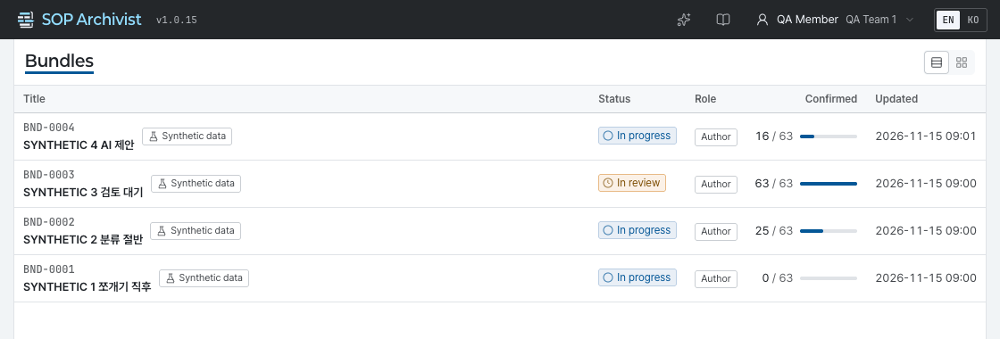

- 첫 화면 **Bundles** 에는 내가 구성원(작성자·검토자)인 Bundle만 보입니다. 줄을 누르거나 줄에 초점을 두고 <kbd>Enter</kbd>를 누르면 열립니다.
- **View** 에서 **Table** 과 **Cards** 를 바꿉니다. 고른 보기는 이 브라우저에 기억됩니다. 카드 보기에서는 Synthetic data 표지가 늘 제목 아래 줄에 오고, 같은 줄의 카드는 아래 끝이 맞습니다.
- 제목을 아직 쓰지 않은 Bundle은 제목 자리에 흐린 **Untitled**(한국어 화면은 '이름 없음')가 보입니다. 목록 화면(Bundles·Documents·History·관리)은 큰 화면에서 본문이 더 넓게 펼쳐집니다.
- **New bundle** 은 `bundle.create` 권한이 있을 때만 보입니다. 누르면 곧바로 새 Bundle이 만들어지고 **Overview** 가 열리니, 제목과 설명은 거기서 고칩니다.

### 화면 설정 {#settings}

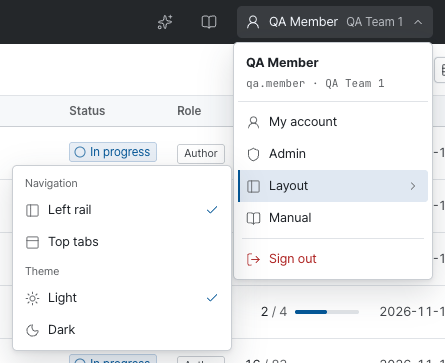

| 메뉴 | 하는 일 |
|---|---|
| **My account** | 내 정보와 권한을 본다 |
| **Admin** | 관리 화면을 연다. 관리 권한이 있을 때만 보인다 |
| **Layout** | **Navigation** 에서 단계 이동을 **Left rail** 또는 **Top tabs** 로, **Theme** 에서 **Light** 또는 **Dark** 로 바꾼다 |
| **Manual** | 이 설명서를 새 탭으로 연다 |
| **Sign out** | 로그아웃한다 |

- 화면 말은 오른쪽 위 **EN** | **KO** 로 바꿉니다. 상태 이름과 Bundle·Old·New·Unit 같은 용어는 어느 쪽에서나 영어입니다.
- 상단 막대의 책 모양 단추 **Manual** 은 지금 보고 있는 화면을 설명하는 조각을 새 탭으로 엽니다.

### 이동할 때 {#moving}

- 링크를 누르면 잠깐 뒤에 이동합니다. 그 사이 같은 링크를 다시 누르거나 <kbd>Esc</kbd>를 누르면 이동이 취소됩니다.
- 저장하지 않은 변경이 있으면 떠나기 전에 먼저 묻습니다.
- 상단 막대의 화살표 **Back to bundles** 는 Bundle 목록으로 돌아갑니다.
- 창이 떠 있을 때 <kbd>Esc</kbd>는 맨 위의 창 하나만 닫고, 초점은 그 창을 연 곳으로 돌아갑니다.

## Bundle과 Overview {#bundle}

Bundle은 함께 재구성할 문서 묶음입니다. Old SOP 여러 편과 새로 만들 SOP·WI가 한 Bundle 안에 들어가고, Bundle마다 `BND-0001` 같은 번호가 붙습니다.

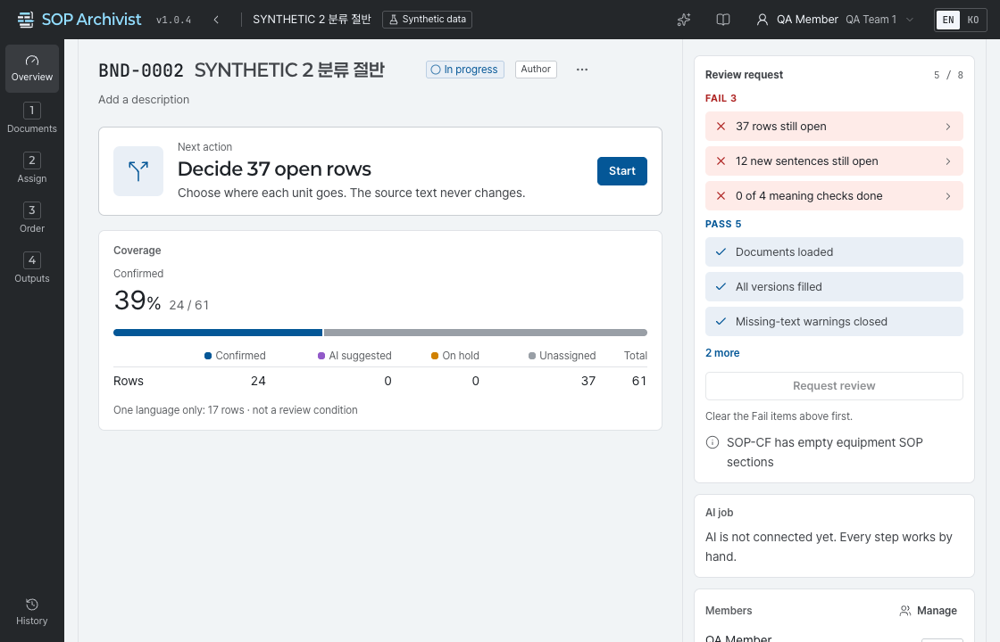

**Overview** 는 Bundle의 지금 상태를 한 화면에 모아 보여 줍니다.

| 카드 | 보는 것 |
|---|---|
| **Next action** | 지금 할 일 한 가지. **Start** 를 누르면 그 일을 하는 화면으로 간다 |
| **Coverage** | 한/영 짝을 한 줄로 센 숫자 한 벌 — 확정 비율과 상태별 줄 수. 한 언어만 있는 줄이 있으면 표 아래에 그 수를 따로 적는다(검토 요청 조건은 아니다). 배정한 표·그림의 캡션도 한 언어뿐이면 이 수에 든다 |
| **Review request** | 검토 요청 조건 여덟 가지. 빨간 줄을 누르면 고칠 화면으로 간다 |
| **AI job** | 진행 중인 AI 작업. **Cancel jobs** 로 멈추고 **Retry failed** 로 실패한 것만 다시 돌린다 |
| **Members** | 구성원과 역할. **Manage** 에서 추가·역할 변경·제외 |
| **Activity** | 최근 작업 기록. **View all** 은 **History** 로 간다 |

- 검토 요청 단추(**Request review**)는 조건 목록 바로 아래, 안내 위에 있습니다. 장비 SOP 칸이 빈 문서가 둘 이상이면 안내가 한 줄로 묶이고, 그 줄을 누르면 문서 코드가 펼쳐집니다.
- 문서가 아직 없는 Bundle은 조건 목록 대신 **Not started — add documents first** 한 줄만 보입니다.
- 검토자가 되돌린 사유가 길면 아래가 흐려지고 **Show more** 가 나타납니다. 누르면 전체가 펼쳐지고 **Show less** 로 다시 접습니다.

### 제목·설명·삭제 {#bundle-edit}

- 제목이나 설명에 마우스를 올리면 나오는 연필 단추를 눌러 그 자리에서 고칩니다. 제목은 <kbd>Enter</kbd>, 여러 줄인 설명은 <kbd>Ctrl</kbd>+<kbd>Enter</kbd>로 저장하고 <kbd>Esc</kbd>로 취소합니다.
- 제목 옆 **More** 메뉴의 **Mark as test data** 는 시험용 Bundle임을 표시합니다. 표시한 Bundle은 상단 막대에 **Synthetic data** 표지가 붙습니다.
- **More** 메뉴의 **Delete bundle** 은 Bundle과 그 안의 문서·판단을 모두 지웁니다. 되돌릴 수 없습니다.

### 구성원 {#members}

- **Manage** 를 누르면 **Bundle members** 창이 열립니다. **Add member** 에서 사람을 찾아 넣고 **Role** 에서 **Author** 또는 **Reviewer** 를 고릅니다.
- 사람은 이름·한글 이름·아이디로 찾습니다. 아무것도 입력하지 않으면 내 부서 사람이 먼저 나옵니다.
- 작성자는 한 명 이상 있어야 하고, 검토를 요청하려면 활동 중인 검토자가 한 명 이상 있어야 합니다.
- Bundle은 구성원에게만 보입니다. 구성원이 아닌 사람이 주소로 들어오면(개요·Documents·Split·Assign·Outputs·Review·History 어느 단계 주소든) **Bundle not available** 화면이 뜹니다. 이때는 단계 이동 줄 없이 **Back to Bundles** 단추만 있습니다. 없는 주소로 들어와도 같은 단추가 있는 안내 화면이 뜹니다.

## 1단계 Documents {#documents}

재구성할 원문을 올리는 화면입니다. 올린 파일은 바로 읽혀 글자와 표가 추출됩니다. 화면은 목록 둘입니다 — 위는 지금 있는 문서인 **Old documents**, 아래는 새로 만들 SOP·WI를 적는 **New documents**([New 문서 목록](#tobe)). 두 목록은 한 화면, 한 스크롤입니다.

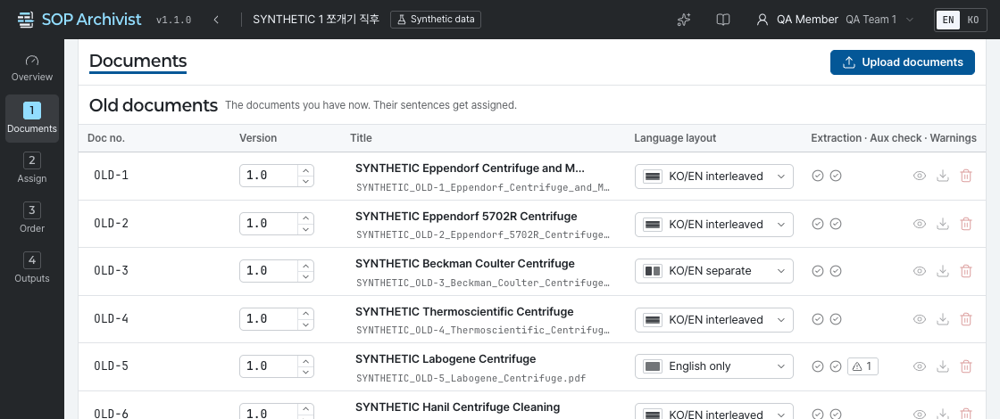

본문 폭이 좁아도 표의 뒤쪽 열은 한 줄을 유지합니다. 한 줄에 **Extraction**·**Aux check** 표시와 경고 개수 칩이(칩에 올리면 경고 목록이 뜹니다) 왼쪽에, 줄 단추가 오른쪽 끝에 놓입니다. **Language layout** 드롭다운은 폭이 고정이라 긴 이름은 말줄임(…)이 되고, 올리면 전체 이름이 뜹니다.

### 올리기 {#upload}

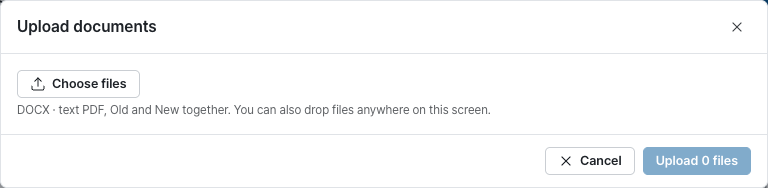

올리는 곳은 하나입니다. 지금 있는 옛 문서(Old)와 이미 써 둔 새 문서(New)를 같은 창에서 함께 올립니다.

1. **Upload documents** 를 누르거나, 파일을 이 화면 아무 데나 끌어다 놓습니다(끄는 동안 화면에 테두리가 뜹니다).
2. **Choose files** 로 파일을 고릅니다. 여러 개를 한 번에 고를 수 있고, DOCX와 글자가 들어 있는 PDF를 받습니다.
3. 파일마다 **Old** · **New** 가운데 눌린 쪽이 올라갈 곳입니다. 앱이 먼저 고릅니다 — 파일 이름의 문서 번호가 아래 New 목록에 있으면 **New**, 아니면 **Old**. 틀렸으면 눌러 바꿉니다.
4. **New** 파일은 번호가 같은 목록 줄에 붙습니다(종류와 상위 SOP는 그 줄의 것 그대로). 목록에 없는 번호면 줄이 새로 생기고, 그 자리에서 종류(SOP·WI)와 WI의 상위 SOP를 고릅니다. 줄에 이미 파일이 붙어 있거나 배정한 문장이 있으면 붙이지 못하고 까닭이 빨간 글로 나옵니다.
5. 올리기 단추를 누르면 파일마다 결과가 표시됩니다. 다 올렸으면 **Go to Assign** 으로 넘어갑니다.

> [!TIP]
> 파일 이름에 문서 번호와 버전이 들어 있으면 그대로 읽어 옵니다. 이름을 정리해 두고 올리면 고칠 일이 줄어듭니다.

### 목록의 열 {#document-columns}

| 열 | 뜻 |
|---|---|
| **Side** | **Old**(옛 문서) 또는 **New**(이미 쓴 새 문서) |
| **Doc no.** · **Version** · **Title** | 파일 이름과 본문에서 찾은 값. 틀리면 그 자리에서 고친다. 버전은 **Version up** · **Version down** 으로 올리고 내린다 |
| **Language layout** | **KO/EN interleaved**(한 줄씩 번갈아), **KO/EN separate**(한글 뒤 영어가 따로), **English only**, **Korean only** |
| **Extraction** | **Ready**(읽기 끝), **Rejected**(받을 수 없는 파일), **Failed**(읽다가 실패) |
| **Aux check** | 다른 방법으로 한 번 더 읽어 빠진 글이 없는지 견준 결과 |
| **Warnings** | 읽으면서 생긴 경고 수. **Assign** 위쪽 줄의 경고 표시에서 확인한다 |

정상이면 글자 없이 체크 아이콘만 보입니다(**Ready**, **Checked**). 아이콘에 올리거나 Tab으로 가면 뜻이 툴팁으로 뜹니다. 거절·실패·보조 검사 불가처럼 살펴야 할 때만 글자가 있는 알약이 나타납니다.

- 위 목록(**Old documents**)에는 옛 문서만 나옵니다. 이미 써서 올린 New 문서의 파일은 아래 **New documents** 목록의 그 줄 **Written file** 칸에 붙어 보입니다 — 따로 줄을 차지하지 않습니다. 읽지 못해 목록 줄이 생기지 않은 New 파일만 위 목록에 남고(쪽 칸에 New), 거기서 지웁니다.
- 줄 끝의 단추로 **Preview**(읽힌 글 미리 보기), **Download**(원본 파일 내려받기), **Delete document** 를 합니다. 단추는 평소에도 제자리에 흐리게 보이고, 줄에 올리거나 Tab으로 들어가면 또렷해집니다. 단추에 올리면 이름이 툴팁으로 뜹니다. 미리 보기의 **Open in Assign** 은 그 문서를 **Assign** 의 한 단 보기로 엽니다([문장 다듬기](#split)).
- 판단이 이미 있는 문서를 지우려 하면 한 번 더 묻습니다. **Delete anyway** 를 누르면 그 문서의 Unit에 걸린 판단이 함께 풀립니다.
- 같은 파일을 두 번 올리면 받지 않습니다.
- AI가 켜져 있으면 규칙이 찾지 못한 문서 번호·버전을 AI가 제안합니다. 제안은 눌러야 저장됩니다.

### EQUIS 표시 {#document-equis}

> [!TIP]
> Old 문서의 **Version** 칸이 비어 있고 EQUIS가 그 문서의 지금 판을 알면, 칸 옆에 그 판이 EQUIS 표와 함께 흐리게 뜹니다. 누르면 그 값이 들어갑니다. 이 칸은 올린 파일의 판이라 저절로 채우지는 않습니다 — 올린 파일이 지금 판이 아닐 수 있습니다.

문서 번호가 있으면 EQUIS에서 그 문서를 조회해, 제목 아래 파일 이름 줄의 오른쪽 끝에 결과를 보입니다. 조회는 올리거나 번호를 고친 뒤에 따로 돌아서 표시가 몇 초 뒤에 채워집니다. 표시는 안내일 뿐입니다. 무엇이 떠도 올리기·저장·검토 요청은 그대로 됩니다.

| 표시 | 뜻 | 할 일 |
|---|---|---|
| **Current** | 올린 판이 EQUIS에서 지금 시행 중인 판이다. 검토 중인 다음 판이 있으면 뒤에 덧붙는다 | 없다 |
| **Check** | 올린 판이 지금 판이 아니거나, 다음 판이 승인돼 곧 시행되거나, 폐기된 문서이거나, 옛 번호다. 이유가 뒤에 적힌다 | 한 번 확인한다. 버전 칸이 틀렸으면 고치면 바로 바뀐다 |
| **In EQUIS** | 새 문서의 번호가 이미 EQUIS에 있다 | 없다 |
| **Not in EQUIS** | EQUIS에 없는 번호다 | 새 문서라면 정상이다. 옛 문서라면 번호를 확인한다 |
| **Looking up** | 조회하는 중이다 | 기다리지 않고 하던 일을 계속한다 |
| **Lookup failed** | 조회가 응답하지 않았다. 문서에 문제가 있다는 뜻은 아니다 | 잠시 뒤 **Retry** 를 누른다 |

- 표시를 누르면 EQUIS에서 받은 정보(정식 이름, 지금 판과 시행일, 진행 중인 판, 소유 부서, Plant, Area, 옛 번호)와 조회 시각이 펼쳐집니다. 사내 데이터 창고(EDW) 기준이라 EQUIS 화면보다 늦을 수 있습니다. 작성자는 **Look up again** 으로 다시 조회합니다.
- EQUIS에 있는 문서는 **제목이 EQUIS의 정식 이름으로 맞춰지고 고칠 수 없습니다.** 연필 자리에 자물쇠가 보입니다. 제목을 바꾸려면 EQUIS에서 바꿉니다. 여기에 반영되기까지 하루가 걸릴 수 있습니다. 번호와 버전은 계속 고칠 수 있습니다.
- 제목이 틀려 보이면 번호가 틀린 것입니다. 번호를 고치면 제목도 따라 바뀌고, EQUIS에 없는 번호로 고치면 잠금이 풀립니다.
- 제목 옆 **Open in EQUIS** 아이콘은 EQUIS 원본을 새 탭으로 엽니다. 제목 자체를 누르면 그 문서가 **Assign** 의 한 단 보기로 열립니다([문장 다듬기](#split)).
- 옛 번호로 올린 문서는 펼친 정보의 **Use current number** 로 지금 번호로 바꿀 수 있습니다.
- 번호가 비었거나 이 서비스가 붙인 임시 번호인 문서는 조회하지 않습니다.

### 받지 못한 파일 {#upload-rejected}

| 이유 | 할 일 |
|---|---|
| DOCX·PDF가 아니다 | DOCX나 PDF로 저장해 다시 올린다 |
| 파일이 너무 크다, 쪽이 너무 많다, 글이 너무 길다 | 문서를 나눠 올린다 |
| 암호가 걸려 있거나 파일이 깨졌다 | 암호를 풀거나 다시 저장해 올린다 |
| 스캔한 그림 PDF다 | 글자가 들어 있는 원본(DOCX나 글자 PDF)을 올린다 |
| 변경 내용 추적이 남아 있다 | Word에서 변경을 모두 적용하거나 취소한 뒤 올린다 |
| 다른 문서를 끼워 넣은 DOCX다 | Word에서 한 문서로 다시 저장해 올린다 |
| 글자가 없다 | 내용이 있는 파일인지 확인한다 |
| 읽는 데 너무 오래 걸렸다, 읽다가 멈췄다 | 다시 올려 보고, 되풀이되면 관리자에게 알린다 |

### 크기 한도 {#limits}

| 항목 | 기본 한도 |
|---|---|
| 파일 하나 | 25 MB |
| DOCX를 풀었을 때 | 200 MB |
| PDF 쪽수 | 500쪽 |
| 문서 하나의 글자 수 | 2,000,000자 |
| 문서 하나를 읽는 시간 | 60초 |

한도는 서버 설정에 따라 다를 수 있습니다.

### 경고 종류 {#warnings}

| 경고 | 뜻 |
|---|---|
| **Missing text** | 다시 읽은 결과와 견주니 빠진 글이 있을 수 있다. **Assign** 의 경고 표시에서 원문과 대조해 확인해야 검토를 요청할 수 있다([누락 의심 경고](#assign-warnings)) |
| **Reading order may differ** | PDF라서 읽는 순서가 원문과 다를 수 있다 |
| **Auto numbering** · **Clause numbers** | 자동 번호나 절 번호가 원문과 다르게 읽혔을 수 있다 |
| **Merged cells** · **Table position** | 병합된 칸이나 표의 자리가 원문과 다를 수 있다 |
| **Large image** | 큰 그림이 있는 자리. 원문과 견주어 본다 |
| **Check needed** | 그 밖에 사람이 한 번 봐야 하는 곳 |

## New 문서 목록 {#tobe}

새로 만들 SOP·WI의 목록입니다(화면의 **New documents**, 전에는 To-Be라고 불렀습니다). **Documents** 화면(1단계)에서 Old 문서 목록 아래에 있습니다. 여기 적은 문서와 그 안의 칸이 **Assign** 에서 Unit을 보낼 곳이 됩니다.

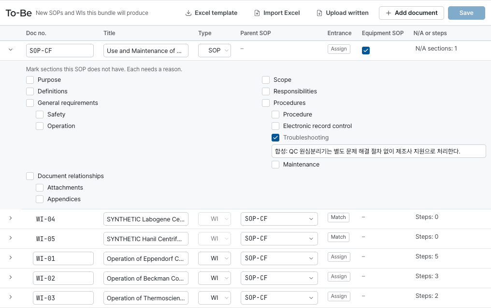

### 문서 적기 {#tobe-docs}

목록 머리(**New documents**) 바로 아래 칸에 문서 번호를 적고 <kbd>Enter</kbd>(또는 **Add**)를 누르면 그 줄이 바로 저장됩니다. 적는 동안 칸 옆에 무엇이 더해질지가 적힙니다 — "Adds WI WI-09 under SOP-PH"(종류와 어느 SOP 아래인지), "Adds SOP SOP-MX", 이미 있는 번호면 "WI-04 is already on the list"(이때는 **Add** 가 꺼집니다). 더한 줄은 잠깐 강조되고, 화면 밖이면 그쪽으로 스크롤합니다. 칸은 비워지고 커서는 칸에 남아 다음 번호를 바로 적습니다. 번호 여러 개를 한꺼번에 붙여 넣으면(Excel의 열을 복사한 것처럼 줄마다 하나) 줄마다 하나씩 더합니다. 이미 목록에 있는 번호는 건너뛰고 몇 개였는지 알려 줍니다.

종류와 상위 SOP는 앱이 먼저 고릅니다 — 번호가 SOP-…로 시작하면 SOP, WI-…로 시작하면 바로 앞 SOP 아래의 WI, 번호만으로 알 수 없으면 목록에 SOP가 있을 때 그 아래 WI입니다. 목록에 SOP가 하나도 없으면 WI 번호도 SOP로 더해집니다(칸 옆에 "No SOP on the list yet, so WI-09 is added as an SOP"). 틀렸으면 줄을 펼쳐 고칩니다. 제목은 EQUIS가 아는 번호면 저절로 채워집니다([EQUIS 표시](#document-equis)).

줄은 두 줄로 읽습니다. SOP 줄은 옅은 바탕이고, 그 아래 WI 줄은 안으로 들여 선으로 묶입니다.

- 왼쪽에 종류(SOP · WI)와 번호가 있습니다. 긴 번호는 두 줄에서 잘리고, 올리면 전체가 뜹니다.
- 가운데 첫 줄은 제목입니다(두 줄까지, 없으면 **No title yet**). 둘째 줄에는 쓴 파일의 이름과 버전(없으면 **Not written**), 장비 SOP면 **Equipment SOP**, WI면 단계 수("Steps 3")가 보입니다.
- SOP 줄의 둘째 줄 앞에는 칸 15개의 상태 막대가 있습니다 — 눈금 하나가 칸 하나이고(하위 칸은 낮은 눈금), 문장이 든 칸은 채운 눈금, 빈 칸은 테두리만, N/A 칸은 빗금, 장비 SOP에서 정할 칸은 호박색 테두리와 위의 점입니다. 눈금에 올리면 칸 번호 · 이름 · 상태가 뜹니다. 그 옆에 채운 칸 수("7 of 15 sections filled"), N/A 칸이 있으면 **N/A** 수와 첫 N/A 칸("6.3 Troubleshooting +1"), 장비 SOP에서 아직 정하지 않은 칸이 있으면 그 수("2 to decide")가 적힙니다. 이미 쓴 SOP는 칸이 파일의 절을 따르므로 막대와 채운 칸 수 없이 **N/A** 수와 첫 N/A 칸, 정할 칸 수가 적힙니다. 둘째 줄이 한 줄에 다 들어가지 않으면 첫 N/A 칸 이름이 먼저 말줄임으로 줄다가 빠지고(줄었을 때 올리거나 <kbd>Tab</kbd>으로 가면 전체 이름이 뜹니다), 그다음 **Equipment SOP** 글자(아이콘만 남음), 파일 이름(가운데가 줄어 끝이 남음), 막대 순으로 줄어듭니다. 채운 칸 수, **N/A** 수, 정할 칸 수, **Not written** 은 끝까지 남습니다.
- EQUIS가 아는 값이 줄과 다르면 둘째 줄에 "EQUIS suggests 1" 같은 칩이 붙습니다. 누르면 줄이 펼쳐지고, 제안은 펼친 곳의 그 칸 옆에 있습니다([저장](#tobe-save)).
- 상위 SOP를 찾지 못한 WI(있어서는 안 되는 자료)는 목록 끝의 **No parent SOP** 묶음에 모이고 줄에 같은 알약이 붙습니다. 펼쳐서 **Parent SOP** 를 고르면 그 SOP 아래로 갑니다.
- 줄에 올리거나 <kbd>Tab</kbd>으로 들어가면 오른쪽 끝에 **Edit**(줄을 펼칩니다)와 **Remove**(줄을 뺍니다)가 보입니다. 목록이 좁으면 `⋯` 단추 하나(**Actions**)가 같은 일을 메뉴로 합니다.
- 뺄 수 없는 줄은 **Remove** 가 꺼져 있고, 올리면 까닭이 뜹니다 — 쓴 파일이 붙은 줄, 문장을 배정한 줄, 아래에 WI가 있는 SOP.
- **줄을 누르거나 <kbd>Enter</kbd>로 펼치면 고치는 칸이 나옵니다.** 다시 누르거나 <kbd>Space</kbd>로 접습니다. 여러 줄을 함께 펼쳐 둘 수 있고, 줄의 글자를 긁어 고르는 것은 펼침으로 치지 않습니다.

펼친 곳의 왼쪽 **Document** 에서 고칩니다.

| 칸 | 뜻 |
|---|---|
| **Doc no.** · **Title** | 새 문서의 번호와 제목 |
| **Type** | SOP · WI 두 칸 단추. WI로 바꾸면 목록의 첫 SOP 아래로 가고, 상위 SOP를 옆 칸에서 바꿉니다 |
| **Parent SOP** | WI가 속한 SOP의 번호(WI 줄에만) |
| **Equipment SOP** | 장비 SOP면 켭니다(SOP 줄에만). 장비 SOP에 있어야 하는 절차 칸("Electronic record control" · "Troubleshooting" · "Maintenance" — 전자 기록 관리 · 문제 해결 · 유지 보수)이 비어 있으면 **Overview** 에 알려 줍니다. 검토 요청을 막지는 않습니다 |
| **Written file** | 이미 써서 올린 파일(있을 때만). 붙어 있으면 Old Unit을 그 파일의 문장에 잇고, **Not written** 이면 Old Unit을 칸에 보내 새 문장을 만듭니다 |

오른쪽에는 SOP면 **Sections**(칸 상태 표), WI면 **Steps** 가 있습니다([칸과 단계](#tobe-slots)). 검토 중이거나 끝난 Bundle, 검토자에게는 줄이 펼쳐지기만 하고 값은 글자로 보입니다 — 고치는 칸, **Edit** · **Remove**, 번호를 적는 칸이 없습니다.

저장한 번호는 EQUIS에서 조회해 번호 옆에 아이콘으로 결과를 보입니다. 아이콘에 올리면 뜻이 뜨고, 누르면 [Documents의 EQUIS 표시](#document-equis)와 같은 정보가 펼쳐집니다. 새 문서는 아직 EQUIS에 없는 것이 보통이라 **Not in EQUIS** 는 경고가 아닙니다. 폐기된 번호일 때만 **Check** 가 뜹니다. 번호가 EQUIS에 있으면 제목이 EQUIS의 정식 이름으로 맞춰지고 고칠 수 없습니다. 바꾸려면 EQUIS에서 바꾸고, 반영까지 하루가 걸릴 수 있습니다.

### 이미 쓴 문서 올리기 {#tobe-written}

이미 써 둔 새 SOP·WI 파일도 화면 위쪽의 **Upload documents** 창에서 올립니다([올리기](#upload)) — 따로 올리는 단추는 없어졌습니다. 그 창에서 파일을 **New** 로 두면 됩니다.

올린 파일은 이 목록의 그 번호 줄에 붙습니다(없던 번호면 줄이 새로 생깁니다). 줄의 둘째 줄에 파일 이름과 버전이 보입니다 — 긴 이름은 가운데가 줄어 끝(확장자)이 남고, 올리면 전체 이름이 뜹니다. 줄을 펼치면 **Written file** 에서 버전과 언어 배치를 고치고, 미리 보기·내려받기와 **Delete the written file** 을 합니다. 파일을 지워도 목록 줄은 남고 **Not written** 으로 돌아갑니다 — 줄은 목록에서 따로 뺍니다. 파일 이름에 번호가 없어 임시 번호로 생긴 줄만 파일과 함께 지워집니다.

### 칸과 단계 {#tobe-slots}

- 줄을 펼치면 오른쪽에 SOP는 **Sections**, WI는 **Steps** 가 나옵니다(창이 좁으면 **Document** 아래에 놓입니다).
- SOP는 칸이 정해져 있습니다. SOP를 펼치면 **Sections** 에 칸 15개가 번호 · 이름 · 지금 상태로 보입니다 — 문장이 든 칸은 문장 수("6 sentences", 하위 칸에 든 상위 칸은 "8 in sub-sections"), 빈 칸은 **Empty**, N/A 칸은 **N/A** 와 그 사유입니다. 머리에 문장 있는 칸 · 빈 칸 · N/A 칸의 수가 적힙니다. 넓으면 두 단(1~5.2 | 6~7.2), 좁으면 한 단입니다.
- 이 SOP에 없는 칸은 빈 칸에 올려 **Mark N/A** 를 누릅니다. 그 줄 아래에 사유 칸이 열립니다(사유는 결과물에 "N/A · 사유"로 찍힙니다). **Save N/A**(<kbd>Enter</kbd>)로 저장하고 **Cancel**(<kbd>Esc</kbd>)로 닫습니다. 사유가 비어 있으면 저장되지 않고, 칸을 떠나도 사유 칸은 닫히지 않습니다. **Used in this Bundle** 의 칩을 누르면 이 Bundle에서 이미 쓴 사유가 들어갑니다(많이 쓴 순으로 셋까지).
- 사유 칸은 한 번에 하나만 열립니다. 사유를 적는 중에 다른 칸의 **Mark N/A** 를 누르면 지금 사유 칸으로 돌아가(그 줄을 접어 두었으면 다시 펼쳐집니다) "Save or cancel this reason first."가 뜹니다.
- N/A 칸에 올리면 **Edit reason**(같은 사유 칸이 저장된 사유를 담아 열립니다)과 **Restore**(바로 되돌립니다)가 나옵니다. 긴 사유는 두 줄에서 잘리고, 사유를 누르면 다 펴집니다.
- 상위 칸을 N/A로 두면 하위 칸이 함께 덮여 **N/A** 와 "Covered by 7 Document relationships"가 보입니다. 상위 칸을 되돌리면 하위 칸도 제 상태로 돌아갑니다(따로 N/A로 둔 하위 칸은 N/A로 남습니다).
- 문장이 든 칸(하위 칸 포함)과 칸 제목에 Old 제목이 이어진 칸에는 단추가 없습니다 — N/A로 두려면 **Assign** 에서 먼저 비웁니다(칸 제목이 이어진 칸에는 그 까닭이 흐린 글로 적힙니다).
- 장비 SOP의 세 칸("Electronic record control" · "Troubleshooting" · "Maintenance" — 전자 기록 관리 · 문제 해결 · 유지 보수)이 비어 있으면 **Fill or mark N/A** 로 표시되고, 그 칸의 **Mark N/A** 는 늘 보입니다.
- 이미 쓴 SOP(쓴 파일이 붙은 줄)는 칸이 파일의 절을 따르므로 문장 수 대신 **From the file** 로 보이고, 머리에는 N/A 칸 수만 적힙니다. N/A로 두기와 되돌리기는 그대로 됩니다.
- WI는 **Add step** 으로 단계를 더하고 **Step title** 을 적습니다. **Remove step** 으로 뺍니다. 단계 번호는 자동으로 다시 매기지 않습니다. 문장이 든 단계는 이름 옆에 문장 수("3 sentences")가 적히고 **Remove step** 이 없습니다 — 빼려면 **Assign** 에서 먼저 비웁니다.
- 이미 문장을 배정한 문서·칸·단계는 뺄 수 없습니다. 먼저 **Assign** 에서 배정을 풉니다.
- 쓴 파일이 붙은 줄은 번호와 종류를 고칠 수 없고 줄을 뺄 수도 없습니다. 파일을 먼저 지우면(줄은 남습니다) 뺄 수 있습니다.

### 저장 {#tobe-save}

- **Save** 단추는 없습니다. 줄을 펼쳐서 고치고, 칸마다 바로 저장됩니다 — 글 칸(번호·제목·단계 이름)은 그 칸을 떠나거나 <kbd>Enter</kbd>를 누를 때, 고르는 칸(종류·상위 SOP·장비 SOP)은 고르는 즉시. 저장하는 동안 목록 머리에 **Saving...** 이 잠깐 보입니다.
- 글 칸에서 <kbd>Esc</kbd>를 누르면 적던 것을 버리고 저장된 값으로 돌아갑니다.
- 저장이 거절되면(다른 줄과 번호가 겹침, 문장이 든 칸을 N/A로 함 등) 까닭이 알림으로 뜨고 칸이 저장된 값으로 돌아갑니다.
- N/A 사유만은 **Save N/A** 를 눌러야 저장됩니다. 적던 사유는 줄을 접어도 남고(그동안 줄에 "Unsaved N/A reason"이 붙습니다), 저장하지 않은 채 다른 화면으로 가려 하면 묻습니다. 사유를 적는 사이 다른 사람이 그 칸에 문장을 보냈으면 저장이 거절되고 사유 칸이 닫힙니다. 서버가 응답하지 않는 등 그 밖의 까닭으로 실패하면 적던 사유가 그대로 남습니다.
- 번호를 고쳐도 같은 줄입니다 — 아래의 WI, 단계, 이미 배정한 문장이 그대로 따라옵니다.
- EQUIS가 아는 값이 줄과 다르면 줄에 "EQUIS suggests 1" 칩이 붙고, 펼친 곳의 그 칸(**Type** · **Equipment SOP**) 옆에 점선 테두리의 작은 제안이 뜹니다(EQUIS에서는 SOP인데 줄이 WI일 때, EQUIS에 장비 번호가 있는데 장비 SOP로 표시하지 않았을 때). 눌러야 들어가고, 저절로 바뀌지 않습니다.

### Excel로 가져오기 {#tobe-excel}

1. 목록 머리 오른쪽의 `⋯` 단추를 눌러 **Excel template** 으로 양식을 내려받아 채웁니다.
2. 같은 메뉴의 **Import Excel** 로 올립니다. 목록 전체가 파일 내용으로 바뀌므로, 목록이 비어 있지 않으면 **Replace the To-Be list?** 창에서 한 번 더 묻습니다.
3. 이미 문장을 배정한 문서·칸·단계가 파일에 없으면 가져오기가 거절됩니다.

### AI로 목록 읽기 {#tobe-ai}

양식에 맞추지 않은 계획 파일이나 글에서 AI가 새 문서 목록을 읽어 줍니다. AI가 켜져 있을 때만 메뉴에 보입니다 — 꺼져 있으면 번호로 더하거나 Excel 양식을 씁니다.

1. 목록 머리 오른쪽의 `⋯` 단추에서 **Read a list with AI…** 를 누릅니다.
2. **Choose a file** 로 파일(XLSX · DOCX · TXT · CSV · MD, 2MB까지)을 고르거나 글을 붙여 넣고 **Read with AI** 를 누릅니다. 파일은 한 번 읽고 보관하지 않습니다. 글이 길면 앞부분만 읽고 그렇게 알립니다.
3. 보통 몇 초 뒤 AI가 읽은 줄이 표로 나옵니다 — 문서 번호, 제목, 종류, 상위 SOP, 장비 SOP, 단계 수. 기다리는 동안 창을 닫아도 됩니다. 제안은 목록 머리의 보라색 단추(AI가 몇 개를 읽었는지 적혀 있다)에서 기다리고, 누르면 다시 열립니다.
4. 줄을 고치고, 더하지 않을 줄은 체크를 풉니다. 이미 목록에 있는 번호는 **On the list** 로 표시되고 더하지 않습니다. 종류를 알 수 없는 줄이나 상위 SOP가 없는 WI가 있으면 표 아래에 그 번호와 할 일이 뜨고, 고칠 때까지 더하기 단추가 꺼져 있습니다.
5. 더하기 단추를 누르면 체크한 줄이 한 번에 목록에 들어갑니다(하나라도 거절되면 아무것도 들어가지 않고 까닭을 알립니다). 그 전에는 목록이 바뀌지 않습니다. 줄이 많으면 표 안에서 스크롤하고, 단추는 늘 창 아래에 보입니다. 쓰지 않을 제안은 **Discard** 로 버립니다.

- AI가 읽지 못했으면(AI 서버 문제 등) 창이 그렇게 알리고, 넣은 파일과 글은 그대로 남아 다시 보낼 수 있습니다. 까닭은 상단 바의 AI 작업 목록에 있습니다.
- 다시 읽히면 앞의 제안은 새 제안으로 바뀝니다.

> [!NOTE]
> AI는 번호를 지어낼 수 없습니다. 넣은 글에 없는 번호는 앱이 버립니다. 그래도 제목·종류·상위 SOP는 틀릴 수 있으니 더하기 전에 표를 원래 계획과 견주어 보세요.

## 문장 다듬기 {#split}

Unit은 **한곳으로 보낼 수 있는 가장 작은 조각**입니다. 올릴 때 규칙이 먼저 쪼개 두고, 잘못 잘렸거나 잘못 묶인 곳은 **Assign**(2단계)에서 배정하면서 그 자리에서 고칩니다. 전에는 문서 하나를 따로 여는 원문 고치기 화면(더 전에는 쪼개기 단계)이 있었지만 없어졌습니다 — 그 도구는 모두 **Assign** 에 있습니다. 옛 주소로 들어오거나 **Documents** 에서 문서 제목이나 미리 보기의 **Open in Assign** 을 누르면 그 문서가 **Assign** 의 한 단 보기로 열립니다.

도구가 있는 자리는 셋이고 같은 일을 합니다 — 원문 종이 위(두 번 누르기, 조각 사이 단추, 조각 아래 단추, 글자 끌기), 문장의 [우클릭 메뉴](#assign-context), 오른쪽 칸의 1 **Shape** 줄. Old 문서뿐 아니라 이미 쓴 New 문서의 문장도 같은 도구로 다듬습니다 — 그 문서를 한 단으로 열거나, 양 단에서 New 문장을 골라서([2단계 Assign](#assign)).

> [!NOTE]
> Word가 자동으로 매긴 번호(1., 가., (a) 등)는 글 앞에 글자로 붙어 읽힙니다. 한 문단 안에서 <kbd>Shift</kbd>+<kbd>Enter</kbd>로 줄을 바꾼 곳은 줄마다 Unit이 됩니다. 언어는 한글이 한 글자라도 있으면 **KO**, 없으면 **EN** 으로 잡습니다.

### 경계 확인은 따로 하지 않습니다 {#split-check}

결과물과 Excel은 Unit이 잘린 자리를 그대로 따릅니다. 그 자리가 맞는지는 **Assign** 에서 Unit을 확정할 때 함께 확인하는 것으로 칩니다 — 전에 있던 경계 확인 단추와 남은 수, 한꺼번에 확인하기는 없어졌습니다. 정할 수 없는 Unit은 <kbd>H</kbd>(**Hold**)를 누르고 사유를 적어 미룹니다. 미룬 Unit은 **On hold** 에 모입니다.

### 쪼개기와 묶기 {#split-edit}

- **쪼개기**: 나눌 자리를 두 번 눌러 선을 놓습니다(오른쪽 칸 **Shape** 줄의 가위 단추나 우클릭 메뉴의 **Split here** 도 선을 놓습니다). 선은 끌어서 옮기거나 <kbd>←</kbd> <kbd>→</kbd>로 옮깁니다(그 Unit 안에서만 움직입니다). 잠시 뒤 선 옆에 뜨는 **Split here** 를 누르거나 <kbd>S</kbd>를 누르면 조각이 바로 둘로 나뉩니다.
- **조각 사이 간격**: 조각 사이는 평소 좁고, 고른 조각 곁과 마우스를 잠깐 머문 자리만 살짝 넓어집니다(조각 사이를 지나가기만 하면 벌어지지 않습니다). 한/영 짝의 구성원이 이웃해 있으면 몇 줄이든(1:1, 1:2 …) 옅은 바탕의 한 카드로 붙고 줄 사이에는 점선 한 줄만 남습니다. 끝에는 고리 아이콘이 붙습니다. 떨어져 있는 짝은 카드가 되지 않고 고리 아이콘과 고를 때의 강조 테두리로만 보입니다.
- **조각 왼쪽 번호 칸**: 조각마다 왼쪽 바깥에 절 번호 칸이 붙어 있습니다. 보류인 줄은 번호 칸에 마우스를 올리면 "on hold"가 뜹니다. 절 번호(예: 5.2.1)는 그 절의 첫 조각 번호 칸에만 한 번 보이고(짝 카드면 첫 줄에만, 둘째 줄부터는 첫 줄과 같은 폭), 그 줄 글 앞에 같은 번호가 있으면 글에서는 빼고 보입니다(화면에서만 빼고 원문은 그대로입니다). 번호 칸의 폭은 절 깊이로만 정해져서 깊은 절일수록 조각이 오른쪽에서 시작합니다(같은 깊이는 폭이 같습니다). 창이 좁으면 깊은 번호는 "1.2.…"처럼 줄여 보이고, 번호 칸에 마우스를 올리면 전체 번호가 뜹니다. 보류인 줄은 글 첫머리에 ON HOLD 칩이 붙습니다.
- **묶기**: 위아래로 붙은 두 조각 사이(틈과 그 위아래 조각 가장자리)에 마우스를 올리면 바로 옅은 바탕이 차오르기 시작하고, 잠깐 머물러 틈이 벌어지면 선이 그어지며, 글이 시작하는 자리 바로 아래에 **Join** 이 튀어나옵니다(키보드는 <kbd>Tab</kbd>으로 바로). 스쳐 지나가기만 하면 열리지 않습니다. 단추는 다 나타난 뒤에야 눌립니다. 묶으면 어떻게 될지는 두 조각의 언어로 시스템이 고릅니다 — 언어가 같으면 한 문장으로 합치고(단추에 접기 아이콘), 한글과 영어면 한/영 짝으로 묶습니다(단추에 고리 아이콘). 결과가 틀렸으면 오른쪽 칸 1 **Shape** 의 **One sentence** · **KO/EN pair** 로 바꿉니다([묶인 문장과 한/영 짝](#split-pair)).
- **조각 아래 단추**: 합쳐서 만든 Unit을 고르면 그 조각 상자가 아래로 늘어나며 글 바로 아래에 **Unmerge** 가 펼쳐집니다(아래 조각들은 그만큼 밀려 내려갑니다). 다른 Unit을 고르면 접힙니다. 짝 풀기는 우클릭 메뉴의 **Separate the KO/EN pair** 나 **Shape** 줄의 단추로 합니다.
- **합치기 풀기**: **Unmerge** 는 합치기 전의 Unit들을 원래 ID 그대로 되살립니다(그 Unit의 합치기만 골라 되돌리는 것). 합친 뒤 그 Unit을 다시 나누거나 경계를 옮겼다면 풀 수 없으니 되돌리기(<kbd>Ctrl</kbd>+<kbd>Z</kbd>)를 씁니다. 한글과 영어를 합친 것이면 되살린 Unit은 저마다 원래 언어로 돌아가고, 같은 언어끼리 합친 것이면 합친 Unit의 언어를 따릅니다. 짝은 되살아나지 않습니다.
- **글자를 골라 새 Unit**: 글자를 끌어 고르면 **New unit from selection** 이 나옵니다. **Make unit** 을 누르면 고른 글자만 새 Unit이 됩니다.
- **표**: 표는 통째로 Unit 하나입니다. 표·그림 위에는 머리 줄이 있어 그 표·그림의 캡션 글을 보이고(두 줄이 넘으면 말줄임, 고르면 다 펼침, 한글·영어 캡션이면 " / "로 이어서) 오른쪽 끝에 번호를 흐리게 적습니다. 캡션은 원문에서 따로 한 줄로 놓이지 않고 이 머리 줄에서 한 번만 읽힙니다. 캡션이 없는 표·그림은 머리 줄에 **Caption needed** 가 경고색으로 뜨고 그 뒤에 표는 첫 행, 그림은 그림 글을 한 줄로 보입니다(지우거나 다른 SOP로 보낸 표·그림, 이미 쓴 New 문서의 표·그림과 거기에 이은 것은 캡션이 필요 없어 뜨지 않습니다). 표·그림은 어디를 눌러도(머리 줄, 캡션, 칸 글자, 칸 사이 틈, 그림) 그 표·그림 전체가 골라집니다. 캡션 글자도 <kbd>Alt</kbd>를 누른 채 끌어 고를 수 있습니다. 칸 글자만 고르려면 <kbd>Alt</kbd>를 누른 채 끌어 고릅니다(평소에는 <kbd>Alt</kbd>를 누른 채 눌러도 고른 줄이 그대로입니다). 한/영 짝을 고르는 중이거나 쓴 New 문서를 혼자 열어 다듬을 때는 칸 문장 하나를 그대로 고릅니다. 행마다 다른 곳으로 보내야 하면 **Split into rows**, 되돌리려면 **Merge rows back** 을 누릅니다. 자리만 잡으려고 쓴 표는 **Unwrap table** 로 표를 벗겨 칸의 글을 보통 문장으로 다룹니다. 칸 글은 되도록 한 줄로 두고 아주 긴 칸 글만 일정한 폭에서 접어, 넓은 표는 세로로 길어지지 않고 표 안에서 좌우로 스크롤됩니다(결과물 C와 3단계 Order의 표도 같습니다).
- **표·그림의 캡션**: 표·그림을 새 문서로 보내 확정하려면 캡션이 있어야 합니다. 원문에서 표·그림 바로 앞뒤의 캡션(예: "표 3. 운전 조건", "Figure 1. …")은 그 표·그림에 딸려 함께 가고, 표·그림의 New 문장 아래에 캡션 문장으로 붙습니다. 캡션이 없는 표·그림을 새 문서 자리로 보내면 **Confirm** 이 흐리게 꺼지고, 올리면 **Add a caption first** 가 뜹니다(<kbd>↵</kbd>나 메뉴로 확정해도 같은 까닭으로 멈춥니다. 끌어 놓은 뒤 뜨는 그 자리 메뉴에서도 **Confirm** 이 꺼지고 메뉴에 **Add a caption first** 가 적힙니다 — 끌어 놓은 표·그림은 칸·캡션을 그대로 달고 갑니다). 결정 칸의 **Write a caption** 을 누르거나 **Edit and confirm** 을 열어 캡션을 써 넣은 뒤 확정합니다 — 써 넣는 칸의 언어는 표·그림 바로 앞 문장의 언어(없으면 한국어)입니다. 원문 캡션이 있는 표·그림은 **Edit and confirm** 에서 캡션 언어마다 글 칸이 열려 캡션을 고쳐 쓸 수 있고, 고친 캡션은 고쳐 쓴 것으로 남습니다. 보류와 삭제·이동은 캡션 없이도 됩니다. 캡션 꼴이 아니어서 붙지 않은 바로 앞뒤 문장을 캡션으로 쓰려면, 표·그림을 고르고 **Shape** 나 우클릭 메뉴의 **Attach the sentence above as caption** · **Attach the sentence below as caption** 을 누르거나, 그 문장 쪽에서 **Use as caption of the table above**(below, 그림이면 figure)를 누릅니다. 거꾸로 캡션으로 잘못 잡힌 문장(예: 표 바로 앞의 "표 1 참조.")은 **Shape** 의 캡션 줄이나 캡션을 우클릭해 **Detach caption** 으로 보통 문장으로 돌립니다. 표·그림마다 언어당 캡션은 하나라, 같은 언어 캡션이 이미 있으면 붙이기와 캡션 줄의 그 언어 칸이 꺼지고 까닭이 뜹니다(먼저 뗍니다). 캡션은 참조 줄이 될 수 없어 캡션 줄의 **REF** 칸도 꺼져 있습니다. 캡션을 나누면 두 조각 모두 캡션이라, 한글과 영어가 한 줄에 함께 든 캡션을 그 사이에서 나누는 것만 됩니다 — 한 언어뿐인 캡션이나 묶음에 다른 캡션이 이미 있으면 **Split** 이 꺼지고 **A caption splits only into a Korean and an English caption.** 이 뜨며, 한글 글 가운데를 자르면 같은 언어 조각 둘이 되어 거절됩니다. 그림 안에 들어 있던 옛 캡션은 뗄 수 없어 **Shape** 에 떼기 단추가 없고 우클릭 메뉴의 **Detach caption** 은 꺼져 있습니다. 행으로 나눈 표의 캡션은 첫 행에 딸려, 첫 행을 고르면 **Shape** 에 캡션 줄이 나옵니다(어느 행에서 붙여도 첫 행으로 갑니다). 배정된 표·그림이면 한 번 묻고 배정을 풀며 붙이거나 떼고, 둘 다 <kbd>Ctrl</kbd>+<kbd>Z</kbd>로 되돌립니다. 캡션이 필요한 표·그림이 남아 있으면 위쪽 줄에 그 수가 경고색 알약("3 captions needed")으로 보이고, 누르면 다음 표·그림으로 갑니다(머리 줄의 **Caption needed** 와 같은 기준이라, 써 넣은 캡션이 있으면 둘 다 사라집니다).
- **되돌리기와 다시 하기**: <kbd>Ctrl</kbd>+<kbd>Z</kbd>, 다시 하기는 <kbd>Shift</kbd>를 함께 누릅니다. 나누기·합치기 같은 편집과 배정이 한 줄 순서로 되돌려집니다([되돌리기](#assign-undo)). 무엇을 되돌렸는지는 알림에 나옵니다.

> [!WARNING]
> 이미 판단이 있는 Unit을 쪼개거나 합치면 그 판단이 풀립니다. **Decisions will be cleared** 창에서 **Edit anyway** 를 눌러야 진행됩니다.

### 묶인 문장과 한/영 짝 {#split-pair}

- **KO/EN pair** 는 같은 뜻의 한글·영어 문장을 묶은 것입니다. 짝은 배정할 때 함께 움직입니다(이미 쓴 New 문장이 한 언어뿐일 때는 [확정·고쳐 쓰기·보류](#assign-confirm) 참고).
- 이웃한 짝은 원문에서 옅은 바탕의 한 카드로 붙어 보이고, 고르면 짝 모두에 강조색 테두리가 둘러집니다. **Assign** 에서는 짝이 한 줄이라 오른쪽 칸 머리에 두 Unit의 번호가 함께 보이고, **Shape** 에 문장마다 한 줄이 나옵니다.
- 묶은 결과는 **Shape** 줄 아래의 **One sentence** · **KO/EN pair** 로 바꿉니다. 언어를 잘못 읽어 묶은 결과가 틀렸을 때 고치는 길입니다.
  - 짝에서 **One sentence** 를 누르면 짝을 풀고 그 문장들을 한 Unit으로 합칩니다. 짝의 문장들이 위아래로 붙어 있을 때만 쓸 수 있습니다 — 떨어져 있는 짝(한/영 따로 문서에서 흔합니다)은 단추가 흐리고 까닭이 뜹니다.
  - 합쳐서 생긴 Unit에서 **KO/EN pair** 를 누르면 합치기를 풀고 되살린 Unit들을 짝으로 묶습니다. 되살린 Unit들이 같은 언어로 잡혀 있으면 영어 글자가 많은 쪽을 EN으로 바꿔 묶습니다. 한 언어로만 된 문장이면 단추가 흐리고 까닭이 뜹니다. 풀기는 됐는데 짝을 묶지 못하면 알림으로 알려 주니 직접 묶습니다.
- 짝을 풀려면 우클릭 메뉴의 **Separate the KO/EN pair** 를 누릅니다. 올릴 때 자동으로 잡힌 짝도 따로 확정하지 않습니다 — 그 줄을 확정하면 짝도 함께 확정됩니다. **Pair view** 에서는 제안 짝을 끌어 놓아 따로 확정할 수도 있습니다(아래 "끌어서 짝 맺기").
- 올릴 때 자동으로 잡는 짝은 위아래로 붙어 있고 서로 맞는 것이 분명한 한글·영어 문장뿐입니다. 나머지는 직접 묶거나 **AI pair** 로 제안을 받습니다.
- 배정이 있는 문장은 짝을 맺거나 풀 수 없습니다(항목이 흐리고 까닭이 뜹니다). 먼저 그 배정을 지웁니다.
- 떨어져 있는 문장과 묶으려면 우클릭 메뉴나 **Shape** 줄의 **Pair with another sentence…** 를 누르고 같은 내용의 문장을 누릅니다. 셋 이상이면 <kbd>Shift</kbd>를 누른 채 눌러 모읍니다([우클릭 메뉴](#assign-context)). 떨어진 문장끼리는 한/영 짝만 묶습니다 — 같은 언어 문장은 위아래로 붙어 있을 때 틈의 **Join** 으로 합칩니다.
- **끌어서 짝 맺기**: **Pair view** 에서 조각을 맞은편 언어의 조각에 끌어 놓으면(어느 쪽에서 끌어도) 바로 한/영 짝이 됩니다. 회색 점선으로 이어진 제안 짝의 조각을 제 짝에 놓으면 그 제안이 확정됩니다(제안이 세 문장이면 셋 모두). 끄는 동안 따라오는 표에 "Pair with OLD-3-011"처럼 놓으면 할 일이 적힙니다.
  - 놓으면 바로 저장됩니다. 알림의 **Undo** 를 10초 안에 누르면 그 짝을 풉니다 — 제안을 확정한 것도 풀기까지 하고 제안으로 돌아가지는 않습니다. <kbd>Ctrl</kbd>+<kbd>Z</kbd>로는 되돌리지 않습니다. 그 뒤에는 오른쪽 패널이나 우클릭 메뉴의 **Separate the KO/EN pair** 로 풉니다. 그사이 짝이 바뀌었으면(이미 풀렸거나 배정했으면) **Undo** 는 아무것도 바꾸지 않고 그렇다고 알립니다. **Undo** 는 한 번만 눌립니다 — 누른 뒤 풀기가 실패하면(그사이 다른 저장이 문서를 바꿨으면) 오류 알림만 남으니 그때도 **Separate the KO/EN pair** 로 풉니다.
  - 못 놓는 조각 위에서는 표에 까닭이 뜨고 놓아도 아무 일도 없습니다: 같은 언어 문장, 이미 확정한 짝의 문장, 다른 문장과 제안으로 묶인 문장(먼저 따로 뗍니다), 배정된 문장(먼저 **Clear assignment**), 참조 줄, 저장하지 않은 고름이 있는 문장.
  - 끌기로는 한 문장과 한 문장만 맺습니다. 셋 이상을 한 짝으로 묶으려면 **Pair with another sentence…** 에서 <kbd>Shift</kbd>를 누른 채 눌러 모읍니다.
  - 한글·영어 문장이 번갈아 나오는 문서(한/영 연달아 배치)에서는 **Pair view** 없이 Old 원문 안에서 조각을 맞은편 언어의 조각에 끌어 놓아 짝을 맺습니다 — 규칙도 알림의 **Undo** 도 같습니다. 짝 카드는 한 장으로 끌리고 다른 조각에는 놓이지 않습니다(이미 짝이라는 까닭이 뜹니다). 같은 언어의 조각에도 놓이지 않습니다 — 위아래로 붙은 같은 언어 문장을 합치려면 틈의 **Join** 을 누릅니다. 조각을 오른쪽 New 문서로 끌면 지금처럼 잇기·보내기입니다([보낼 곳 고르기](#assign-destination)). 다른 배치의 문서에서는 Old 조각을 Old 조각에 놓아도 아무 일도 없습니다.
- Unit의 언어를 직접 고치려면 **Shape** 줄 맨 앞의 **KO** | **EN** | **REF** 세 칸(평소 **REF** 는 접혀 있다가 올리면 펼쳐집니다)에서 다른 칸을 누르거나, 우클릭 메뉴의 **Language** 줄에서 KO | EN 중 다른 쪽을 누릅니다. **REF** 를 누르면 참조 줄 번호를 넣는 칸이 열리고, 참조 줄에서 **KO**·**EN** 을 누르면 참조를 풀고 그 언어로 바꿉니다. 언어를 바꾸는 동안 고른 줄과 포커스는 그대로입니다. 배정이 있는 문장은 언어를 바꿀 수 없습니다.

### AI 나누기 제안 {#split-ai}

1. **Assign** 위쪽 줄의 AI 메뉴에서 **AI split whole document** 를 고르면 보고 있는 문서의 문장을 한꺼번에 보냅니다. 30자보다 짧은 문장은 보내지 않습니다. 고른 줄 하나만 보내려면 **Suggest a split for this row** 를 고릅니다.
   AI는 미배정 문장과 AI 분류 제안만 있는 문장을 나눕니다. 확정·보류한 줄, AI 짝 맞추기 제안이 있는 줄, 제목·그림·표 줄에서는 **Suggest a split for this row** 가 흐리게 꺼져 있고, 포인터를 올리면 까닭이 뜹니다 — 이런 줄은 먼저 **Clear assignment** 를 합니다.
2. 제안이 오면 그 조각 끝에 AI 표시가 붙고, 위쪽 줄에 보라색 제안 수가 뜹니다. 누르면 다음 제안이 붙은 줄로 갑니다.
3. 그 줄을 고르면 오른쪽 칸에 잘린 모습이 미리 보입니다. **Apply split** 으로 적용하거나 **Dismiss** 로 버리고, 남은 것이 있으면 다음 제안으로 넘어갑니다. 적용한 나누기는 <kbd>Ctrl</kbd>+<kbd>Z</kbd>로 되돌립니다.

### 누락 의심 경고 {#split-warnings}

문서에 **Missing-text warnings** 가 있으면 경고마다 원문과 견주어 본 뒤 **Mark checked** 를 누릅니다. 확인하지 않은 경고가 남아 있으면 검토를 요청할 수 없습니다. **Assign** 위쪽 줄의 경고 표시에서 합니다([누락 의심 경고](#assign-warnings)).

### 단축키 {#split-keys}

| 글쇠 | 하는 일 |
|---|---|
| <kbd>J</kbd> <kbd>K</kbd> | 다음·이전 줄(한 단으로 연 New 문서에서는 다음·이전 문장) |
| 두 번 누르기 | 쪼갤 자리에 선 놓기 |
| 끌기, <kbd>←</kbd> <kbd>→</kbd> | 선 옮기기 |
| <kbd>S</kbd> | 선에서 쪼개기 |
| <kbd>V</kbd> | 한 단 · 양 단 보기 |
| <kbd>Ctrl</kbd>+<kbd>Z</kbd> | 되돌리기. <kbd>Shift</kbd>를 더하면 다시 하기 |

## 2단계 Assign {#assign}

Old Unit마다 새 문서의 어디로 갈지 정하고 확정하는 단계입니다. 가장 오래 머무는 화면입니다. 확정한 Unit은 잘린 자리도 확인한 것으로 치므로 경계만 따로 확인하는 일은 없습니다. 잘린 자리가 틀렸으면 그 자리에서 고칩니다([문장 다듬기](#split), 아래 [Old 문장 우클릭 메뉴](#assign-context)).

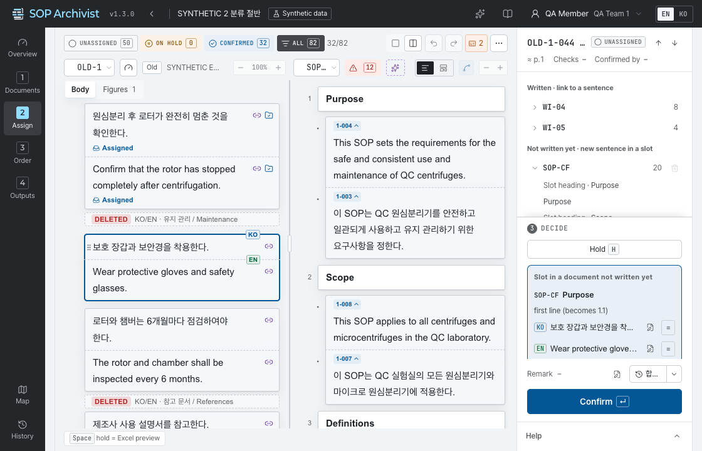

- 왼쪽: Old 원문. 원문 자체가 목록이라 문맥을 보면서 판단합니다. 고른 조각은 강조색 테두리로 둘러지고(한/영 짝이면 짝 카드 전체), 조각 위 테두리 오른쪽에 **KO**(파랑)·**EN**(초록) 탭이 뜹니다(언어가 없는 표·그림에는 그 자리에 TABLE·FIGURE 표시가 고르지 않아도 늘 떠 있습니다). 마우스를 올리기만 한 조각에는 옅은 바탕만 깔리고 테두리·탭은 뜨지 않습니다. 배정한 줄 아래에는 간 곳이 한 줄로 적힙니다. 글 앞의 아이콘이 종류를 말합니다(이어진 New 문장은 문서 아이콘, 지운 것은 휴지통, 다른 SOP로 보낸 것은 폴더, 아직 쓰지 않은 문서의 칸에 둔 것은 받은 편지함).
- 오른쪽: 이미 쓴 New 문서의 원문. Old와 같은 종이 조각이라 조각 왼쪽에 절 번호 칸이 붙고(언어 탭은 고르거나 <kbd>Tab</kbd>으로 갈 때 위 테두리 오른쪽에 뜹니다), 번호 칸 폭이 절 깊이를 따라 들여쓴 것처럼 읽힙니다. 절 번호는 절 머리 줄이 아니라 이 번호 칸에만 보이고, 이웃한 한/영 짝은 두 줄이 붙은 한 카드로 보입니다. 이어진 Old 출처(**출처 칩**)는 본문 위 줄에 붙습니다. 그 Old Unit이 왼쪽 칸 화면 위쪽 밖에 있으면 칩 오른쪽에 위 갈매기, 아래쪽 밖이면 아래 갈매기가 붙습니다. 출처가 넷 이상이면 둘만 보이고 "+2"처럼 남은 수가 나오며, 누르면 모두 펼쳐집니다.
- 오른쪽 칸의 문서 고르기에는 아직 쓰지 않은 To-Be 문서도 있습니다(이름 옆 "not written"). 고르면 머리 표지가 **New · from Assign** 이 되고, 지금까지 그 문서의 칸에 배정한 문장이 칸 순서대로 보입니다(결과물 C와 같은 칸, 한글·영어 함께, 고쳐 쓴 글이 있으면 그 글). 문장 앞 번호도 결과물 C와 같습니다 — 칸 머리는 칸 번호, 문장마다 자기 번호(5.1.1 등), 번호를 생략한 문장과 주석에는 번호가 없습니다. 방금 확정해 들어온 문장은 다시 받을 때까지 번호 없이 보입니다. 아직 받은 문장이 없는 칸은 **Nothing assigned yet**, N/A 칸은 **N/A** 로 옅게 보입니다. 칸 제목에 이은 옛 제목은 문장 줄이 아니라 그 칸 이름 뒤에 "← OLD-1 §5"처럼 옅게 보입니다(결과물 C의 칸 머리와 같고, 칸 제목은 줄로 세지 않습니다). 표는 칸 글이 든 실제 표로(넓으면 표 안에서 좌우로 스크롤되고, 확정 전 칸은 점선), 그림은 원본 이미지로 보입니다 — 이미 쓴 New 문서의 표·그림도 같습니다. 표·그림 위에는 캡션 글이 한 줄(한글·영어 캡션이면 두 줄) 보이고, 아직 쓰지 않은 문서에서 캡션이 없으면 **Caption needed** 가 옅게 보입니다. 이 문서는 미리 보기라 문장을 눌러 잇지 않고, 출처 칩을 누르면 Old의 그 Unit으로 갑니다.
- 문장을 확정하면 오른쪽 칸이 보낸 문서로 바로 옮겨 가고(그 줄에서 손으로 다른 문서를 골라 두었으면 그대로), 새 문장이 제 칸에 펼치며 나타나 화면 안으로 들어오고 Old 문장과 잇는 선이 진하게 그려집니다. 이미 쓴 문장에 이었을 때는 그 문장이 잠깐 번쩍입니다. **Clear assignment** 를 하면 그 문장이 접히며 빠집니다. 다음 줄로 옮겨 가면 오른쪽 칸은 다시 그 줄을 따라갑니다(칸에 확정한 줄을 고르면 그 문서가 열립니다).
- 화면은 두 칸이 기본입니다. To-Be에 문서가 하나도 없으면 오른쪽 칸에 안내가 뜨고, **Go to To-Be** 로 올리는 곳에 갑니다.
- **문서 하나만 넓게 볼 수도 있습니다.** 위쪽 줄 오른쪽 묶음 맨 앞의 두 칸짜리 단추에서 네모 하나(**One document**)를 누르면 New 칸과 가운데 세로선, 연결선이 접히고 Old 문서가 가운데에 넓게 보입니다. 나란한 네모 둘(**Two documents**)을 누르면 돌아옵니다. <kbd>V</kbd>로도 오가고, 가운데 세로선을 오른쪽 끝까지 끌어 놓아도 접힙니다(끄는 동안 선이 굵어지면 놓았을 때 접힌다는 뜻입니다). 고른 보기는 이 브라우저에 기억됩니다. 한 단에서도 문장 다듬기(우클릭 메뉴), 보낼 곳 고르기, 확정·보류·삭제는 그대로 됩니다. 이미 쓴 New 문서의 문장을 직접 눌러 고르는 일만 양 단이 필요해서, 오른쪽 칸의 보낼 곳 아래에 안내와 양 단으로 돌아가는 단추가 뜹니다(추천 카드로 잇는 것은 한 단에서도 됩니다). **New without source** 탭이나 New 문장으로 가는 표시를 누르면 저절로 양 단으로 펴집니다.
- **이미 쓴 New 문서의 원문도 여기서 다듬습니다.** 양 단에서 New 문서 머리의 가위 단추를 누르거나, 한 단에서 문서 고르기 칸의 아래쪽(문서 번호 옆에 New가 붙은 줄)을 고르면 그 문서가 혼자 넓게 열립니다. 문서 이름 옆 꼬리표가 **New · written** 으로 바뀝니다. 문장을 누르면 오른쪽 칸에 그 문장의 1 **Shape** 줄이 뜨고, Old 문서와 같은 도구를 씁니다 — 자를 자리 놓기와 **Split here**, 조각 사이 **Join**, 합친 문장 **Unmerge**, 한/영 짝 맺기·풀기와 **One sentence** · **KO/EN pair**, 언어 바꾸기, 표 도구, 우클릭 메뉴, <kbd>J</kbd>·<kbd>K</kbd>로 다음·앞 문장, <kbd>Ctrl</kbd>+<kbd>Z</kbd>. 이 문서의 문장은 어디로 보내는 것이 아니라서 **Where it goes** 와 **Decide** 는 없습니다. 옛 문서의 문장이 이미 이어진 문장을 자르거나 합치면 한 번 묻고 그 이음을 풀며 고칩니다. 문서 고르기에서 옛 문서를 고르거나 **Two documents** 로 펴면 배정으로 돌아옵니다.
- **양 단에서도 New 문장을 그 자리에서 다듬습니다.** Old 줄을 고르지 않은 채 오른쪽 New 문장을 누르면 그 문장이 강조색 테두리로 골라지고 오른쪽 칸에 1 **Shape** 줄이 뜹니다. Old 줄을 고른 채라면 그 문장을 오른쪽 단추로 누릅니다 — 고치기 메뉴가 열립니다(Old 줄을 고른 채 그냥 누르면 전처럼 그 줄에 잇습니다). 자르기를 누르면 그 문장의 글 안에 선이 놓이고 바로 아래에 **Split here** 가 뜹니다. 선은 끌거나 <kbd>←</kbd>·<kbd>→</kbd>로 옮기고 <kbd>S</kbd>로 자릅니다. 앞·뒤 문장과 합치기·짝 맺기, 짝 풀기, **One sentence** · **KO/EN pair**, 언어 바꾸기, <kbd>Ctrl</kbd>+<kbd>Z</kbd>도 같습니다. 떨어진 문장과 짝을 맺으려면 메뉴의 **Pair with another sentence…** 를 누른 뒤 New 칸에서 같은 내용의 문장을 누릅니다(안내 줄이 New 칸 머리 아래에 뜹니다. 셋 이상이면 <kbd>Shift</kbd>를 누른 채 눌러 모읍니다). <kbd>Esc</kbd>나 Old 줄을 고르면 놓입니다. <kbd>V</kbd>를 누르면 고르던 문장 그대로 그 문서가 한 단으로 열립니다.
- Old 문서에 머리말·꼬리말이 있으면 Old 칸 위에 **Body**·**Header**·**Footer** 탭이 생깁니다. 머리말·꼬리말은 Word 파일에 든 것마다 종이 한 장으로 보이고, 장 위에 어느 구역의 어떤 머리말인지(Section 1 · first page처럼) 적혀 있습니다. 글자가 똑같은 머리말이 여러 구역에 있어도 여기서는 저마다 따로 보입니다 — 하나하나가 배정할 줄이기 때문입니다. 고른 조각이 다른 탭에 있으면 그 탭으로 저절로 넘어갑니다.
- New 문장에 이어진 Old 조각에는 조각 오른쪽 아래 모서리에 배지가 붙습니다. 오른쪽에 열린 New 문서와 이어졌으면 아이콘만 보입니다 — 그 문장이 오른쪽 칸 화면 안에 있으면 연결 아이콘, 위쪽 화면 밖이면 위 갈매기, 아래쪽이면 아래 갈매기입니다. 다른 New 문서와만 이어졌으면 옅은 글자로 그 문서 번호가 보이고, 문서가 여럿이면 "+1"처럼 수가 붙습니다. AI가 제안만 한 연결(아직 확정하지 않음)은 배지가 점선 테두리와 AI 색으로 보이고, 마우스를 올리면 AI 제안이라는 설명이 뜹니다. 배지를 누르면 오른쪽 칸이 그 문장으로 갑니다.

### 목록 거르기 {#assign-filters}

| 탭 | 보이는 것 |
|---|---|
| **Unassigned** | 아직 정하지 않은 Unit |
| **AI suggested** | AI 제안이 있는 Unit. 제안이 있을 때만 보인다 |
| **On hold** | 미뤄 둔 Unit |
| **Confirmed** | 확정한 Unit |
| **All** | 전부. 처음 열면 이 탭이다(Old 원문 전부, 접지 않음) |
| **New without source** | 어느 Old Unit과도 이어지지 않은 새 문장. 남아 있으면 검토를 요청할 수 없다 |

- 상태 탭을 누르면 Old 원문이 그 탭으로 접힙니다. 맞는 문장만 제 모양으로 보이고, 바로 앞뒤 문장은 옅은 한 줄로, 나머지 이어진 문장들은 "문장 12개 § 5.1–5.2"처럼 점선 한 줄로 묶입니다. 묶음 줄을 누르면(오른쪽 **Expand**) 그 문장들이 한 줄씩 펼쳐지고 위에 **Collapse** 가 생깁니다. 한 줄을 누르면 그 문장이 제 모양으로 펼쳐집니다(바탕이 가라앉고 테두리가 점선 — 탭 밖이라는 뜻). 펼친 문장도 눌러 고르고 배정할 수 있습니다. 고른 문장은 **Collapse** 를 눌러도 펼친 채 남고, 그 앞뒤만 다시 묶음 줄로 접힙니다.
- 목록은 탭을 누른 순간에 정해집니다. 확정·보류로 상태가 바뀌어도 그 자리에서 사라지거나 접히지 않고, 같은 탭을 다시 누르면 새로 세고 펼친 것이 모두 접힙니다. <kbd>J</kbd>·<kbd>K</kbd>는 이 목록만 밟고, 펼친 문장에서 누르면 문서 순서로 가장 가까운 목록 문장으로 갑니다.
- New 문장의 **출처 칩** 으로 접힌 Old 문장에 가면 그 문장만 저절로 펼쳐지고 앞뒤는 접힌 채 남습니다.
- 지금 문서·부분에 맞는 문장이 없으면 원문 대신 안내와 맞는 문장이 있는 곳(문서·부분·수)이 뜹니다. 누르면 그리로 옮깁니다.
- **New without source** 탭에서는 Old를 넓게 훑어 출처를 골라야 하니 접지 않습니다.

### 보낼 곳 고르기 {#assign-destination}

오른쪽 패널은 위에서 아래로 일하는 순서이고, 세 걸음에 번호가 붙어 있습니다 — 1 **Shape**(문장 다듬기) → 2 **Where it goes**(보낼 곳) → 3 **Decide**(결정). 맨 위에는 고른 Unit의 번호·상태와 앞·다음 줄로 가는 화살표(<kbd>K</kbd>·<kbd>J</kbd>와 같습니다), 그 문장이 원문에서 놓인 쪽(p.3처럼. 파일에서 쪽을 알 수 없어 어림한 값이면 앞에 ≈)과 **Checks**·**Confirmed by** 한 줄이 있습니다. **Shape** 에는 고른 줄의 문장마다 한 줄이 있습니다: 언어 세 칸 **KO** | **EN** | **REF**(평소 한글·영어 문장은 **KO** | **EN** 만, 참조 줄은 **REF** 만 보이고, 올리거나 Tab으로 들어가면 나머지 칸이 펼쳐집니다. 눌린 칸이 지금 언어이고 다른 칸을 누르면 바꿉니다. **REF** 는 참조 줄 번호 칸을 엽니다), 글의 앞부분, 그 문장의 도구 — 자를 자리 놓기(**Split here**), 앞·뒤 문장과 합치기나 짝 맺기, 떨어진 문장과 짝 맺기, 짝 풀기, 표라면 행으로 나누기·다시 합치기·표 벗기기, 표·그림이면 바로 앞·뒤 문장을 캡션으로 붙이기. 표·그림을 고르면 그 캡션도 문장처럼 한 줄씩 나와(언어 세 칸, 자르기, **Detach caption**) 한/영 한 줄 캡션을 잘라 언어를 따로 줄 수 있습니다. 도구 단추는 그 줄에 마우스를 올리거나 Tab으로 들어가면 보입니다. [우클릭 메뉴](#assign-context)와 같은 일이지만, 그 줄에서 할 길이 없는 일(옆에 문장이 없을 때의 합치기, 이미 짝인 문장끼리의 짝 맺기 등)은 단추를 두지 않습니다. 저장 전 고름처럼 먼저 할 일이 있어 지금 못 하는 단추는 흐리고, 올리면 까닭이 뜹니다. 참조 줄에는 언어 세 칸만 있습니다. 고른 줄이 한/영 짝이거나 합쳐서 만든 한 문장이면 그 줄들 아래에 **One sentence** · **KO/EN pair** 두 칸짜리 단추가 붙고, 눌린 쪽이 지금 모양입니다(짝이면 그 옆에 짝 풀기 단추가 하나 있습니다) — 짝에서 **One sentence** 를 누르면 두 문장이 한 문장으로 합쳐지고(위아래로 붙은 짝만), 합친 문장에서 **KO/EN pair** 를 누르면 합치기를 풀고 다시 짝으로 맺습니다(한글과 영어 글자가 모두 있는 문장만. 되살린 문장이 같은 언어로 잡혀 있으면 영어 글자가 많은 쪽을 EN으로 바꿔 맺습니다). 언어를 잘못 읽어 묶인 결과가 틀렸을 때 고치는 길입니다. 배정된 줄이면 한 번 묻고 배정을 풀며 바꿉니다. 읽기만 하는 사람에게는 **Shape** 가 보이지 않고 번호가 둘(**Where it goes**·**Decide**)입니다. 그 아래 **Where it goes** 목록(패널에서 **Shape** 와 이곳이 함께 스크롤됩니다), 맨 아래에 붙은 **Decide** 칸(다른 길 **Edit and confirm**·**Hold**·**Clear**, 고른 곳, **Remark**, 맨 끝의 큰 **Confirm**)입니다. 목록에서 보낼 곳을 누르면 그 항목이 아래 **Decide** 칸으로 날아 들어가고 고른 곳 상자가 한 번 번쩍입니다(키보드로 고르거나 New 원문에서 고르면 번쩍임만, 컴퓨터의 움직임 줄이기 설정이면 날지 않습니다). 손을 멀리 옮기지 않고 바로 아래 **Confirm** 을 누릅니다. 고른 곳이 없으면 **Confirm** 은 흐리게 꺼져 있고, <kbd>↵</kbd>는 목록의 첫 후보로 갑니다.

| 묶음 | 내용 |
|---|---|
| **Suggested** | 같은 글·비슷한 글·AI가 고른 후보. 카드마다 종류 아이콘(잇기·칸·옮기기·지우기)이 붙고, 아래 줄에 절 번호와 **Same text**, **Similar**, **AI** 표지가 붙는다. 묶음 제목 옆에는 개수가 보인다. 한/영 짝 줄에서 New 문장도 한/영 짝이면 두 문장이 카드 하나로 묶여 함께 골라진다 |
| **Nearby** | 지금 고른 곳의 바로 옆 문장이나 옆 칸 |
| **All** | To-Be의 모든 문서와 칸 |
| **Delete or move** | 새 문서로 가지 않는 처분. 지우기와 다른 문서로 옮기기 |

보낼 곳은 세 가지입니다.

- **Written sentence**: 이미 쓴 New 문서의 문장에 잇습니다. 오른쪽 칸의 New 문서에서 문장을 눌러도 됩니다.
- **Slot in a document not written yet**: 아직 쓰지 않은 문서의 칸에 새 문장을 만듭니다. 처음 글은 Old 원문 그대로이고, 고쳐 쓰려면 **Edit and confirm** 을 씁니다.
- **Slot heading**: 옛 제목 줄을 새 SOP 칸의 제목으로 삼습니다. 아직 안 쓴 문서의 칸 목록에서 각 칸 이름 바로 앞에 있고, 줄이 제목·문장일 때만 보입니다. 짝이면 한글·영어가 각자 그 칸의 제목이 되고 글은 칸 이름이라 고칠 수 없습니다. 다른 문서의 같은 제목도 같은 칸 제목에 이으면 출처만 더해집니다. 칸 제목에는 번호가 붙지 않습니다.

**끌어서 잇기**: Old 원문의 조각을 눌러 끌어 오른쪽 칸에 연 이미 쓴 New 문서의 문장 위에 놓아도 그 문장에 잇습니다. 누른 채 조금 움직여야 끌기가 시작되고, 그 전에 떼면 평소처럼 그 줄을 고릅니다. 표는 칸 어디를 눌러 끌어도 표 전체가 끌립니다. 마우스를 올리면 조각이 살짝 들려 보입니다 — 한/영 짝 카드는 한 장으로 끌리므로 어느 줄에 올려도 카드 전체가 들리고, 상태 탭 밖이라 한 줄을 눌러 펼친 점선 테두리 문장은 들리지 않습니다(끌 수는 있습니다). 끄는 동안에는 작은 표(Unit 번호와 글 첫 줄, 짝 줄이면 Unit 수)가 포인터를 따라오고, 원래 조각은 흐리게 남으며, 조각에서 점선이 따라옵니다. 창 오른쪽 끝 가까이에서는 표가 포인터 왼쪽으로 넘어가 창 안에 남고, 긴 이유는 표 안에서 줄을 바꿔 끝까지 보입니다. 이을 수 있는 문장 위에서는 그 문장에 테두리가 생기고 점선이 그 문장에 닿으며 표에 **Link to this sentence** 가 적힙니다. 놓으면 끈 줄이 골라지고 그 문장이 골라진 채 그 자리 메뉴가 뜹니다 — 문장을 눌러 고른 것과 같고 아직 저장되지 않았습니다(**Not saved yet**). 메뉴의 **Confirm** 이나 <kbd>↵</kbd>로 저장하고, **Cancel** 로 고름을 거둡니다. 이미 그 문장에 확정해 이은 줄을 놓으면 고름은 그대로 두고 끊기 메뉴가 뜹니다. 끄는 동안 <kbd>Esc</kbd>를 누르면 취소되고, 문장 밖에 놓으면 아무 일도 없습니다. 한/영 연달아 문서에서는 Old 조각을 맞은편 언어의 Old 조각 위에 놓으면 짝 맺기입니다([묶인 문장과 한/영 짝](#split-pair)). 아직 쓰지 않은 문서(**New · from Assign**)에 놓으면 잇기가 아니라 보내기가 됩니다(아래 **끌어서 보내기**). 조각의 글자를 긁어 고르려면 <kbd>Alt</kbd>를 누른 채 끕니다(누르는 동안 커서가 글자 커서로 바뀝니다). 긁어 둔 글자는 조각을 그냥 누르면 풀리고, 그 누름은 평소의 클릭입니다. 읽기 전용, **New without source** 탭, 짝을 고르는 중, 이미 쓴 New 문서를 한 단으로 연 동안에는 끌리지 않습니다.

**끌어서 보내기**: 조각을 오른쪽 칸에 연 아직 쓰지 않은 문서(**New · from Assign**)의 두 문장 사이에 놓으면, 그 자리에 저장 전 문장이 점선 상자로 생기고(한/영 짝 줄이면 두 언어 문장이 영어 먼저 함께) 오른쪽 패널의 보낼 곳에 그 칸이 찹니다. 끄는 동안에는 놓을 자리에 선이 그어지고 표에 "→ 6.1. Procedure"처럼 그 칸 이름이 적힙니다. 문장 위에 올리면 위쪽 절반은 그 앞, 아래쪽 절반은 그 뒤입니다 — 같은 Old 줄에서 나온 이웃 문장(한 의미 묶음)의 한가운데에는 끼지 않고 그 묶음의 앞이나 뒤로 붙습니다. 놓아도 저장되지 않습니다. 점선 초안 옆에 그 자리 메뉴가 뜨고(**Not saved yet**), **Confirm** 이나 <kbd>↵</kbd>로 저장하면 그 자리에 들어가며, **Cancel** 로 거둡니다. **Edit and confirm**(<kbd>E</kbd>)으로 글을 고쳐 확정해도 자리는 지킵니다. 문장 사이에 놓아 확정하면 그 문서는 그때부터 순서를 사람이 정한 문서가 됩니다 — <kbd>Ctrl</kbd>+<kbd>Z</kbd>로 그 문장을 되돌려도 순서를 정한 것은 남습니다(**Order & numbering** 에서 순서를 바꾼 뒤와 같습니다). 그 문서에서 처음 이렇게 확정한 뒤에는 그 문서의 문장을 건드린 그 전 단계는 <kbd>Ctrl</kbd>+<kbd>Z</kbd>로 되돌려지지 않습니다 — 줄이 바뀌었다는 알림이 뜨는데, 다른 사람이 아니라 순서를 굳힌 이 확정 때문입니다. 빈 칸에 놓으면 그 칸의 자리 표시에 테두리가 생기고 그 자리 메뉴가 뜨며, 자리 없이 그 칸으로만 갑니다 — 오른쪽 패널 목록에서 그 칸을 고른 것과 같게 저장됩니다. 이미 확정한 줄을 끌어 다른 칸의 두 문장 사이에 놓으면 그 문장이 그 자리로 옮겨집니다. 놓지 못하는 곳에서는 표에 이유가 적히고, 놓아도 아무 일도 없습니다: N/A 칸(**That section is N/A in the To-Be list.** — 그 칸의 자리 표시에 끊긴 테두리), 끄는 줄의 문장이 이미 든 칸의 문장 위(**Already in this section. Change the order in Order** — 올린 문장에 끊긴 테두리. 같은 칸 안의 순서는 **Order & numbering** 에서 바꿉니다), 이미 쓴 New 문서의 두 문장 사이나 번호 칸(**A document that is already written takes no new sentences. Link to one of its sentences.** — 테두리 없이 표에 이유만). 확정하기 전에 다른 사람이 그 자리의 문장을 지우거나 옮겼으면 저장이 거절되고 알림이 뜨며 초안은 남습니다. 다시 받은 문서에서 그 문장이 사라졌으면 자리만 버리고 그 칸의 초안으로 남습니다. 초안은 줄마다 남습니다 — 다른 줄을 고르면 점선 초안이 화면에서 사라지고, 그 줄로 돌아오면 다시 보입니다. 아직 쓰지 않은 문서의 문장은 여전히 눌러 고르지 못합니다(놓을 자리로만 씁니다). 오른쪽 패널 **All** 목록의 칸이나 step 줄에 놓아도 보냅니다 — 끈 줄이 골라지고, 그 줄을 누른 것과 똑같이 그 칸이 보낼 곳이 됩니다(자리는 정하지 않고 그 자리 메뉴도 뜨지 않습니다. **Confirm** 이나 <kbd>↵</kbd>로 저장합니다). 끄는 동안 그 줄에 테두리가 생기고 표에 "→ SOP-CF · Scope"처럼 문서 번호와 칸 이름이 적힙니다. 다른 줄을 끌어 놓았으면 오른쪽 패널이 그 줄의 것으로 바뀌어, 줄을 눌러 고를 때처럼 목록의 펼침도 처음으로 돌아갑니다. N/A 칸의 줄에서는 끊긴 테두리와 함께 **That section is N/A in the To-Be list.** 가 적히고, 놓아도 아무 일도 없습니다. 칸 제목 자리 줄과 이미 쓴 문서의 문장 줄은 놓을 곳이 아닙니다. 접힌 **All** 목록이나 접힌 문서는 끄는 동안 저절로 펼쳐지지 않으니 끌기 전에 펼쳐 둡니다. 목록의 위아래 가장자리 가까이 끌면 목록이 스스로 스크롤합니다. **One document** 보기에서는 New 칸이 없어 오른쪽 패널의 목록이 놓을 곳입니다(Old 원문 위에 놓으면 아무 일도 없습니다 — 한/영 연달아 문서에서 맞은편 언어의 조각에 놓는 짝 맺기만 됩니다).

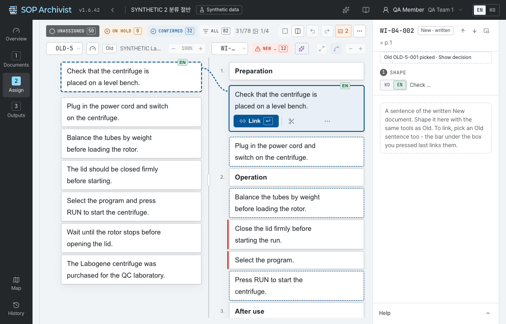

> [!NOTE]
> 보낼 곳이 하나도 없으면 New 문서 목록이 비어 있는 것입니다. **Open To-Be** 로 가서 새 문서 목록부터 적거나, 아래처럼 이 자리에서 바로 만듭니다.

### 보낼 곳 더하고 지우기 {#assign-places}

배정하다가 보낼 곳이 모자라면 **Documents** 로 돌아가지 않고 **All** 목록에서 바로 만듭니다(작성자, 작업 중인 Bundle만).

- **New document**: 목록 맨 아래에 있습니다. 누르면 그 자리가 입력 줄로 바뀝니다. SOP인지 WI인지 고르고 문서 번호를 적은 뒤 <kbd>Enter</kbd>(또는 **Add**)를 누릅니다. WI는 **Parent SOP** 를 고릅니다(SOP가 하나도 없으면 WI를 고를 수 없습니다). 이미 목록에 있는 번호면 줄 아래에 알려 주고 **Add** 가 잠깁니다. <kbd>Esc</kbd>로 닫습니다.
- 만든 문서는 목록 끝에 생기며 바로 펼쳐지고 한 번 번쩍입니다. 제목, 장비 SOP 여부, N/A 칸은 여기서 받지 않습니다 — **Documents** 의 **New documents** 목록에서 채웁니다.
- **Step**: WI를 펼치면 맨 아래에 있습니다. 단계 제목을 적고(비워도 됩니다) <kbd>Enter</kbd>를 누르면 다음 번호의 단계가 생기고, 그 단계의 Instruction 자리가 바로 고른 곳이 됩니다 — 이어서 **Confirm** 만 누르면 됩니다. 번호는 가장 큰 번호 다음이라, 지운 번호를 다시 쓰지 않습니다.
- **지우기**: 문서 줄과 단계의 첫 줄 끝에 휴지통 단추가 흐리게 있고, 줄에 마우스를 올리거나 <kbd>Tab</kbd>으로 가면 또렷해집니다. 한 번 누르면 빨갛게 바뀌며 **Click again to delete** 가 되고, 3초 안에 한 번 더 눌러야 지워집니다.
- 지울 수 없는 줄은 단추가 잠겨 있고 이유가 툴팁으로 뜹니다: 배정된 문장이 있는 문서·단계(먼저 **Clear assignment**), 아래에 WI가 있는 SOP(WI부터 지웁니다). 올린 파일로 만든 문서는 **Documents** 에서 지웁니다.
- 더하고 지운 것은 한 줄씩 바로 저장되고 **History** 에 남습니다. 저장하지 않은 고른 곳이 지운 문서·단계였으면 고름이 풀립니다.

### 이어진 곳 보기·이동 {#assign-links}

- 이어진 Old Unit과 New 문장은 한쪽에 마우스를 올리면 맞은편에 옅은 강조 바탕이 깔립니다(테두리는 고른 조각에만 둘러집니다).
- 양쪽 끝이 다 화면에 보이는 이음은 옅은 파란 선으로 그려집니다. 선은 Old 조각 오른쪽 끝(연결 배지 높이)에서 나와 두 문서 사이 빈 곳에서만 위아래로 움직이고, New 문장 상자 왼쪽 끝(출처 칩 높이)에 닿아 본문 글을 가리지 않습니다. 두 끝의 높이가 많이 다른 이음은 평소 선 전체 대신 양 끝에 짧은 꼬리만 보이고(꼬리는 맞은편이 있는 위·아래로 살짝 휘며 끝으로 갈수록 옅어집니다), 고르거나 마우스를 올리면 선 전체가 그려집니다. 고른 줄과 마우스를 올린 것은 진하게(마우스를 올려 진해진 선은 양 끝의 연결 배지와 출처 칩도 함께 강조됩니다), AI가 이어 두고 아직 확정하지 않은 이음은 선과 출처 칩이 보라색으로, 아직 저장하지 않은 고름은 점선으로 보입니다. 이음이 아주 많으면 고른 것과 마우스를 올린 것만 그립니다. New 문서 머리의 선 아이콘으로 선을 켜고 끌 수 있고, 이 브라우저가 기억합니다(배지와 강조는 그대로).
- Old Unit 아래 "간 곳"(문서 아이콘이 붙은 글)을 누르면 New 문서의 그 문장으로, New 문장 위의 출처 칩을 누르면 Old의 그 Unit으로 갑니다. New 문서가 닫혀 있거나 다른 문서면 열고 갑니다. 간 자리는 잠깐 테두리가 번쩍입니다.
- Old 줄에 없는 언어의 New 문장도 이을 수 있습니다. 그 줄의 Unit이 출처가 되고 변경 종류는 **Translated** 로 적힙니다(고르지 않습니다). New 문장 하나를 고르면 New 문서에서 짝인 다른 언어 문장도 늘 함께 골라집니다 — 빼려면 그 문장을 <kbd>Ctrl</kbd>을 누른 채 다시 누릅니다.
- 추천이나 New 문장을 누르거나 이렇게 이동하면 그 옆에 작은 메뉴가 조금 늦게 뜹니다. 메뉴는 이은 줄의 글 아래(자리가 모자라면 위)에 놓여 그 줄을 가리지 않습니다. 가로는 누른 곳을 따라가되, New 문장을 눌러 잇거나 끊을 때는 두 문서 사이 선이 그 문장에 닿는 끝(문장 왼쪽 테두리)에 맞춰 떠서 어느 연결을 확정·끊는지 보입니다(선이 안 보이면 누른 곳). 마우스를 멀리 옮기지 않고 여기서 고릅니다.

| 메뉴가 뜬 때 | 항목 |
|---|---|
| 고르기만 하고 저장 전 | **Confirm**(<kbd>↵</kbd>) · **Cancel**(고름을 되돌림). 메뉴와 추천 카드에 **Not saved yet** 이 보인다 |
| 이미 확정해 이은 문장 | **Unlink** · **Close**. 문장이 여럿이면 그 문장(한/영 짝은 함께)만 빼고 나머지를 고른 상태로 두고, 하나뿐이면 배정을 지운다 |
| AI가 이어 둔 문장 | **Confirm** · **Unlink** · **Close** |
| 이어지지 않은 문장 | **Link**(고르기) · **Close** |

메뉴는 <kbd>Esc</kbd>로 닫고, <kbd>↑</kbd> <kbd>↓</kbd>로 항목을 옮깁니다. 확정하면 오른쪽 위에 **Confirmed** 알림이 뜹니다.

### 확정·고쳐 쓰기·보류 {#assign-confirm}

| 단추 | 글쇠 | 하는 일 |
|---|---|---|
| **Confirm** | <kbd>↵</kbd> | 고른 보낼 곳으로 확정하고 다음 Unit으로 |
| **Edit and confirm** | <kbd>E</kbd> | 새 문장을 고쳐 쓴 뒤 확정. <kbd>Ctrl</kbd>+<kbd>↵</kbd>로 저장, <kbd>Esc</kbd>로 닫기 |
| **Hold** | <kbd>H</kbd> | 사유를 적고 미루기 |
| **Clear assignment** | <kbd>U</kbd> | 판단을 지우고 **Unassigned** 로 |

- **Remark** 는 지우기·다른 문서로 옮기기·보류·두 문서로 보내기에 꼭 적어야 합니다. 그 밖에는 메모로 적어 두어도 되고 비워 두어도 됩니다. **Decide** 칸의 **Remark** 줄에는 지금 사유가 한 줄로 보이고(넘치면 올렸을 때 전체), 옆의 **Write remark**(이미 있으면 **Edit remark**)를 누르면 창에서 씁니다. 창 칸 아래 **My recent remarks** 에 내가 최근에 쓴 사유가 5개(모든 Bundle, 같은 글은 한 번) 보이고 더 보기로 10개까지 펼치며, 누르면 칸에 채워집니다. <kbd>Ctrl</kbd>+<kbd>↵</kbd>로 확인합니다. 창을 닫으면 포커스가 **Confirm** 으로 가서 <kbd>↵</kbd>로 바로 확정합니다.
- 지금 고른 곳에 사유가 꼭 필요한데(지우기·옮기기·두 문서) 비어 있으면 **Remark** 줄이 주황 경고("**Required to delete**" 등)로 바뀌고 **Write remark** 가 강조됩니다.
- 사유가 꼭 필요한 저장(지우기·옮기기·보류)을 사유 없이 누르면 이 창이 저절로 열리고 무엇에 필요한지 알려 줍니다. 쓰고 **Save and confirm**(보류는 **Save and hold**)을 누르면 저장이 이어집니다.
- 다른 문서로 옮기기의 **Target doc** 은 치면서 고르는 칸입니다. 내가 멤버인 다른 Bundle의 To-Be 문서(번호·제목·Bundle 코드)가 추천으로 뜨고, 전에 옮길 곳으로 쓴 번호(이 Bundle에서 쓴 것 먼저)가 맨 위입니다. 목록에 없는 번호는 친 그대로 쓸 수 있습니다(목록 맨 위 "그대로 쓰기"). <kbd>↑</kbd> <kbd>↓</kbd>로 옮기고 <kbd>↵</kbd>로 고르며 <kbd>Esc</kbd>는 목록만 닫습니다.
- **Change type** 은 원문과 새 문장의 관계입니다: **As is**, **Tone**, **Rewritten**, **Merged**, **Split**, **Translated**, **Deleted**, **New**, **Table restructured**.
- **Checks** 는 원문과 새 문장을 견준 결과입니다. **Numbers differ**, **Units differ**, **Negation differs** 가 뜨면 뜻이 바뀌지 않았는지 다시 봅니다.
- 한/영 짝은 함께 확정됩니다(**Confirmed together**).
- 이어 갈 New 문장이 한 언어로만 있으면 그 언어의 Old 문장만 이어집니다. 잇지 않는 문장은 고른 곳 아래에 알려 주고, **Confirm** 을 누르면 같은 저장에서 짝이 풀려 그 문장이 따로 줄이 됩니다(서버가 함께 처리합니다. **History** 에 **Removed a KO/EN pair**). 따로 남은 줄은 **Delete or move** 의 **Deleted**(**Remark** 필수)나 **Hold** 로 마무리합니다. 흔한 경우는 아닙니다 — 보통은 Old와 New 모두 한글·영어가 함께 있어 두 문장이 같이 이어집니다.
- 짝의 문장들이 서로 다른 New 문서나 처리(지우기·옮기기)로 가면 짝이 풀리고 알림이 뜹니다. 한 줄의 처리는 늘 하나입니다.
- 고르기만 하고 확정하지 않은 채 떠나려 하면 먼저 묻습니다.

### Old 문장 우클릭 메뉴 {#assign-context}

Old 문장을 오른쪽 단추로 누르면(키보드는 줄을 고른 채 <kbd>Shift</kbd>+<kbd>F10</kbd> 또는 메뉴 글쇠) 그 줄을 고르고 메뉴가 뜹니다. 메뉴는 그 줄의 조각(한/영 짝이면 둘 다) 아래, 자리가 모자라면 위에 놓여 다룰 문장을 가리지 않습니다. 지금 할 수 없는 항목은 숨기지 않고 흐리게 보이며, 마우스를 올리거나 포커스를 두면 까닭이 뜹니다.

| 묶음 | 항목 | 하는 일 |
|---|---|---|
| **Assignment** | **Clear assignment** | 배정을 지우고 **Unassigned** 로. 확정은 메뉴에 없다 — <kbd>↵</kbd>, 오른쪽 칸 **Decide** 의 **Confirm**, 보낼 곳을 고른 뒤 뜨는 그 자리 메뉴로 한다 |
| **Edit sentence** | **Split here** | 누른 자리 가까이에 나눌 선을 놓는다. 선을 끌거나 <kbd>←</kbd> <kbd>→</kbd>로 옮긴 뒤 선 옆 **Split here**(<kbd>S</kbd>)로 나누고, **Cancel**(<kbd>Esc</kbd>)로 거둔다. 문장을 두 번 눌러도 선이 놓인다 |
| | **Merge with previous** · **Merge with next** | 바로 앞·뒤 문장과 한 문장으로 합친다(같은 언어끼리) |
| | **Pair with previous (KO/EN)** · **Pair with next (KO/EN)** | 앞·뒤 문장이 다른 언어(한글 ↔ 영어)면 합치기 대신 이 항목이 나온다. 두 문장을 한/영 짝으로 맺어 한 줄로 다룬다. 이미 짝이 있는 문장과는 맺을 수 없다 |
| | **Pair with another sentence…** | 짝이 없는 한글·영어 문장에서 보인다. 누르면 용지 위에 안내 줄이 뜨고, 이어서 누르는 문장(떨어져 있어도 된다)과 짝이 된다. 같은 언어를 누르면 까닭을 알려 주고 계속 기다린다. 셋 이상을 한 짝으로 묶으려면(한글 한 문장에 영어 두 문장처럼) <kbd>Shift</kbd>를 누른 채 문장을 눌러 모은다 — 모은 문장은 용지에 옅게 표시되고(다시 누르면 빠진다) 안내 줄에 모은 수가 적힌 맺기 단추(Pair 3)가 생긴다. 그 단추나 <kbd>↵</kbd>로 맺고, 마지막 문장을 <kbd>Shift</kbd> 없이 눌러도 맺어진다. <kbd>Esc</kbd>나 **Cancel** 로 거둔다 |
| | **Separate the KO/EN pair** | 짝인 문장에서만 보인다. 짝을 풀어 두 문장을 따로 다룬다 |
| | **Language** | KO·EN 중 하나로 바꾼다. 참조 줄에서는 꺼져 있다(언어가 없다) |
| | **Mark as reference…** · **Not a reference** | 다른 문서를 번호로 가리키는 줄을 참조 줄로 표시하거나, 참조 줄·제안을 보통 문장으로 돌린다(아래 참조 줄) |
| | **Split into rows** · **Merge rows back** | 표(또는 표의 칸)를 우클릭하면 나온다. 표의 머리 줄이나 표 위를 그냥 누르면 표 전체가 골라져 오른쪽 **Shape** 에도 같은 단추가 보인다. 통째인 표를 행마다 다른 곳으로 보낼 수 있게 행으로 나누고, 나눈 표는 다시 합친다 |
| | **Unwrap table** | 통째인 표에서만. 글을 줄 맞추려고 쓴 배치용 표를 표가 아닌 글로 다룬다 |
| | **Attach the sentence above as caption** · **Attach the sentence below as caption** | 표·그림을 우클릭하면 나온다(그림도 문장 메뉴가 아니라 이 묶음 메뉴). 표·그림 바로 앞·뒤가 묶이지 않은 문장일 때만 보이고, 그 문장을 캡션으로 붙인다 |
| | **Use as caption of the table above** · **Use as caption of the table below** | 표·그림 바로 앞·뒤 문장을 우클릭하면 나온다(그림이면 figure). 그 문장을 그 표·그림의 캡션으로 붙인다 |
| | **Detach caption** | 캡션을 우클릭하면 나온다. 캡션을 보통 문장으로 돌린다. 캡션에는 이 밖에 **Split here** 와 **Language** 만 있다 |

**배정된 문장도 자르고 합칠 수 있습니다** — 누르면 **Decisions will be cleared** 창이 한 번 묻고, **Edit anyway** 를 누르면 그 문장의 배정이 풀리며(미배정으로 돌아가고, 이어져 있던 New 문장은 보류가 됩니다) 고쳐집니다. 표를 행으로 나누거나 합치는 것, 고른 글자로 새 Unit 만들기, AI 나누기 제안 적용도 같습니다. 언어 바꾸기·짝 맺기·풀기·참조 줄 표시는 배정된 문장에서 잠겨 있으니 먼저 **Clear assignment** 를 합니다. 저장하지 않은 고름이 있는 줄은 먼저 확정하거나 고름을 되돌립니다. 고친 뒤에는 원문을 다시 읽고 고친 문장(나누면 앞쪽 조각)의 줄을 고릅니다. 여기서 자른 것은 바로 <kbd>Ctrl</kbd>+<kbd>Z</kbd>로 되돌릴 수 있습니다(아래 되돌리기). 짝 맺기·풀기는 되돌리기 기록에 들어가지 않습니다 — 같은 메뉴의 반대 항목으로 되돌립니다. 표 항목은 문장 고치기처럼 <kbd>Ctrl</kbd>+<kbd>Z</kbd>로 되돌립니다. 

**고른 글자로 새 Unit 만들기**: Old 원문에서 한 문단 안의 글자를 마우스로 끌어 고르면(Assign의 Old 칸에서는 <kbd>Alt</kbd>를 누른 채 긁습니다 — 그냥 끌면 조각 끌기가 됩니다) 용지 위에 **New unit from selection** 줄이 뜨고 고른 글이 보입니다. **Make unit** 을 누르면 그 범위가 새 Unit이 되고(앞뒤 글은 따로 남습니다), 옆의 ✕로 거둡니다. 배정이 있는 문장이면 한 번 묻고 배정을 풀며 만듭니다. 이것도 <kbd>Ctrl</kbd>+<kbd>Z</kbd>로 되돌립니다.

**조각 사이의 붙이기 단추와 합친 문장 풀기**: 두 조각 사이 틈에 마우스를 올리면 **Join** 단추가 나타납니다 — 같은 언어의 문장이면 한 문장으로 합치고, 한글·영어 문장이면 짝으로 맺습니다(우클릭 메뉴의 앞·뒤 항목과 같은 일입니다). 묶을 수 없는 자리는 단추가 꺼져 있고 까닭이 툴팁으로 뜹니다. 합쳐서 만든 문장을 고르면 글 아래에 **Unmerge** 가 생기고, 누르면 합치기 전의 문장들로 돌아갑니다. 합치기와 풀기는 <kbd>Ctrl</kbd>+<kbd>Z</kbd>로 되돌립니다.

**Pair view** 에는 우클릭 메뉴·두 번 눌러 나누기·**Join** 이 없습니다 — 끄고 씁니다(오른쪽 패널의 **Shape** 줄은 그대로 됩니다. 다만 **Shape** 줄의 나누기를 누르면 Pair view가 먼저 꺼지고 Old 용지의 그 문장에 나눌 선이 놓입니다 — 선을 보고 자릅니다).

### 참조 줄 (REF) {#assign-ref}

참고 문서 목록처럼 **다른 문서를 번호로 가리키는 줄**은 한글·영어 문장이 아니라 참조 줄(REF)로 다룹니다. 참조 줄은 한/영 짝이 없어도 "한 언어만 있음"에 잡히지 않고, 새 문장에서 번호를 지금 번호로 바꿔 써도 숫자 불일치 경고가 뜨지 않습니다.

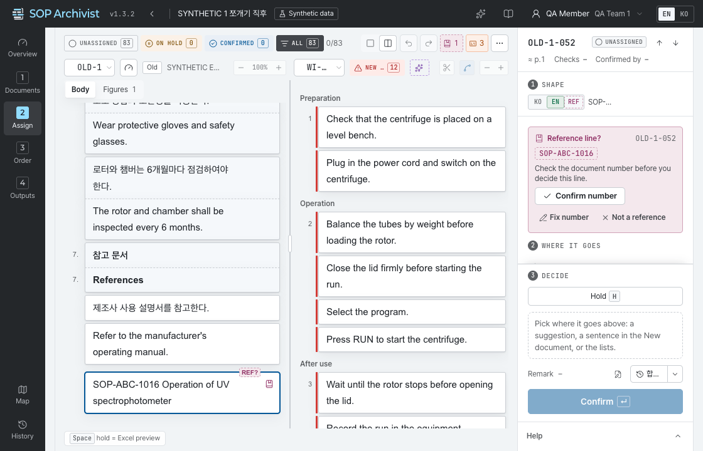

- **앱이 먼저 제안합니다.** 줄이 문서 번호로 시작하면(예: `SOP-ABC-1016 Operation of …`) Old 원문의 그 줄 끝에 책갈피 표시가 붙고, 언어 자리(조각 위 테두리 오른쪽)에 점선 `REF?` 가 늘 보입니다. 위쪽 줄에는 확인이 남은 수가 뜨고, 누르면 다음 줄로 갑니다.
- **결정 전에 번호만 확인합니다.** 그 줄을 고르면 오른쪽 칸 맨 위에 **Reference line?** 카드가 뜹니다. 번호가 맞으면 **Confirm number**, 번호 자리가 틀렸으면 **Fix number** 로 그 줄에 적힌 번호를 넣고 **Use this number**, 참조가 아니면 **Not a reference** 를 누릅니다. 카드를 정리하기 전에는 그 줄의 **Confirm** 이 꺼져 있습니다(다른 줄 작업은 막지 않습니다).
- **EQUIS가 아는 번호면 지금 번호와 이름을 보여 줍니다.** 옛 번호면 "Old number, now …"와 함께 지금 번호·정식 이름이 카드에 보입니다.
- **새 문장은 EQUIS에 맞춥니다.** 보낼 곳을 고르면 결정 칸의 새 문장 아래에, 글이 EQUIS와 다를 때만 작은 주의가 뜹니다 — 옛 번호가 그대로면 **Number differs from EQUIS**, 번호는 맞는데 이름이 다르면 **Title differs from EQUIS**. 그 아래에 지금 번호와 정식 이름으로 맞춘 글이 보이고, **Use EQUIS text** 를 누르면 새 문장이 그 글로 바뀝니다(저장은 **Confirm**). 원문은 바뀌지 않습니다. 번호가 문장 가운데에 있는 줄은 문장을 두고 번호만 바꾼 글을 제안합니다. 주의는 안내일 뿐 확정을 막지 않습니다.
- **이미 쓴 New 문서의 문장에 이을 때**도 같은 주의가 뜹니다. 그 문서의 글은 여기서 고칠 수 없어 맞춘 글만 보여 주고, 이은 뒤에는 New 원문의 그 문장 위(출처 표시 옆)에 **Number differs from EQUIS** 나 **Title differs from EQUIS** 가 작은 표시로 남습니다. 올린 파일을 고쳐 다시 올리거나, 그대로 둘지 정합니다. 참조 줄을 영어 문장에 이어도 번역으로 세지 않습니다.
- **이미 쓴 New 문서에만 있는 참조 줄**(옛 문서와 잇지 않은 줄)도 EQUIS와 견줍니다. New 원문의 그 문장 위에, 볼 것이 있을 때만 작은 표시가 뜹니다 — **Number differs from EQUIS**(옛 번호가 적혀 있다), **Title differs from EQUIS**(번호는 맞는데 이름이 다르다), **Retired in EQUIS**(폐기된 문서를 가리킨다), 회색 **Not in EQUIS**(EQUIS가 모르는 번호다. 이번에 새로 만드는 문서를 가리키는 줄이라면 정상이다), 회색 **EQUIS lookup failed**(조회하지 못했다). 번호와 이름이 맞는 줄에는 아무것도 뜨지 않습니다. 표시를 누르면 그 번호의 EQUIS 정보(지금 번호, 정식 이름, 지금 판과 시행일, 소유 부서)와 **Open in EQUIS** 가 펼쳐집니다. 여기서 고치는 단추는 없고 검토자에게도 똑같이 보입니다. 번호는 New 원문을 열 때 조회해서, 참조 줄이 많으면 표시가 몇 초에 걸쳐 차례로 채워집니다(새로 고치지 않아도 됩니다).
- **제안이 못 잡은 줄**(번호가 문장 가운데에 있는 줄 등)은 우클릭 메뉴의 **Mark as reference…** 로 직접 표시합니다. 번호는 그 줄의 글에 있는 것만 넣을 수 있습니다.
- 확정된 참조 줄은 고르지 않아도 언어 자리에 `REF` 가 늘 보이고 카드 제목이 **Reference line** 으로 바뀝니다. 보통 문장으로 돌리려면 **Not a reference** 를 누릅니다.

표시·되돌리기는 언어 바꾸기와 같습니다 — 배정이 있는 줄은 먼저 **Clear assignment** 를 하고, <kbd>Ctrl</kbd>+<kbd>Z</kbd>로 되돌립니다.

가리키는 문서가 무엇으로 바뀌는지는 **Map** 에서 봅니다.

### 여럿을 한 번에 {#assign-bulk}

- **같은 글 일괄 확정**: 이미 쓴 New 문서에 글자가 똑같은 문장이 있는 Unit은 목록 위의 same-text pairs 단추로 한 번에 확정합니다. 누르면 **Confirm same-text pairs** 창에서 건수를 보여 주고 **Confirm all** 을 눌러야 진행됩니다.
- **지우기·옮기기**: <kbd>Shift</kbd>를 누른 채 Old Unit을 눌러 여럿을 고르면 **Delete picked rows** 와 **Move picked rows to another document** 가 나옵니다. 여럿을 한 번에 할 수 있는 것은 지우기와 옮기기뿐입니다. AI 제안이 붙은 줄이 섞여도 됩니다 — 그 제안은 걷히고 고른 처분으로 확정됩니다(AI가 만든 새 문장은 지워지고, 이미 쓴 New 문서의 문장은 이음만 풀립니다). 제안 하나가 한/영 짝 두 줄을 덮는데 한쪽만 골랐으면 고르지 않은 쪽은 **Unassigned** 로 돌아갑니다. 새 문장을 사람이 확정하거나 미룬 줄이 섞이면 아무것도 바뀌지 않고 거절됩니다 — 그 줄은 배정을 먼저 지웁니다. 창에서 바로 사유를 쓰고(아래에 **My recent remarks**), 옮기기의 **Target doc** 은 하나씩 할 때와 같은 추천 칸입니다.
- **배정 초기화**: 목록 위 **Reset** 메뉴의 **Reset this document** 는 지금 연 Old 문서의 배정을, 선 아래 **Reset the whole bundle** 은 Bundle 안 모든 배정을 한 번에 지웁니다. 창이 먼저 몇 Unit이 **Unassigned** 로 돌아가는지, 함께 묶인 다른 문서의 Unit 몇 개가 **On hold** 로 가는지, 새로 쓴 문장 몇 개가 지워지는지 세어 보여 주고, **Reset** 을 눌러야 진행됩니다. AI 작업이 돌고 있으면 끝난 뒤에 할 수 있습니다. **History** 에 **Reset assignments** 로 남습니다.
- **합치기와 나누기**: Unit 여럿을 새 문장 하나로 보내면 합침, Unit 하나를 새 문장 여럿으로 보내면 나눔입니다. New 문서에서 <kbd>Ctrl</kbd>을 누른 채 문장을 누르면 보낼 문장이 더해집니다.

### 누락 의심 경고 {#assign-warnings}

파일을 읽을 때 보조 읽기가 찾았지만 본문에는 빠졌을 수 있는 글이 있으면, 위쪽 줄에 주황색 경고 표시(삼각형과 남은 수)가 뜹니다. 확인이 남아 있는 동안만 보이고, 모두 확인하면 사라집니다. Old 원문에서도 그 자리가 보입니다 — 경고가 걸린 문단의 글에 물결 밑줄이 그어지고 줄 끝에 삼각형 표시가 붙으며, 확인하면 함께 사라집니다. **확인하지 않은 경고가 남아 있으면 검토를 요청할 수 없습니다**(**Missing-text warnings closed**).

1. 경고 표시를 누르면 Bundle의 모든 문서에서 모은 **Missing-text warnings** 목록이 열립니다. 줄마다 문서 번호와 빠졌을 수 있는 글이 그대로 보입니다.
2. **Show** 를 누르면 목록이 닫히고 Old 원문의 그 자리로 갑니다(그 자리에 Unit이 없으면 문서만 엽니다). 이미 쓴 New 문서의 경고는 **Open the document** 로 그 문서를 한 단으로 엽니다.
3. 원본 파일과 견주어 본 뒤 **Mark checked** 를 누릅니다. 줄의 표시가 **Checked** 로 바뀝니다. 확인은 작성자만 합니다.

**Overview** 의 조건 카드와 다음 할 일도 이 화면으로 데려옵니다.

### 되돌리기 {#assign-undo}

도구 줄 오른쪽 묶음 맨 앞의 되돌리기·다시 하기 아이콘(<kbd>Ctrl</kbd>+<kbd>Z</kbd>, <kbd>Ctrl</kbd>+<kbd>Shift</kbd>+<kbd>Z</kbd>, 맥은 <kbd>⌘</kbd>)으로 이 화면에서 한 판단을 한 단계씩 되돌리고 다시 합니다. 되돌릴 것이 없으면 아이콘이 흐리게 꺼져 있고, 읽기 전용이면 나오지 않습니다.

- 되돌아가는 것: 확정·보류·잇기와 끊기, **Clear assignment**, 같은 글 일괄 확정(한 번에 모두), **Mark as new**, 출처 없는 새 문장에 Old 잇기, 여럿 지우기·옮기기, 배정 초기화(문서 하나 또는 Bundle 전체), 이 화면에서 한 문장 자르기·합치기·언어 바꾸기.
- 되돌리면 알림이 무엇을 어느 줄에서 되돌렸는지 알려 주고(예: Confirm · OLD-1-009, 여럿이면 줄 수), 그 줄을 골라 그 자리로 갑니다. 거르기는 그대로 둡니다.
- 기록은 이 화면을 연 동안만 있습니다. 다른 화면으로 가거나 새로 고치면 사라집니다.
- 그 사이 다른 사람(또는 다른 창)이 그 줄을 바꿨거나, 그 줄로 짝·번역이 새로 생겼거나, 되살릴 문장의 문서 순서를 결과물 C에서 바꿨으면 되돌리지 않습니다. 알림이 어느 줄인지(예: OLD-1-009) 알려 주고 화면은 지금 상태를 다시 불러옵니다 — 그때까지 저장한 것은 그대로입니다. 자른 조각에 그 사이 배정이 걸렸으면 먼저 배정을 지우라고 알립니다.
- 글을 쓰는 칸(고쳐 쓰기·**Remark** 등) 안에서 누른 <kbd>Ctrl</kbd>+<kbd>Z</kbd>는 그 칸의 글자만 되돌립니다.

### 출처 없는 새 문장 {#assign-new}

**New without source** 탭에는 이미 쓴 New 문서의 문장 가운데 Old 출처가 없는 것이 모입니다. 오른쪽 칸에서 이런 문장은 상자 왼쪽 바로 바깥에 가는 빨간 세로선이 붙습니다(상자 테두리는 그대로).

- 정말 새로 쓴 문장이면 **Mark as new** 를 누릅니다. 아래 **Decide** 칸의 **Write remark** 로 **Remark** 를 적어 두면 함께 저장됩니다(선택).
- Old에 출처가 있으면 그 Old Unit을 골라 이 문장에 잇습니다.

### 번역 {#assign-translate}

AI가 켜져 있으면 한쪽 언어만 있는 새 문장에 **Make English** 또는 **Make Korean** 단추가 나옵니다(제목 줄도 같습니다). 그 언어의 문장이 이미 있으면(직접 쓴 문장·AI 번역) 단추가 나오지 않고, AI 번역도 그 줄을 건너뜁니다. 누르면 AI가 다른 언어 문장을 제안하고, 사람이 확인해 확정합니다. 번역 문장의 자리는 출처 문장을 따라가며 따로 옮길 수 없습니다.

AI가 꺼져 있어도 빠진 언어를 직접 채울 수 있습니다. 칸에 확정한 한 언어 줄에서 **Write English** 또는 **Write Korean** 을 누르면 고쳐 쓰기가 열리며 다른 언어의 빈 칸이 하나 더해집니다. 글을 쓰고 확정하면 그 줄의 Unit을 출처로 같은 칸에 저장되고 변경 종류는 **Translated** 입니다. 칸을 비워 두면 저장되지 않고, 비운 채 <kbd>Esc</kbd>로 닫으면 빈 칸도 걷혀 단추가 다시 나옵니다.

### 보기 조절 {#assign-view}

- 마우스를 올린 문서에서 <kbd>Ctrl</kbd>+휠 또는 <kbd>Ctrl</kbd>+<kbd>+</kbd> <kbd>-</kbd>로 그 문서만 확대·축소합니다.
- 두 문서 사이의 세로선을 끌어 폭을 바꿉니다. 확대와 폭은 이 브라우저에 기억됩니다.
- **Pair view**: 한글과 영어가 따로 적힌 Old 문서(한/영 따로)를 열면 Old 문서 머리의 확대 단추 앞에 **Pair view** 단추가 보입니다(칸이 좁으면 아이콘만). 켜면 New 문서 자리를 빌려 왼쪽 칸에 그 문서의 한국어 Unit, 오른쪽 칸에 영어 Unit이 원문 순서대로 펴집니다. 한/영 짝은 두 칸 사이의 선으로 이어집니다 — 확정한 짝은 실선, 아직 제안인 짝은 회색 점선이고, 조각의 세로선 쪽 변에도 같은 뜻의 막대가 붙어 맞은편이 스크롤 밖이어도 짝인지 보입니다. 두 칸은 따로 스크롤합니다. 조각을 누르거나 <kbd>J</kbd> <kbd>K</kbd>로 줄을 고르면 오른쪽 패널이 평소처럼 그 줄을 다루고, 그 줄의 조각이 두 칸에서 모두 화면 안으로 들어옵니다. 언어가 없는 줄(참조 줄·표·그림)은 흐리게 제자리에 남습니다(눌러 고를 수는 있습니다). 단추를 다시 누르거나 <kbd>V</kbd>, 보기 단추(**One document** · **Two documents**)로 끄면 보던 화면으로 돌아오고, 다른 문서의 줄을 고르거나 New 문서의 문장으로 가거나 **New without source** 를 눌러도 꺼집니다. 끄면 고른 줄의 조각이 Old 원문 화면 안에 섭니다(고른 줄이 없으면 켜기 전 자리). 켜 둔 것은 기억하지 않습니다 — 새로 고치면 꺼져 있습니다.
- 위쪽 도구 줄은 한 줄로 두고, 개수·**Reset**·보기 아이콘은 오른쪽 끝에 모입니다. 도구 줄이 좁으면(대략 창 폭 1750 이하) 개수·**Reset**·AI 메뉴는 아이콘만 보이고 마우스를 올리거나 키보드로 가면 이름이 뜹니다. 그래도 넘치면 그 묶음이 통째로 다음 줄 오른쪽으로 갑니다. 오른쪽 패널은 화면 폭에 따라 280~420px로 달라지고, 아주 넓은 화면에서는 작업면이 1920px까지 늘어납니다. 패널이 좁으면(대략 창 폭 1350 이하) **Edit and confirm**·**Hold**·**Clear** 단추의 글쇠 표시가 빠집니다 — 단축키는 그대로 됩니다(**Clear** 는 **Clear assignment** 의 줄임으로, 올리면 전체 이름이 뜹니다). 꺼진 단추는 흐리게 남고 올리면 까닭이 뜹니다. 고른 곳 상자의 한/영 문장은 한 줄씩(끝에 **Change type**) 보이고 전체는 올리거나 **Edit and confirm** 에서 봅니다. **Decide** 칸은 패널의 절반 남짓까지만 커지고 넘치면 고른 곳 부분만 스크롤되어, 목록이 늘 보이고 **Confirm** 은 화면 밖으로 나가지 않습니다. 긴 보류·확정 사유는 **Remark** 줄에 한 줄로 보이고, 전체는 마우스를 올리거나 **Edit remark** 창에서 봅니다.
- 오른쪽 칸 맨 아래의 **Help** 는 **Shortcuts** 와 **Marks** 두 탭으로 단축키와 표시의 뜻을 풀이합니다. 처음에는 접혀 있고, 펼침과 탭은 이 브라우저에 기억됩니다.

### 단축키 {#assign-keys}

| 글쇠 | 하는 일 |
|---|---|
| <kbd>↑</kbd> <kbd>↓</kbd> <kbd>J</kbd> <kbd>K</kbd> | 다음·이전 Unit |
| <kbd>↵</kbd> | 확정하고 다음으로 |
| <kbd>E</kbd> | 고쳐 쓰기. <kbd>Ctrl</kbd>+<kbd>↵</kbd> 저장, <kbd>Esc</kbd> 닫기 |
| <kbd>H</kbd> | 보류 |
| <kbd>U</kbd> | 배정 지우기 |
| <kbd>Ctrl</kbd>+<kbd>Z</kbd> | 판단 되돌리기. <kbd>Shift</kbd>를 더하면 다시 하기 |
| <kbd>Shift</kbd>+누르기 | Old Unit 여럿 고르기(지우기·옮기기) |
| <kbd>Ctrl</kbd>+누르기 | New 문장 더하기(나눔) |
| <kbd>Ctrl</kbd>+휠 | 마우스를 올린 문서 확대·축소 |
| <kbd>Alt</kbd>+끌기 | Old 조각의 글자 긁어 고르기(그냥 끌면 조각을 New 문장에 끌어 잇거나, 아직 쓰지 않은 문서의 문장 사이·빈 칸이나 오른쪽 패널 **All** 목록의 칸으로 끌어 보내기, 맞은편 언어의 Old 조각에 놓으면 한/영 짝) |
| <kbd>Esc</kbd>(끄는 동안) | 조각 끌기 취소 |
| <kbd>Shift</kbd>+<kbd>F10</kbd> · 메뉴 글쇠 | 고른 줄에서 우클릭 메뉴 열기 |
| <kbd>S</kbd> · <kbd>Esc</kbd> | 나눌 선이 있을 때 여기서 나누기 · 선 거두기 |
| <kbd>↑</kbd> <kbd>↓</kbd> <kbd>←</kbd> <kbd>→</kbd> | 그 자리 메뉴 안에서 항목 옮기기 |
| <kbd>Esc</kbd> | 그 자리 메뉴 닫기 |

## 3단계 Order {#order}

새 문서마다 문장이 놓이는 순서와 들여쓰기, 문단번호를 정하는 단계입니다. 화면 제목은 **Order & numbering** 입니다. **Assign** 에서 문장이 어느 칸으로 갈지 정했다면, 여기서는 그 칸 안에서 읽는 순서를 맞추고, 필요하면 같은 문서의 다른 칸으로 끌어 옮깁니다.

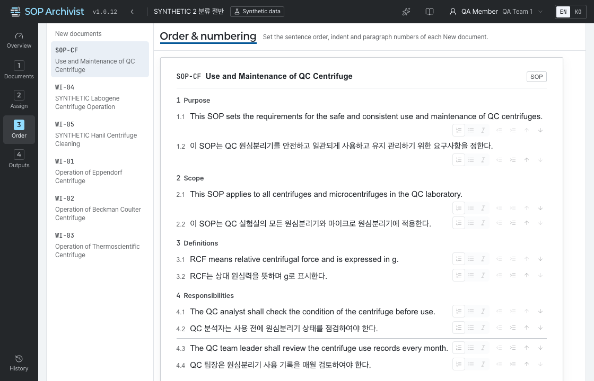

- 왼쪽: 새 문서 목록. 한 번에 한 문서만 엽니다.
- 오른쪽: 고른 문서의 칸과 문장. **Outputs** 의 **C · New documents** 와 같은 모양이고, 여기서만 고칠 수 있습니다. 칸 제목으로 간 옛 제목은 칸 머리 옆에 '← OLD-1 §5'처럼 흐리게 적힙니다.
- 지우거나 다른 문서로 옮긴 줄은 순서가 없으므로 여기 나오지 않습니다(**Outputs** 의 **Deleted and moved** 에 모입니다).
- **끌어서 옮기기**: 줄 어디든(줄 끝 단추는 빼고) 마우스로 눌러 끌면 옮겨집니다. 누른 채 조금 움직여야 끌기가 시작되고, 그 전에 떼면 평소처럼 줄을 고릅니다. 마우스를 올리면 줄이 살짝 들려 보이고, 끄는 동안에는 작은 표(번호·글 첫 줄·여러 줄이면 줄 수)가 포인터를 따라오며(창 오른쪽 끝 가까이에서는 포인터 왼쪽으로 넘어갑니다) 원래 자리는 흐리게 남습니다. 같은 의미에서 나온 이웃 줄(굵은 선으로 묶인 줄)과 그 아래 더 깊은 줄이 함께 옮겨집니다 — 줄 끝 단추와 글쇠는 지금처럼 한 줄씩 옮깁니다. 놓을 자리에는 그 깊이의 줄이 시작하는 곳부터 선이 그어지고, 따라오는 표에 그 자리에 놓았을 때 받을 번호가 "→ 5.2"처럼 적힙니다(좌우로 깊이가 바뀌면 indent · outdent도 붙습니다). 번호는 줄 위에 적지 않아 아래 줄 글을 가리지 않습니다. 이 번호는 화면이 미리 센 것이고 저장 응답의 번호가 이깁니다. 같은 문서의 다른 칸에도 놓입니다 — SOP는 다른 칸·하위 칸으로, WI는 같은 부분의 다른 단계로(Instruction은 Instruction으로, Why는 Why로) 옮겨집니다. 다른 칸 위로 가면 그 칸에 테두리가 생기고 표에 그 칸에서 받을 번호가 "→ 5.1.3"처럼 적히며(깊이 낱말은 붙지 않고, 번호가 없는 칸이면 칸 이름), 놓으면 그 문장이 속한 칸이 정말 바뀌고 그 칸의 번호로 다시 셉니다. **Outputs** 의 세 탭과 Excel도 바뀐 칸을 따릅니다. 줄이 없는 칸(–)에도 놓이고, 놓은 덩어리가 그 칸의 첫 줄들이 됩니다. 놓을 수 없는 칸 위에서는 끊긴 테두리와 함께 표에 이유가 적히고, 거기서 놓으면 아무것도 바뀌지 않습니다: N/A 칸(상위 칸이 N/A인 하위 칸도 — **That section is N/A in the To-Be list.**), 이미 쓴 New 문서의 줄(SOP는 **Only sentences written here for an SOP can change section.**, WI는 **Only sentences written here for a WI can change step.** — 이런 덩어리를 끄는 동안에는 자기 칸 밖이 모두 흐려집니다), 원문과 갈라지는 AI 번역 줄(**An AI translation moves only with its source: put them side by side first**), WI의 다른 부분(**Instruction or Why: change it in Assign**), 다른 문서(**Another document: change it in Assign** — 문서를 바꾸는 일은 **Assign** 에서 합니다). 끄는 동안 그 덩어리가 갈 수 없는 칸은 모두 흐려집니다(N/A 칸, WI의 다른 부분 칸, 이미 쓴 New 문서처럼 줄을 받지 못하는 문서의 칸, 다른 문서) — N/A 칸의 사유 줄(N/A · …)은 흐려지지 않아 그대로 읽힙니다. 다른 칸에 놓은 줄은 놓인 자리에서 잠깐 테두리로 강조되고(움직임 줄이기 설정이면 같은 시간 동안 멈춘 테두리), 화면 밖이면 화면이 그 줄로 갑니다. 용지 밖이나 칸이 없는 곳(문서 머리, 마지막 칸 아래)에서 놓아도 아무 일도 없습니다(표에 이유도 적히지 않습니다). 끄던 줄은 그대로인데 포인터를 멈춘 사이 앞선 저장의 응답이 닿아 출발 칸이나 놓을 칸의 줄 자리가 바뀌면, 놓은 순간 포인터가 가리키는 자리로 다시 셉니다. 끄는 동안 앞선 저장이 실패해 되돌려지는 등으로 끌던 줄들이 바뀌면 선이 사라지고 표에 이유(**The lines changed while dragging: drag again**)가 적히며, 놓아도 저장하지 않습니다 — 다시 끌면 됩니다. 다른 의미 묶음의 한가운데에는 끼지 않고 그 묶음의 앞이나 뒤로 붙습니다. 좌우로 끌면 24px마다 한 단씩 들이거나 내어 쓰고, 앞 번호 줄보다 한 단 깊게까지만 됩니다. AI 번역 줄이나 이미 쓴 New 문서의 줄이 하나라도 든 덩어리는 위아래로만 옮겨집니다. 끄는 동안 <kbd>Esc</kbd>를 누르면 취소되고 고른 줄은 그대로 남습니다. 용지 위아래 가장자리 가까이 끌면 화면이 스스로 스크롤합니다. 놓으면 줄이 미끄러져 자리를 잡고(움직임 줄이기 설정이면 바로) 놓은 줄이 고른 채로 남으며, 저장은 단추로 옮길 때와 같이 뒤에서 차례로 합니다. 줄의 글자를 긁어 고르려면 <kbd>Alt</kbd>를 누른 채 끕니다(<kbd>Alt</kbd>를 떼도 고른 글자는 남고, 빈 곳을 누르면 풀립니다). 화면 제목 옆 (i)에 같은 도움말이 있습니다. 터치 화면과 읽기 전용(검토자, 검토 중·완료된 Bundle)에서는 끌리지 않습니다.
- **줄 끝 단추**: 줄 끝 단추는 줄에 마우스를 올리거나 그 줄(또는 그 줄의 단추)에 포커스가 있을 때 나타나고, 단추가 보이는 줄은 옅게 칠해집니다. 용지 오른쪽 바깥, 그 줄의 위 끝에 맞춰 떠서 글을 가리지 않고 자리도 차지하지 않습니다. 창이 넓으면 단추 묶음을 펼쳐 보이고(자리가 모자라면 두 줄로 감김), 좁으면 ⋯ 단추(**Line actions**) 하나만 보입니다. ⋯를 누르면 같은 동작이 이름 붙은 메뉴로 열립니다. 위에 번호 표시 셋(지금 것에 표시), 그 아래 **Outdent** · **Indent** · **Move up** · **Move down** 이고, 단추에서 못 하는 동작은 메뉴에서도 흐리게 막혀 있습니다. 메뉴는 바깥을 누르거나 <kbd>Esc</kbd>로 닫히고 포커스는 ⋯로 돌아옵니다. 한 번에 한 줄의 단추만 보입니다(<kbd>Tab</kbd>으로 단추에 가 있거나 메뉴를 연 줄은 다른 줄에 마우스를 올려도 남습니다). 터치 화면에서는 단추 묶음이 늘 보입니다. **Move up** · **Move down** 으로 칸 안의 문장 순서를 바꿉니다. 칸 끝에서 멈추고, 다른 칸으로는 끌어서 옮깁니다. 한글·영어 문장을 가리지 않고 한 줄씩 옮깁니다. 줄을 눌러 고른 뒤 <kbd>Alt</kbd>+<kbd>↑</kbd> · <kbd>↓</kbd>로도 한 자리씩 옮기고(고른 줄은 옮긴 뒤에도 고른 채로 남음), 옮길 수 없는 쪽이나 단추·메뉴에 포커스가 있을 때는 아무 일도 없습니다. 어떤 줄이든 눌러 고를 수 있습니다(들여쓸 수 없는 줄도 같습니다). 누르면 바로 자리가 바뀌며 두 줄이 서로 미끄러지고(움직임 줄이기 설정이면 바로 바뀜), 저장은 뒤에서 합니다. 연달아 눌러도 되고, 단추에 포커스를 두고 <kbd>Enter</kbd>·<kbd>Space</kbd>를 눌러도 됩니다(포커스는 옮긴 줄의 단추에 남고, ⋯ 메뉴에서 옮기면 ⋯ 단추에 남습니다). 옮긴 줄이 화면 가장자리로 가면 화면이 그 줄을 따라갑니다. 저장하지 못하면 원래 자리로 돌아오고 오른쪽 위에 알림이 뜹니다. 저장을 기다리는 동안 다른 사람이 그 문서를 바꿨으면 기다리던 바뀜도 되돌리고 알립니다. 저장을 기다리는 바뀜이 남은 채 다른 화면으로 가려 하면 버리고 나갈지 묻고(창을 닫거나 새로 고치면 브라우저가 묻습니다), 다시 받은 C를 불러오지 못하면 위에 알림과 **Try again** 이 붙고 기다리던 바뀜은 다시 불러온 뒤에 저장합니다. 들여쓰기와 번호 표시(아래)도 같습니다.
- **섹션 번호**: 칸마다 정해진 번호(SOP는 칸 자리, WI는 단계 번호)가 있고, 그 안 문장은 한글·영어를 가리지 않고 C 순서대로 한 줄로 세어 들여쓰기 깊이대로 5.1, 5.2, 5.2.1처럼 번호가 붙습니다. 줄 끝 단추의 **Indent** · **Outdent** 를 누르거나, 줄을 눌러 고른 뒤 <kbd>Tab</kbd> · <kbd>Shift</kbd>+<kbd>Tab</kbd>을 누릅니다(<kbd>Esc</kbd>로 고름을 놓음). 들여쓸 수 없는 줄에서는 <kbd>Tab</kbd>이 평소처럼 포커스를 옮깁니다. 들여쓰기는 앞 줄보다 한 단계 깊게까지만 됩니다. 바꾼 깊이는 그 줄에만 붙습니다. AI 번역 문장은 출처 문장의 깊이를 따르므로 들여쓰기 단추가 없고, 사람이 쓴 다른 언어 문장은 다른 문장처럼 들여 씁니다. 이미 쓴 New 문서는 자기 번호를 그대로 쓰므로 들여 쓸 수 없습니다. 번호는 **A · Units** 와 Excel에도 나옵니다.
- **번호 표시**: 줄 끝 단추 묶음의 들여쓰기 단추 왼쪽에 세 칸 단추가 있습니다(⋯ 메뉴에서는 맨 위 세 항목). **Numbered**(기본)는 번호를 붙이고, **No number** 는 번호 없이 두며, **Note** 는 번호 없이 글을 기울여 보입니다. 번호가 없는 줄은 세지 않으므로 다음 번호 줄이 이어 셉니다(5.1 영어, 번호 없는 한글, 5.2 영어). 들여쓰기 깊이는 번호가 없어도 그대로 보이고, 들여쓰기 한도는 앞의 번호 줄을 기준으로 합니다. 고른 표시는 그 줄에만 붙고 짝 상대나 번역은 따라 바뀌지 않습니다. 번역 문장도 표시를 따로 고릅니다. 한/영 짝 두 문장이 한 번의 저장이나 한 번의 AI 제안으로 같은 칸에 함께 처음 놓이면 영어 문장이 앞에서 번호를 받고 한글 문장은 바로 뒤에 번호 없이 놓입니다(한쪽이 여럿이면 영어들 다음 한글들, 첫 영어만 번호). 이미 놓인 문장의 번역은 그 문장 바로 뒤에 번호 없이 들어오고, 이미 있는 문장을 다른 칸으로 옮겨도 표시는 그대로입니다. 이미 쓴 New 문서에서는 고를 수 없습니다. 주석 줄은 **A · Units** 의 새 문장과 Excel에서도 기울여 보입니다.
- 고친 순서와 번호는 **Outputs** 의 세 탭과 Excel에 바로 반영됩니다.

## 4단계 Outputs {#outputs}

배정 결과를 세 가지 모양으로 보여 주는 단계입니다. 따로 만드는 것이 아니라 **Assign** 의 판단에서 바로 나오므로, 판단을 고치면 결과물도 따라 바뀝니다. 결과물은 한 벌입니다. 한글판·영어판을 따로 두지 않고 같은 의미의 한글·영어 문장을 한곳에 함께 보이며, 숫자는 **Overview**·**Assign** 의 줄 숫자와 같은 규칙으로 셉니다. 화면 언어를 바꾸면 위치 표기와 칸 이름 같은 이름표만 그 언어로 바뀝니다.

| 탭 | 내용 |
|---|---|
| **A · Units** | 옛 줄(의미 묶음)마다 어디로 갔는지 문장마다 대조한 표 |
| **B · Flow** | 옛 문서에서 새 문서로 가는 줄 수의 흐름도 |
| **C · New documents** | 새 문서별로 문장을 모은 초안 |

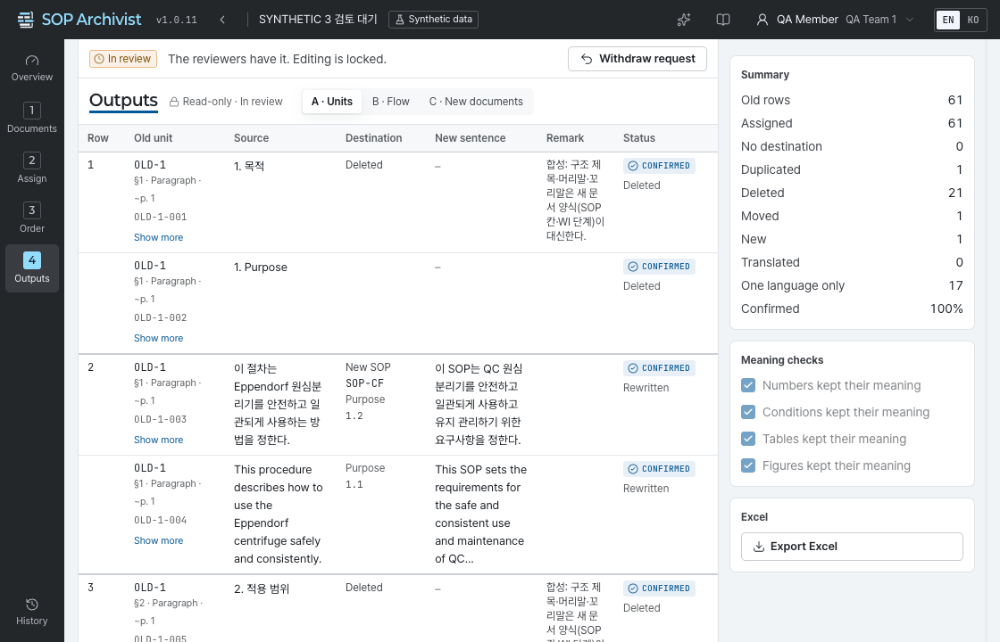

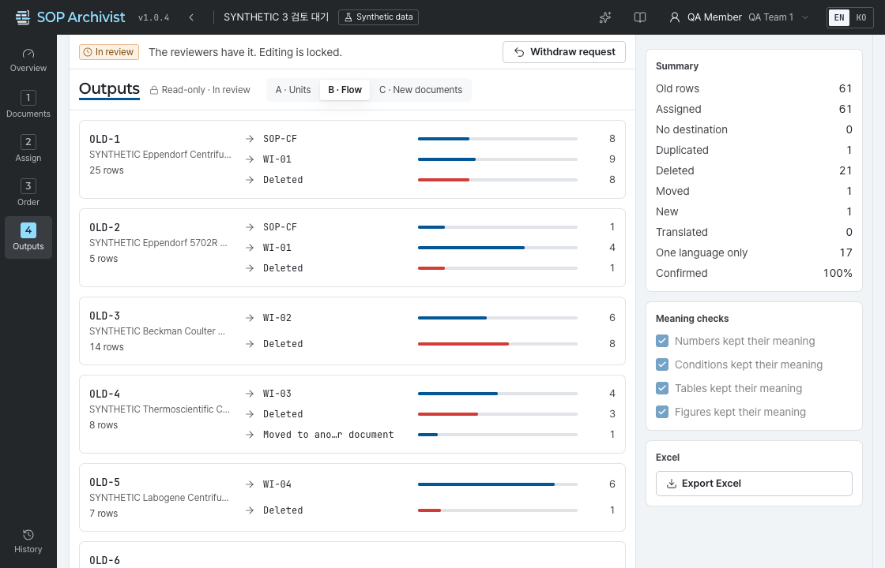

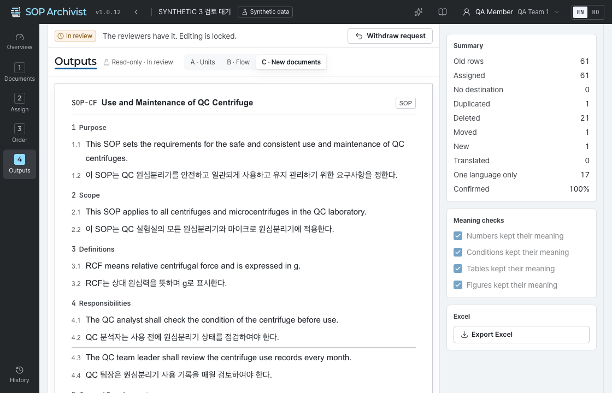

- 고른 탭은 이 브라우저에 기억됩니다.
- **A · Units** 는 의미 묶음(아래 용어)마다 줄을 모으고, 묶음 안은 문장마다 한 줄입니다. 짝 하나는 한글 줄과 영어 줄 두 줄, 번역 문장은 출처 줄 바로 뒤의 한 줄이고, 묶음 첫 줄 위에 굵은 선이 그어집니다. 열은 **Row**, **Old unit**, **Source**, **Destination**, **New sentence**, **Remark**, **Status** 입니다.
  - **Row** 는 묶음 번호이고 **Remark** 는 묶음이 함께 쓰는 사유라 묶음 첫 줄에만 보입니다. 옛 줄 묶음은 옛 문서 순서대로 1부터 매기고, 출처가 사라진 번역과 이미 쓴 New 문서의 신규 문장이 그 뒤를 잇습니다.
  - **Old unit** 은 옛 문서·위치·Unit ID, **Source** 는 원문입니다. 번역 줄과 신규 줄은 원문이 없어 '–'입니다. 표 줄의 **Source** 는 원문 캡션에 크기를 붙인 글("표 3. 운전 조건 [3×3]", 캡션이 없으면 "[표 1, 3×3]")이고, 그림 줄은 원문 캡션입니다. 딸린 캡션은 표·그림 줄 바로 뒤에 캡션 줄로 한 번 더 나와 그 줄의 **New sentence** 에 캡션 새 문장이 보입니다. 옛 문서 쪽이라 번호는 원문 그대로입니다.
  - **Destination** 은 보낸 곳 종류(**New SOP**, **WI**, **Deleted**, **Moved to another document**)와 새 문서 코드를 묶음 첫 줄에 보이고, 두 문서로 보내 보낸 곳이 바뀌는 줄에서 다시 보입니다. 칸 이름과 새 문서 안 섹션 번호(아래)는 줄마다 나오고, 같은 언어로 새 문장 여럿으로 나뉘었으면 ①② 차례로 적힙니다. 지우거나 다른 문서로 옮긴 줄은 **C · New documents** 아래의 **Deleted and moved** 에도 따로 모입니다.
  - **New sentence** 는 확정한 새 문장입니다. 아직 확정하지 않았으면 AI가 제안한 글을 점선 테두리 안에 보이고, 둘 다 없으면 '–'입니다.
  - **Status** 는 줄마다 자기 상태와 변경 종류입니다. 짝의 한쪽만 확정됐으면 두 줄의 상태가 다릅니다. 칸 제목으로 간 옛 제목은 **Slot heading**, 이미 쓴 New 문서에서 짝의 한쪽만 옛 문장과 맞춰졌을 때 다른 쪽은 **Translated · Added** 로 적힙니다.
  - **Source**·**New sentence**·**Remark** 의 글은 여섯 줄까지만 보입니다. 더 길거나 확정한 사람·시각·관계 묶음·검사 경고가 있으면 그 줄의 **Old unit** 칸에 **Show more** 가 나옵니다. 누르면 그 줄만 전부 펼쳐지고 **New sentence** 아래에 **Confirmed by**(이름과 ID), **Confirmed at**, **Group ID**, **Checks** 가 보입니다(**Show less** 로 접음). 키보드로도 누를 수 있습니다. 아주 긴 새 문서 코드는 가운데를 줄여 보이며 마우스를 올리거나 포커스를 두면 전체가 나옵니다.
- **B · Flow** 의 카드는 Old 문서마다 한 장이고, 옛 문서에서 각 새 문서로 가는 양을 줄 수(짝 하나는 한 줄, 그림은 한 번)로 셉니다. 보낸 곳이 여덟 개를 넘으면 여덟 개까지만 보이다가 'N more'(한국어 화면은 'N개 더')를 누르면 나머지가 펼쳐집니다(**Show less** 로 접음). 긴 새 문서 코드는 가운데를 줄여 보이고 전체는 마우스를 올리거나 포커스를 두면 나옵니다.
- **C · New documents** 는 칸마다 한글·영어 문장이 결과물 C 순서대로 한 목록입니다. 같은 의미에서 나와 이웃한 문장은 굵은 선으로 묶여 보입니다. 칸 제목으로 간 옛 제목은 칸 항목이 아니라 칸 머리 옆에 '← OLD-1 §5'처럼 흐리게 적힙니다. 넓은 표는 표 안에서 좌우로 스크롤됩니다. 표는 위에 캡션 줄(한글·영어 캡션이 둘 다 있으면 두 줄)을 두고, 그림은 [Figure] 대신 캡션 줄을 보입니다 — 캡션 줄마다 확정한 글, 없으면 AI가 제안한 글을 점선 테두리 안에 보이고, 번호는 아직 원문 그대로입니다. 표 칸의 번역은 같은 칸 안에 한 줄 더 쌓여 열이 밀리지 않습니다. 지우거나 다른 문서로 옮긴 줄은 아래 **Deleted and moved** 에 줄마다 한 번 나오고, 짝이면 두 문장이 한 항목에 줄을 바꿔 적힙니다. 긴 C는 처음에 앞부분만 그리고 아래로 내리면 이어서 그리며, **Deleted and moved** 는 마지막 줄까지 그린 뒤에 나옵니다.
- **C · New documents** 는 여기서 읽기만 합니다. 순서·들여쓰기·번호를 고치려면 위쪽 줄의 **Edit order** 로 [3단계 Order](#order)에 갑니다. 새 문서가 없으면 **Open To-Be** 로 가서 목록부터 적습니다.
- **문서 번호의 EQUIS 표시도 여기서 봅니다.** **B · Flow** 카드의 옛 문서 이름 아래에 [Documents의 EQUIS 표시](#document-equis)와 같은 한 줄이 붙고, 새 문서 번호 옆에는 아이콘만 붙습니다(올리면 뜻이 뜹니다). **C · New documents** 와 [3단계 Order](#order)에서는 문서 머리의 오른쪽에 보입니다. 표시를 누르면 지금 번호·정식 이름·지금 판과 시행일·소유 부서와 **Open in EQUIS** 가 펼쳐집니다. 읽기 전용이라 번호를 고치거나 다시 조회하지는 않고(그 일은 **Documents** 에서 합니다), 검토자에게도 보입니다. EQUIS에 묻지 않는 번호(빈 칸·임시 번호)와 EQUIS 조회를 쓰지 않는 서버에서는 아무것도 붙지 않습니다.

### 요약과 의미 확인 {#outputs-checks}

오른쪽 **Summary** 칸은 결과물 한 벌을 셉니다. 옛 쪽은 **Overview** 의 진행 숫자처럼 줄(짝 하나, 또는 짝 없는 문장·표·그림 하나)로 셉니다.

| 항목 | 세는 것 |
|---|---|
| **Old rows** | 옛 줄 수. **Overview** 진행 숫자의 전체와 같다 |
| **Assigned** | 갈 곳이 정해진 줄(삭제·이동 포함) |
| **No destination** | 아직 갈 곳이 없는 줄. 갈 곳 없이 보류한 줄과 구성 문장 일부만 판단한 줄도 든다 |
| **Duplicated** | 두 문서 이상으로 보낸 줄 |
| **Deleted** · **Moved** | 지운 줄, 다른 문서로 옮긴 줄 |
| **New** | 이미 쓴 New 문서에서 옛 문장과 맞춰지지 않은 신규 문장(짝은 하나로 셈) |
| **Translated** | 번역 줄(**Translated · Added** 포함)이 든 묶음 수 |
| **One language only** | 한 언어 문장만 있는 줄. 참고용이다 |
| **Confirmed** | 확정된 줄의 비율. '28%'처럼 적는다 |

**No destination** 은 **Overview** 와 **Assign** 의 **Unassigned** 와 다른 숫자입니다. **Unassigned** 는 판단 상태로 세고(보류한 줄은 **On hold** 로 따로 셈), **No destination** 은 갈 곳이 없는지로 세므로 갈 곳 없이 보류한 줄까지 듭니다.

**Meaning checks** 는 작성자가 결과물을 읽고 직접 표시하는 네 가지 확인입니다.

- **Numbers kept their meaning**: 숫자의 뜻이 그대로다
- **Conditions kept their meaning**: 조건의 뜻이 그대로다
- **Tables kept their meaning**: 표의 뜻이 그대로다
- **Figures kept their meaning**: 그림의 뜻이 그대로다

네 가지를 모두 표시해야 검토를 요청할 수 있습니다. 검토자가 돌려보내거나 작성자가 다시 열면 표시가 지워지므로 다시 확인합니다.

### Excel {#outputs-excel}

**Export Excel** 을 누르면 파일을 바로 받지 않고 미리보기 창이 먼저 열립니다. 창에는 파일과 같은 이름과 같은 순서의 시트 다섯 개가 탭으로 보이고, 각 시트는 파일에 들어갈 모양 그대로 그려집니다.

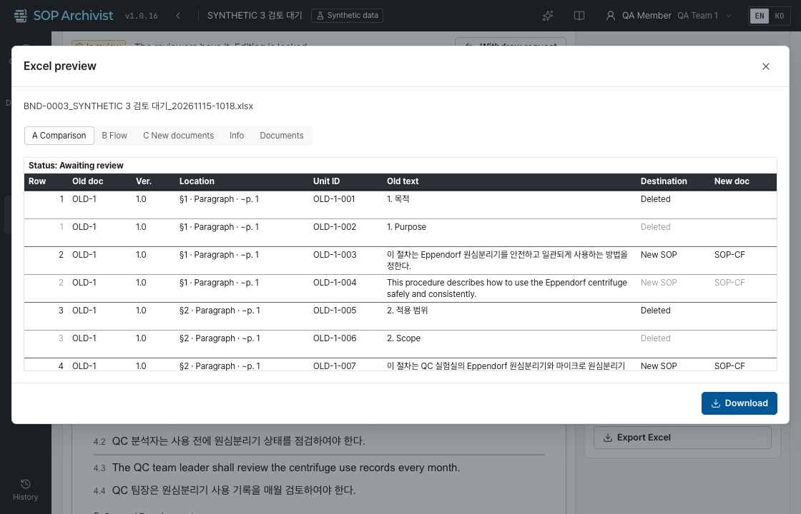

- `A Comparison`: 옛 문장과 새 문장을 줄마다 대조합니다. 같은 묶음에서 윗줄과 같은 함께 쓰는 칸(번호·보낸 곳·새 문서·비고)은 흐린 글자로 되풀이됩니다. 값이 같다는 표시일 뿐 칸이 비어 있는 것이 아닙니다. 묶음이 시작되는 줄은 굵은 선으로 나뉩니다.
- `B Flow`: 흐름 요약과 흐름도 그림입니다.
- `C New documents`: 새 문서와 항목입니다. 표·그림 줄에는 `[Table]`·`[Figure]` 대신 확정한 캡션 글이 적힙니다(확정한 캡션이 없을 때만 표시). 그 아래 한 단계 들여 캡션 줄(칸 위치 `Caption`)이 칸 줄처럼 제 확정 글·AI 제안 글·상태와 함께 먼저 오고, 표의 칸 줄이 뒤를 잇습니다. 이미지는 넣지 않습니다.
- `Info`: Bundle 정보와 요약 숫자입니다.
- `Documents`: Bundle의 옛 문서와 새 문서 목록입니다. 문서 번호·제목·올린 판 옆에 EQUIS에서 받아 둔 값(표시, 지금 번호, 지금 판, 시행일, 소유 부서, EQUIS 링크)이 실립니다. EQUIS가 모르는 번호는 `Not in EQUIS`, 옛 번호처럼 한 번 볼 줄은 `Check: …`로 적힙니다. 내보낼 때 새로 조회하지는 않습니다 — **Documents** 화면에 보이는 값 그대로입니다.

줄이 아주 많은 시트는 앞부분만 보이고 안내 문구가 나옵니다. 파일에는 모든 줄이 들어 있습니다. 확인했으면 **Download** 를 누릅니다. 파일 이름은 서버가 짓습니다. 꼴은 `BND-0004_제목_20261113-0905.xlsx` 처럼 Bundle 코드, 제목, 내보낸 시각(KST)입니다. 결과물이 한 벌이라 Bundle마다 파일도 하나입니다.

## Review {#review}

작성자가 검토를 요청하면 Bundle이 잠기고 검토자가 읽습니다. 검토는 따로 화면이 없고 **Outputs**(4단계) 맨 위의 검토 띠에서 합니다 — 결과물을 읽는 자리에서 요청하고, 읽고, 끝냅니다. 띠에는 지금 상태와 한 줄 안내가 보이고, 오른쪽 끝의 단추가 사람과 상태에 따라 바뀝니다.

| 누가 · 언제 | 띠의 단추 |
|---|---|
| 작성자 · **In progress** | **Request review**. 조건이 남아 있으면 꺼져 있고 옆의 **See what is left** 가 **Overview** 의 조건 카드로 갑니다 |
| 작성자 · **In review** | **Withdraw request** |
| 검토자 · **In review** | **Return**, **Complete review** |
| 작성자 · **Review complete** | **Reopen** |

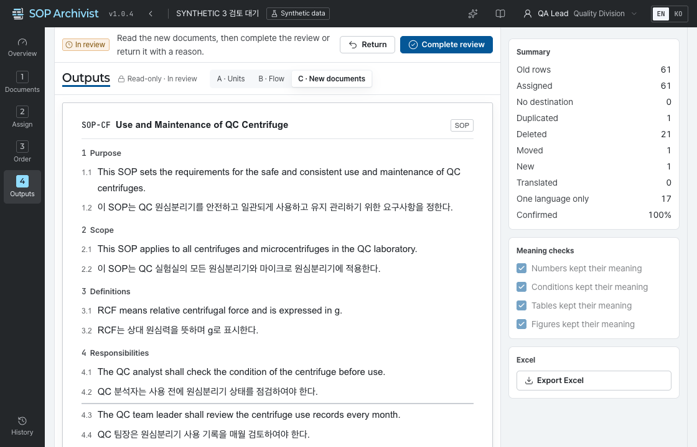

### 요청 조건 {#review-gates}

**Overview** 의 **Review request** 카드에 조건 여덟 가지가 보입니다. 모두 통과해야 **Request review** 가 켜집니다.

| 조건 | 통과하려면 |
|---|---|
| **Documents loaded** | 문서가 한 편 이상 있고 **Rejected**·**Failed** 인 문서가 없다 |
| **All versions filled** | **Documents** 에서 읽은 Old 문서마다 버전을 적었다. 적은 그대로 Excel에 나간다 |
| **All rows decided** | 모든 줄이 **Confirmed** 다. 미배정·AI 제안·보류가 남아 있지 않다 |
| **All new sentences decided** | 모든 새 문장이 확정됐다. 출처 없는 새 문장이 남아 있지 않다 |
| **Missing-text warnings closed** | **Assign** 의 경고 표시에서 누락 의심 경고를 모두 확인했다 |
| **Reasons filled** | 지우기·옮기기·두 문서로 보내기에 사유를 적었다 |
| **Meaning checks done** | **Outputs** 의 의미 확인 네 가지를 표시했다 |
| **Reviewer assigned** | 활동 중인 검토자가 한 명 이상 있다 |

### 작성자가 하는 일 {#review-author}

1. **Outputs** 의 검토 띠나 **Overview** 에서 **Request review** 를 누릅니다. 작성자만 요청할 수 있습니다.
2. Bundle이 **In review** 가 되고 모든 단계가 읽기 전용이 됩니다(**Read-only · In review**).
3. 검토자가 끝내기 전에 고칠 것이 생기면 **Overview** 의 **Review request** 카드나 **Outputs** 의 검토 띠에서 **Withdraw request** 를 누릅니다. 사유는 적지 않습니다. Bundle이 **In progress** 로 돌아오고 의미 확인 표시가 지워집니다. 거두기는 작성자만 합니다.
4. 돌려받으면 **Overview** 와 **Outputs** 의 오른쪽 칸 맨 위에 **Returned by the reviewer** 와 사유가 보입니다. 고친 뒤 의미 확인을 다시 표시하고 다시 요청합니다.
5. 검토가 끝난 Bundle을 고쳐야 하면 **Outputs** 의 검토 띠에서 **Reopen** 을 누르고 사유를 적습니다. Bundle이 **In progress** 로 돌아옵니다. 다시 열기는 작성자만 합니다.

### 검토자가 하는 일 {#review-reviewer}

1. Bundle 목록에서 **In review** 인 Bundle을 열어 **Outputs**(4단계)로 갑니다. **Overview** 의 다음 할 일이 그곳으로 데려갑니다.
2. 결과물 세 탭을 읽습니다. 어떤 Old 문장이 어디로 갔는지는 **Assign**(2단계)에서 문장을 눌러 봅니다 — 보낸 곳, 변경 종류, 사유, 확정한 사람이 오른쪽에 보입니다. 검토자는 내용을 고칠 수 없습니다(**Read-only · Reviewer**).
3. 문제가 없으면 **Complete review** 를 누릅니다. Bundle이 **Review complete** 가 됩니다.
4. 고칠 것이 있으면 **Return** 을 누르고 사유를 적습니다. Bundle이 **In progress** 로 돌아가 작성자가 고칩니다.

> [!NOTE]
> **Review complete** 는 재구성 결과의 확인이 끝났다는 뜻입니다. 정식 승인은 EQUIS에서 합니다.

## Map {#map}

Bundle을 건너 어느 문서가 어느 문서를 가리키는지, 그 문서들이 무엇으로 바뀌는지 보는 화면입니다. 이런 물음에 답합니다.

- 내 문서가 가리키는 문서는 무엇으로 바뀌나 — 그 문서를 다른 Bundle이 재구성하고 있으면 새 문서에 적을 번호가 여기 보입니다.
- 누가 내 문서를 가리키나 — 내 문서 번호가 바뀌면 고쳐야 할 곳입니다.
- 내가 보낸 줄(**Moved to**)의 대상 문서는 어느 Bundle에 있나.
- 가리켜지는데 아무도 맡지 않은 문서는 무엇인가(**Not in any Bundle**).

읽기만 하는 화면입니다. 참조 번호 확인, 새 문장, 보낼 곳은 **Assign** 에서 고칩니다. 검토 중이거나 검토가 끝난 Bundle에서도, 검토자에게도 똑같이 보입니다. 이 Bundle에 문서가 아직 없어도 열립니다 — **No documents yet** 이 보여도 찾기와 **All Bundles** 로 다른 Bundle의 문서를 찾아볼 수 있습니다.

처음에는 지도로 보입니다. 도구 줄의 **Map** · **List** 로 지도와 표를 바꿉니다 — 같은 자료를 그림과 표로 보이는 것이고, 범위·거르기·찾기·고른 문서는 그대로 따라갑니다.

- 지도의 세로 줄기 하나가 Bundle 하나, 줄기 안의 상자(마디) 하나가 문서 하나입니다. 줄기 머리에는 Bundle 코드와 이름, 소유 표시, 상태, 문서 수가 있습니다. 첫 줄기가 이 Bundle이고, 그 옆으로 이 Bundle과 줄이 많이 이어진 Bundle부터, 맨 끝에 **Not in any Bundle** 이 섭니다.
- 마디의 첫 줄은 문서 번호이고, 오른쪽 위의 `→ SOP-UV +1` 은 그 문서가 바뀔 New 문서(첫 번호와 나머지 수)입니다. 둘째 줄은 제목입니다. 다른 문서를 받는 New 문서는 번호 앞에 `NEW` 가 붙습니다. 글이 길면 잘리고, 마디에 포인터를 올리거나 초점을 두면 전체가 뜹니다. 확대를 75%보다 줄이면 제목 줄은 감춥니다.
- 파란 것은 이 Bundle, 회색은 다른 Bundle, 점선 테두리는 **Not in any Bundle** 입니다. 색만으로 가르지 않습니다 — 마디 왼쪽 막대와 줄기 머리의 소유 표시 글자가 함께 말합니다.
- 선은 가리키는 문서에서 가리켜지는 문서로 이어지고 도착 쪽 끝에 점이 있습니다. 모양이 셋입니다 — 실선은 확인한 참조, 짧은 점선은 **REF?**(확인 전 참조), 긴 점선은 **Moved to**(다른 문서로 보낸 줄)입니다. 이 Bundle에서 나가는 선은 파랗고(이 Bundle의 **REF?** 는 Assign의 **REF?** 와 같은 색), 들어오는 선과 다른 Bundle끼리의 선은 회색입니다.
- 마디에 포인터를 올리면 그 문서와 이어진 선·문서만 진해집니다. 마디를 누르면 그 문서를 고르고 오른쪽 칸에 엽니다. 다시 누르거나 지도의 빈 곳을 누르면 고름이 풀립니다. 고른 동안에는 다른 마디에 올려도 고른 문서의 선이 진한 채입니다.
- 줄기 머리의 **Collapse** · **Expand** 로 줄기를 접고 폅니다. 접은 줄기는 머리만 남고 그 문서에 닿는 선도 그리지 않습니다(**List** 에는 그대로 보입니다). 자물쇠는 내가 구성원이 아닌 Bundle이라는 표시입니다.
- **Linked to this Bundle** 에서 다른 Bundle 줄기의 맨 아래 "문서 N개 더"(**List** 에는 없는 줄)는 그 Bundle의 Old 문서 가운데 이 Bundle과 이어지지 않아 감춘 수입니다. 누르면 **All Bundles** 로 넘어가 그 줄기를 편 채 엽니다. **All Bundles** 에서는 이 Bundle과 선으로 이어지지 않은 줄기가 접힌 채 시작합니다.
- **List** 의 열은 **From**(가리키는 문서), **To**(가리켜지는 문서), **Becomes**(**To** 문서가 바뀔 New 문서), **Bundle**(맞은편 문서의 Bundle), **State**, **Lines**(그 선에 든 줄 수)입니다. 번호와 제목은 두 줄까지 보이고, 칸에 포인터를 올리면 전체가 뜹니다.
- **State** 는 셋입니다. **Confirmed** 는 사람이 확인한 참조 줄, **REF?** 는 줄이 문서 번호로 시작해 앱이 제안했지만 아직 확인하지 않은 줄, **Moved to** 는 Assign에서 다른 문서로 보내기로 확정한 줄입니다.
- 범위는 둘입니다. **Linked to this Bundle**(기본)은 이 Bundle의 문서와 그 문서에 선으로 이어진 문서만, **All Bundles** 는 읽힌 Old 문서가 있는 모든 Bundle의 문서와 Bundle끼리의 선까지 보입니다. 범위와 거르기는 들어올 때마다 기본으로 돌아갑니다.
- **REF? only** 를 켜면 확인 전 참조만 남고, **Moved to** 를 끄면 보낸 줄이 빠집니다.
- 찾기 칸(<kbd>/</kbd>로 바로 갑니다)에 문서 번호나 제목의 일부를 넣으면 지도에서는 맞는 문서만 진하고 나머지는 흐려지며, **List** 에는 그 문서가 든 줄만 남습니다. <kbd>Enter</kbd>를 누를 때마다 맞는 다음 문서를 지도 순서(줄기 순서, 줄기 안 순서)로 골라 오른쪽 칸에 엽니다 — 접힌 줄기의 문서면 그 줄기를 펴고 그 문서가 보이게 옮깁니다. **Linked to this Bundle** 에서 맞는 것이 없으면 **Search all Bundles** 가 나타나 같은 글로 모든 Bundle에서 찾습니다. 맞는 줄이 하나도 없으면 **Clear filters** 로 찾기와 거르기를 지웁니다.
- 지도는 들어올 때와 **Read again** 을 누를 때만 읽습니다. 그사이 다른 사람이 고친 것은 **Read again** 으로 봅니다.
- **List** 에서 줄을 누르거나 줄에 초점을 두고 <kbd>Enter</kbd>를 누르면 맞은편 문서가 오른쪽 칸에 열립니다 — 소유 표시, 번호, 제목, **Bundle**, **Status**, **Becomes**, 그 문서가 가리키는 문서와 그 문서를 가리키는 곳의 줄 수. 그 목록의 줄을 누르면 그 문서로 옮겨 갑니다. 이 Bundle이나 내가 구성원인 Bundle의 Old 문서면 **Open in Assign** 으로 그 Bundle의 Assign에서 그 문서를 엽니다. <kbd>Esc</kbd>나 **Clear selection** 으로 고름을 풉니다.
- 아무것도 고르지 않았으면 오른쪽 칸에 이 Bundle의 요약(가리키는 줄과 문서 수, 가리켜지는 줄과 Bundle 수, 확인하지 않은 참조 번호 수, 어느 Bundle에도 없는 문서 수)과 선 모양 풀이가 보입니다. 이 Bundle을 다른 문서와 잇는 줄이 없으면 **No references yet** 이 뜹니다.
- 선은 문서 번호 꼴(영문자로 시작해 영문자·숫자 마디를 하이픈으로 잇고 숫자로 끝나는 번호, 예: `SOP-ABC-1016`)인 번호끼리만 맞춰 긋습니다 — 이 Bundle 안에서도 같아서 번호가 그 꼴이 아닌 문서(양식 번호 `QP 07`, `SOP-CF` 같은)는 다른 문서의 선을 받지 않고(그 문서의 줄이 번호 꼴인 다른 문서를 가리키면 그 선은 그어집니다), 번호 없이 올린 New 문서의 임시 번호(`NEW-…`)는 맞추지 않습니다.
- 합성 Bundle과 실제 Bundle은 서로의 지도에 나오지 않습니다.

### 남의 Bundle은 어디까지 보이나 {#map-visibility}

- 문서마다 소유 표시가 붙습니다. **This Bundle** 은 지금 연 Bundle, **Other Bundle · member** 는 내가 구성원인 Bundle입니다. **Other Bundle · summary only** 는 Bundle 이름 대신 코드(`BND-0018`)만 보이고, 문서 번호·제목·상태·바뀔 문서·줄 수만 보입니다. 문장을 보려면 그 Bundle의 구성원이어야 합니다. 구성원이 아닌 Bundle의 문서에는 **Open in Assign** 이 없습니다.
- **Not in any Bundle** 은 어느 Bundle도 올리지 않은 번호입니다. 누군가 가리키지만 아무도 재구성하지 않는 문서라, 그 번호를 쓴 Bundle끼리 누가 맡을지 정해야 합니다.
- 확인 전 참조(**REF?**)는 이 Bundle의 줄과, 내가 구성원인 Bundle의 줄 가운데 이 Bundle의 문서를 가리키는 것만 선이 됩니다. 구성원이 아닌 Bundle에서는 사람이 확인한 참조와 확정한 **Moved to** 만 선으로 나옵니다.
- 모든 Bundle의 문서 번호·제목·상태·바뀔 문서는 어느 Bundle의 구성원이든 봅니다(Old 문서의 제목은 보통 올린 파일 이름에서 번호를 뺀 나머지입니다). Bundle 이름과 문장은 그 Bundle의 구성원만 봅니다.

### 바뀔 문서 읽는 법 {#map-becomes}

- **Becomes** 는 그 Old 문서의 문장을 받은 New 문서입니다. 사람이 확정한 새 문장만 셉니다 — AI 제안이나 보류는 세지 않습니다.
- Bundle이 **Review complete** 가 되기 전에는 바뀔 수 있어서 흐린 글자로 적고 "May change until the Bundle is Review complete"를 덧붙입니다.
- **Not decided yet** 은 그 Bundle이 아직 작업 중이고 확정한 새 문장이 없다는 뜻입니다. **No successor document** 는 검토가 끝났는데 이 문서의 문장을 받은 New 문서가 없다는 뜻입니다. **Nobody is restructuring this document** 는 어느 Bundle도 이 번호의 문서를 올리지 않았다는 뜻입니다.
- 번호 없이 올린 New 문서는 임시 번호 대신 제목만 보입니다.

## History {#history}

Bundle에서 일어난 일을 시간순으로 보는 화면입니다.

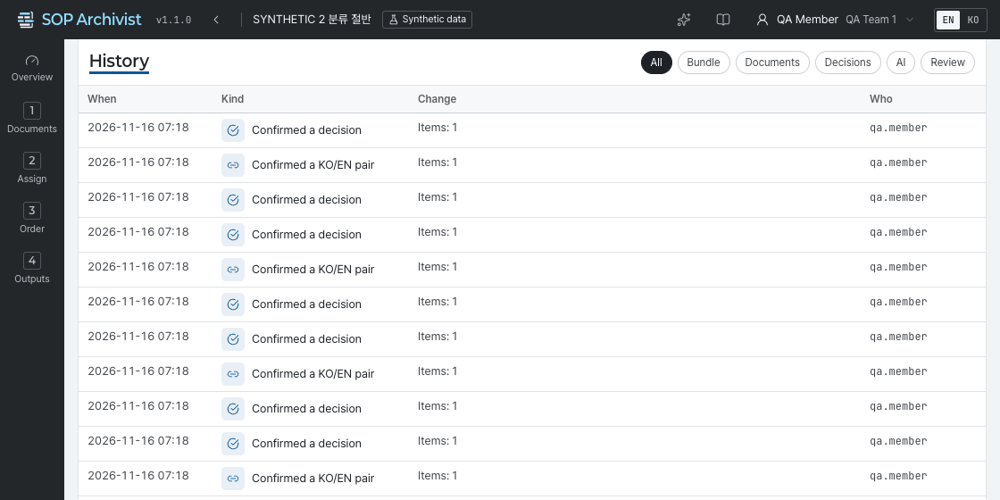

- 열은 **When**, **Kind**, **Change**, **Who** 입니다. **Change** 는 두 줄까지만 보이니, 긴 사유는 줄을 열어 전체를 읽습니다.
- 위쪽 단추로 종류를 거릅니다: **All**, **Bundle**, **Documents**, **Decisions**, **AI**, **Review**.
- 줄을 누르거나 줄에 초점을 두고 <kbd>Enter</kbd>를 누르면 자세한 내용이 열립니다.
- AI는 요청·취소·다시 시도만 기록됩니다. 제안을 확정한 것은 사람의 판단(**Decisions**)으로 남습니다.

## AI가 하는 일, 하지 않는 일 {#ai}

AI는 제안만 합니다. 사람이 줄마다 확인해 확정하기 전에는 아무것도 결정되지 않습니다.

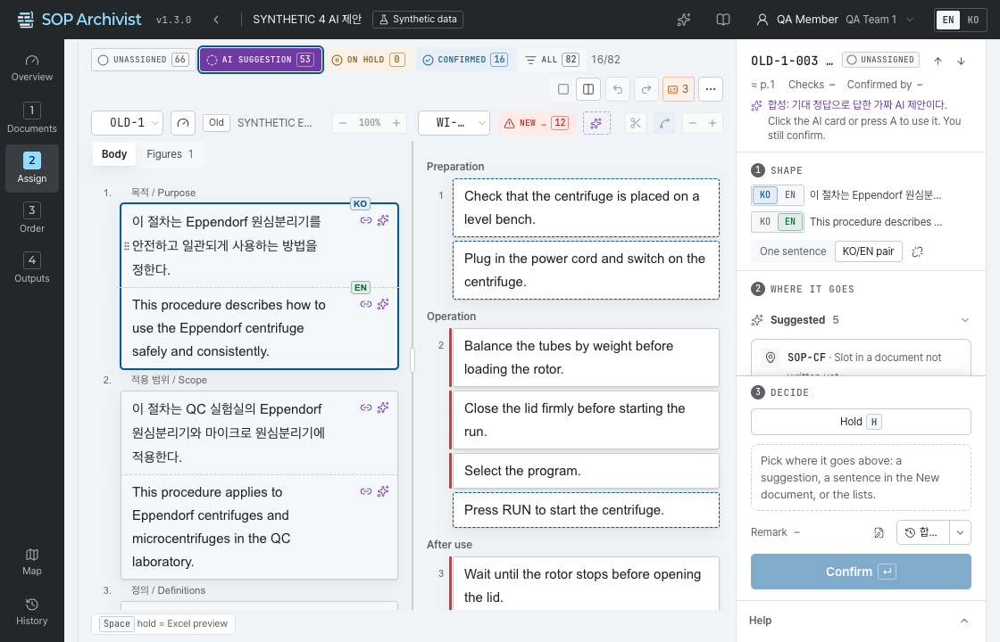

### 제안의 종류 {#ai-kinds}

| 종류 | 제안하는 것 | 요청하는 곳 |
|---|---|---|
| **Classify** | Unit을 보낼 칸과 한·영 고쳐 쓴 문장 | **Assign** 의 **Ask AI**, **AI** → **Classify the whole document** |
| **Translate** | 한쪽 언어만 있는 새 문장의 번역 | **AI** → **Translate to EN** · **Translate to KO** |
| **Match** | Old Unit과 이미 쓴 New 문장의 짝과 변경 종류 | **AI** → **Ask AI to match** |
| **KO/EN pair** | 한글과 영어가 따로 있는 문서의 한/영 짝 | **Assign** 의 **AI** 메뉴에 있는 **AI pair**(한글·영어가 따로 적힌 문서에서만 나온다) |
| **New document list** | 계획 파일·글에 적힌 새 문서 목록(번호·제목·종류·상위 SOP·단계) | **Documents** 의 **New documents** 목록 `⋯` 메뉴 → **Read a list with AI…** ([AI로 목록 읽기](#tobe-ai)) |
| **Split** | 여러 뜻이 섞인 문장을 나눌 자리 | **Assign** 의 **AI** 메뉴에 있는 **AI split whole document**(30자보다 짧은 문장은 일괄로는 보내지 않는다)와 **Suggest a split for this row** |

### 요청하고 확인하기 {#ai-flow}

1. 위 단추로 요청합니다. 요청은 쌓였다가 차례로 처리되므로 기다리지 않고 다른 일을 해도 됩니다.
   이미 줄 서 있는 AI 작업을 같은 범위로 다시 누르면 새로 쌓지 않고 그 작업이 앞으로 옵니다 — 예를 들어 **Classify the whole document** 를 누르면 그 문서의 줄 선 분류가 앞으로 오고, **Ask AI to match** 를 누르면 줄 선 짝 맞추기 작업이 앞으로 옵니다.
2. 진행 상황은 어느 화면에서든 상단 바의 AI 작업 표시에서 봅니다([진행 보기](#ai-progress)). Bundle 하나의 종류별 수는 **Overview** 의 **AI job** 카드에 있습니다.
3. 제안이 오면 **Assign** 의 **AI suggested** 탭에 모입니다. 원문과 견주어 본 뒤 **Confirm**(그대로 확정)이나 **Edit and confirm**(고쳐서 확정)을 누릅니다.
   Old 문서와 이미 쓴 New 문서가 둘 다 읽히면 묶기 제안은 누르지 않아도 저절로 시작됩니다. 서버에서 저절로 도는 AI를 끈 경우에는 **Ask AI to match** 를 눌러야 합니다.
   작성자가 **Assign** 에 들어오면 아직 배정하지 않은 줄의 분류도 저절로 시작되고, 오른쪽 위에 "AI is suggesting the remaining n rows in the background." 알림이 뜹니다. Old 문서마다 한 번만 시작합니다 — 들어올 때마다 다시 쌓지 않고, 취소한 문서도 다시 저절로 시작하지 않습니다(그때는 **Classify the whole document** 를 누릅니다). 나중에 올린 Old 문서는 다음에 들어올 때 시작합니다. 글이 똑같은 New 문장이 있는 줄은 사람이 한 번에 확정할 수 있게 AI에 보내지 않습니다. 저절로 시작한 작업보다 직접 누른 요청이 먼저 처리되고, 줄 서 있는 문서에 **Classify the whole document** 를 누르면 그 문서가 앞으로 옵니다. 저절로 시작한 작업만 끝나는 동안에는 화면이 제안을 15초에 한 번씩만 다시 받아 오므로, 제안은 15초 안에 화면에 나옵니다(직접 누른 요청이 끝나면 바로 받아 옵니다).
   짝 맞추기(**Ask AI to match**)는 묶기 제안이 먼저 옵니다. 어느 Old Unit이 어느 New 문장과 이어지는지는 AI의 답을 기다리지 않고 바로 보이고, 변경 종류는 처음에 정해 둔 잠정값(구조로 정하는 나눔·합침, 글이 같으면 그대로, 그 밖은 고쳐 씀)입니다. 문장마다 AI의 답이 오면 그 변경 종류와 사유로 바뀝니다. 띄어쓰기만 다른 짝은 AI에 묻지 않고 바로 말투로 적힙니다. 다시 눌러도 바뀌지 않은 짝은 그대로 두어, AI가 고친 변경 종류가 처음으로 돌아가지 않습니다.
4. 나누기 제안은 **Apply split** 으로 적용하거나 **Dismiss** 로 버립니다. **Assign** 에서는 위쪽 줄의 보라색 제안 수를 누르면 다음 제안이 붙은 줄로 가고, 오른쪽 칸 맨 위에 잘린 모습이 미리 보입니다 — 거기서 적용하거나 버리고, 적용한 것은 <kbd>Ctrl</kbd>+<kbd>Z</kbd>로 되돌립니다. 배정이 있는 문장은 적용할 때 한 번 묻고 배정을 풀며 자릅니다.

> [!WARNING]
> AI 제안은 한꺼번에 확정할 수 없습니다. 틀릴 수 있으므로 줄마다 원문과 견주어 봅니다. 마지막 판단은 사람의 몫입니다. 여러 줄을 한 번에 지우거나 옮길 때는 AI 제안 줄도 고를 수 있지만, 그때는 제안을 받아들이는 것이 아니라 사람이 고른 처분으로 덮습니다([여럿을 한 번에](#assign-bulk)).

### 진행 보기 {#ai-progress}

상단 바 오른쪽의 반짝이 아이콘이 내가 속한 Bundle의 AI 작업 상태입니다. 최근 24시간 동안 작업이 없으면 보이지 않습니다.

- 작업이 대기·실행 중이면 돌아가는 표시와 요청 수가 나옵니다.
- 아직 보지 않은 실패가 있으면 빨간 배지에 그 수가 나옵니다. 목록을 열어 보면 사라집니다.
- 상태를 받지 못하면 작은 점이 붙고, 저절로 다시 묻습니다.
- 아이콘에 마우스를 올리면 지금 상태를 글로 보여 줍니다.

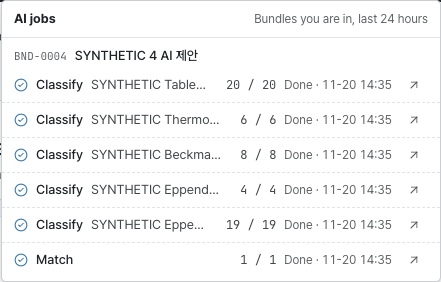

누르면 **AI jobs** 목록이 열립니다. Bundle마다 요청이 한 줄씩이고, 아직 도는 요청과 그 Bundle이 위에 옵니다. 한 줄에는 종류, 문서(문서 하나에 대한 요청일 때), 성공한 작업 수 / 전체 작업 수(실패한 것은 빠져 `12 / 14`처럼 적힙니다), 상태와 시간이 있습니다. 끝나서 실패가 없는 요청은 상태·시간·화살표까지 한 줄에 모입니다. 상태는 **Queued**(차례를 기다림)·**Running**(경과 시간)·**Done**·**Failed**·**Not applied**·**Cancelled** 입니다. 누르지 않았는데 저절로 시작한 요청(배정 화면에 들어올 때의 분류, 묶기 제안의 변경 종류 다듬기)은 종류 옆에 **Background** 표시가 붙습니다 — 마우스를 올리거나 포커스를 두면 설명이 뜹니다. 직접 눌러 앞으로 당긴 뒤에도 표시는 그대로입니다.

- **Failed**: 실패 이유가 함께 보입니다([실패했을 때](#ai-errors)).
- **Not applied**: 요청한 뒤 그 글이 바뀌어 AI의 답을 쓰지 않았습니다. 필요하면 다시 요청합니다.
- **Cancelled**: 누군가 취소했거나 Bundle이 **In progress** 에서 벗어나 끝나기 전에 멈췄습니다.
- 작업 하나가 3분 넘게 돌면 오래 걸린다는 안내가 나옵니다. 멈췄을 수 있으니 취소하고 다시 요청해 봅니다.

내가 한 요청이면 **Cancel**(도는 중)과 **Retry**(실패가 있을 때)를 누를 수 있습니다. 두 단추는 그 요청만이 아니라 그 Bundle의 같은 종류 작업 전체에 듣고, 결과는 그 줄 아래에 적힙니다. 줄 끝의 화살표는 결과를 보는 화면(Assign·Split·Documents)으로, Bundle 이름은 **Overview** 로 데려갑니다. 다른 멤버의 요청도 보이지만 취소·다시 시도는 요청한 사람이 합니다.

내가 한 요청이 끝나면 어느 화면에 있든 오른쪽 위에 알림이 뜹니다. 실패는 이유와 함께 빨간 알림으로, 반영되지 않았거나 취소된 것은 설명 알림으로 나옵니다. 목록이 열려 있으면 알림은 목록을 가리지 않게 그 왼쪽에 뜹니다. 다른 탭을 보는 동안 끝난 요청의 알림은 이 탭으로 돌아왔을 때 뜹니다.

**Documents** 에서는 문서를 올린 뒤 AI가 문서 번호·버전을 읽는 동안 번호 칸 옆에 돌아가는 표시가 보입니다.

### 지켜지는 것 {#ai-rules}

- AI는 사람이 확정했거나 보류한 줄을 덮어쓰지 않습니다.
- AI가 답하는 사이 사람이 그 Unit을 고쳤으면 그 제안은 버려집니다.
- AI의 답이 맞지 않으면 그 Unit만 **On hold** 가 되고 사유에 **The AI answer was invalid** 가 적힙니다. 짝 맞추기는 예외라 묶기 제안이 잠정 변경 종류 그대로 남습니다 — 확정할 때 변경 종류를 살펴봅니다.
- 관련된 Unit이 바뀌어 다시 봐야 하는 줄은 **A related unit changed** 사유로 보류됩니다.
- 직원의 이름은 AI로 보내지 않습니다.
- AI가 꺼져 있거나 실패해도 모든 단계는 손으로 끝까지 할 수 있습니다. 이때 **AI job** 카드에 **AI is not connected yet. Every step works by hand.** 가 보입니다.

### 실패했을 때 {#ai-errors}

| 표시 | 뜻과 할 일 |
|---|---|
| **Timed out** · **AI server error** · **Connection failed** | AI 서버 쪽 문제. 잠시 뒤 **Retry failed** 를 누른다 |
| **AI not configured** | AI가 꺼져 있다. 관리자에게 알린다 |
| **Interrupted** | 서버가 다시 시작돼 작업이 끊겼다. **Retry failed** 를 누른다 |
| **No candidates** | 보낼 곳 후보가 없다. **Documents** 의 **New documents** 목록을 먼저 채운다 |
| **Request rejected** · **Internal error** | 되풀이되면 관리자에게 알린다 |

## 계정, 권한, 관리 {#account}

### 내 계정 {#my-account}

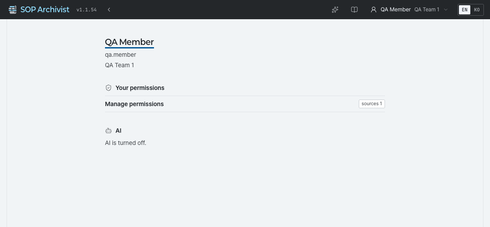

**My account** 에서 이름·아이디·부서와 **Your permissions** 를 봅니다. 권한마다 한 줄이고, 줄 끝의 `sources 2`(출처 2)처럼 출처 수를 적은 표시에 포인터를 올리거나 키보드로 포커스를 주면 그 권한을 어디서 받았는지(사람·부서, 역할 또는 직접 부여)가 목록으로 뜹니다. **AI** 칸은 지금 AI를 쓸 수 있는지 알려 줍니다.

### 권한 {#permissions}

| 권한 | 키 | 할 수 있는 일 |
|---|---|---|
| **Create bundles** | `bundle.create` | 새 Bundle을 만든다 |
| **Manage all bundles** | `bundle.admin` | 구성원이 아닌 Bundle도 관리한다 |
| **Manage AI guidelines** | `guideline.manage` | AI 지침을 고치고 켠다 |
| **Manage AI** | `ai.admin` | AI 연결을 시험하고 사용량을 본다 |
| **Manage permissions** | `permission.manage` | 역할과 권한을 준다 |
| **Run directory sync** | `directory.sync` | 직원·부서 정보를 다시 받아 온다 |
| **View system status** | `system.view` | 배치 작업과 시스템 상태를 본다 |

- 권한은 사람이나 부서에 줍니다. 부서에 주면 그 아래 부서까지 내려갑니다.
- 권한은 더하기만 있습니다. 한 사람의 권한은 직접 받은 것과 소속 부서가 받은 것을 합친 것입니다.
- Bundle을 보고 고치는 것은 권한이 아니라 구성원 여부로 정해집니다. 다만 **Map** 의 요약(문서 번호·제목·상태·바뀔 문서)은 어느 Bundle의 구성원이든 봅니다. Bundle 이름과 문장은 그 Bundle의 구성원만 봅니다. 권한이 필요하면 관리자에게 요청합니다.

### 관리 화면 {#admin}

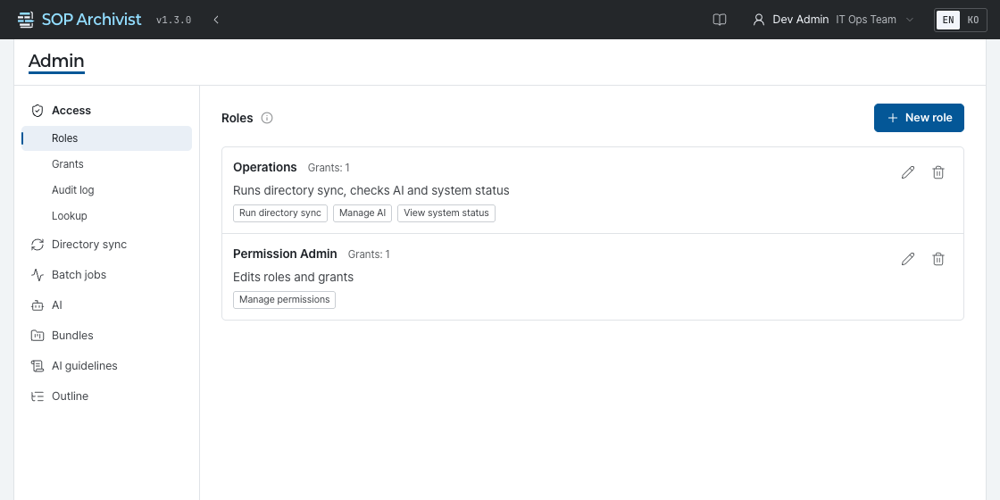

| 메뉴 | 하는 일 |
|---|---|
| **Access** | **Roles**(권한 묶음), **Grants**(사람·부서에 주기), **Audit log**(바꾼 기록), **Lookup**(한 사람의 실제 권한 보기) |
| **Directory sync** | 직원·부서 정보 동기화 기록과 바로 실행. 이 서버에 직원 동기화가 설정되어 있지 않으면 단추 줄 위에 안내가 뜨고 두 단추는 꺼집니다 |
| **Batch jobs** | 백업 같은 정기 작업의 결과 |
| **AI** | **Test connection** 으로 연결을 시험하고 **Daily usage** 로 사용량을 본다 |
| **Bundles** | 모든 Bundle의 목록과 관리. 구성원 단추는 카드에서 맨 아래 줄 오른쪽 끝에 있고, 누르면 창 머리가 "멤버 — 코드 제목"으로 열립니다(긴 제목은 두 줄까지, 초점을 두면 전체가 툴팁으로 보임) |
| **AI guidelines** | AI에 주는 지침. **Edit as a new version** 으로 고쳐 **Save version** 으로 저장한다 |

> [!WARNING]
> AI 지침은 저장만으로는 바뀌지 않습니다. **Activate** 를 눌러야 그 버전을 AI가 씁니다.

## 문제 해결 {#faq}

| 증상 | 까닭 | 할 일 |
|---|---|---|
| Bundle이 목록에 없다 | 구성원이 아니다 | 작성자에게 구성원으로 넣어 달라고 한다 |
| **New bundle** 이 보이지 않는다 | `bundle.create` 권한이 없다 | 관리자에게 권한을 요청한다 |
| 단계가 잠겨 있다 | 올린 문서가 없다 | **Documents** 에서 문서를 올린다 |
| 문서가 **Rejected** 또는 **Failed** 다 | 받을 수 없는 파일이거나 읽다가 실패했다 | [받지 못한 파일](#upload-rejected)을 보고 고쳐 다시 올린다. 남겨 두면 검토를 요청할 수 없으니 지운다 |
| 고칠 수 없고 읽기 전용이다 | 검토 중이거나 검토가 끝났거나 내가 검토자다 | 검토 중이면 작성자가 **Withdraw request** 로 요청을 거두거나 검토자가 돌려줘야 하고, 검토가 끝났으면 작성자가 **Reopen** 해야 고칠 수 있다 |
| **Request review** 가 꺼져 있다 | 조건이 남아 있거나 내가 작성자가 아니다 | **Review request** 카드의 빨간 줄을 눌러 하나씩 푼다 |
| 저장하면 충돌이라고 나온다 | 다른 사람이 먼저 바꿨다 | 화면을 새로 받아 다시 한다 |
| AI 단추가 없거나 눌러도 안 된다 | AI가 꺼져 있다 | 손으로 진행한다. **My account** 의 **AI** 칸에서 상태를 본다 |
| 다시 로그인하라고 나온다 | 세션이 끝났다 | 로그인하면 보던 화면으로 돌아온다 |
| 서버에 닿지 않는다고 나온다 | 연결이 끊겼다 | 연결을 확인하고 다시 한다 |

### 알아 둘 한계 {#limits-known}

- 스캔한 그림 PDF는 읽지 못합니다. 글자가 들어 있는 원본이 필요합니다.
- 창 너비가 1120px보다 좁으면 가로로 밀어 봐야 합니다. 넓은 화면에서 쓰는 것을 권합니다.
- AI 제안의 정확도는 아직 실제 SOP로 검증되지 않았습니다. 반드시 원문과 견주어 확인합니다.
- 정식 승인은 EQUIS에서 합니다.

## 용어와 단축키 {#glossary}

### 용어 {#terms}

| 용어 | 뜻 |
|---|---|
| Bundle | 함께 재구성하는 문서 묶음. 번호는 `BND-0001` 모양 |
| Old | 옛 SOP. 쪼개서 배정하는 쪽 |
| New | 새 SOP·WI. Unit을 받는 쪽 |
| Unit | 한곳으로 보낼 수 있는 가장 작은 조각. 문장·표·그림 |
| SOP · WI | 표준 작업 절차서와 작업 지침서. WI는 SOP 아래에 속한다 |
| To-Be | 새로 만들 SOP·WI의 목록과 그 안의 칸 |
| 칸 | 새 문서 안에서 문장이 들어가는 자리. SOP의 절, WI의 단계 |
| 새 문장 | 새 문서에 들어가는 문장. Old Unit을 칸에 보내 만들거나 이미 쓴 New 문서에서 온다 |
| KO/EN pair | 같은 뜻의 한글·영어 문장 짝 |
| 의미 묶음 | 결과물에서 함께 묶는 줄. 짝 하나 전체, 또는 짝 없는 문장·표·그림 하나. **A · Units** 의 **Row** 하나이고, 묶음 첫 줄 위에 굵은 선이 그어진다 |
| Translated · Added | 이미 쓴 New 문서의 한/영 짝 중 한쪽만 옛 문장과 맞춰졌을 때, 출처 없는 다른 쪽. 맞춰진 옛 줄의 묶음 안 한 줄이 되고 **Summary** 의 **Translated** 와 **New** 에 함께 센다 |
| Slot heading | 새 SOP 칸의 제목. 옛 제목을 여기에 이으면 결과물 C의 칸 머리 옆에 '← OLD-1 §5'처럼 출처가 적힌다 |
| Written file | 새 문서를 이미 써서 올린 파일. 있으면 Old Unit을 그 문장에 잇고, 없으면(Not written) Old Unit을 칸에 보내 새 문장을 만든다 |
| Coverage | 확정된 Unit의 비율 |
| Hold | 사유를 적고 판단을 미루는 것 |
| Meaning checks | 숫자·조건·표·그림의 뜻이 유지됐는지 작성자가 하는 확인 |

### 단축키 모아 보기 {#keys}

| 화면 | 글쇠 |
|---|---|
| **New documents** | 글 칸에서 <kbd>Enter</kbd> 저장, <kbd>Esc</kbd> 적던 것 버리기 |
| **Order** | 줄을 눌러 고른 뒤 <kbd>Alt</kbd>+<kbd>↑</kbd> <kbd>↓</kbd> 한 자리 옮기기(칸 끝에서 멈춤 — 다른 칸으로는 끌어서 옮기고, 키보드로 줄의 칸을 바꾸는 일은 **Assign** 화면에서 합니다), <kbd>Tab</kbd> <kbd>Shift</kbd>+<kbd>Tab</kbd> 들여쓰기·내어쓰기, <kbd>Esc</kbd> 고름 놓기(끄는 동안이면 끌기 취소), <kbd>Alt</kbd>를 누른 채 끌어 글자 고르기 |
| **Assign** | <kbd>↵</kbd> 확정, <kbd>J</kbd> <kbd>K</kbd> 이동, <kbd>E</kbd> 고쳐 쓰기, <kbd>H</kbd> 보류, <kbd>U</kbd> 배정 지우기, <kbd>V</kbd> 문서 하나 · 둘 보기 |
| 어디서나 | <kbd>Esc</kbd> 맨 위 창 닫기, 이동 취소 |

Mac에서는 <kbd>Ctrl</kbd> 대신 <kbd>⌘</kbd>를 씁니다.

### 이 설명서 읽는 법 {#how-to-read}

이 설명서도 서비스와 같은 방식으로 움직입니다. 조각 하나가 Unit 하나입니다.

- 읽지 않은 조각은 점선(**Unread**), 읽었다고 표시한 조각은 실선(**Read**)입니다.
- <kbd>J</kbd> <kbd>K</kbd>로 조각 사이를 옮기고 <kbd>↵</kbd>로 읽음 표시, <kbd>U</kbd>로 표시를 지웁니다.
- 읽은 뒤 내용이 바뀐 조각은 **Updated** 로 돌아옵니다. 서비스가 바뀌면 바뀐 조각만 다시 읽으면 됩니다.
- 왼쪽 찾기 칸에 낱말을 넣으면 그 낱말이 든 조각만 남습니다.
- 읽음 표시는 이 브라우저에만 기억됩니다.
