# SOP Archivist 사용 설명서

옛 SOP 묶음을 새 SOP·WI 구조로 다시 짜는 일을, 문서 올리기부터 검토까지 차례로 안내합니다. 화면에 보이는 단추·탭·열 이름은 영어 화면 그대로 **굵게** 적었습니다. 오른쪽 위 **EN** | **KO** 로 화면 말을 바꿔도 자리와 순서는 같습니다.

## 한눈에 보기 {#at-a-glance}

SOP Archivist는 옛 SOP 여러 편(Old)을 새 SOP·WI 구조(New)로 옮기는 작업대입니다. 관련 문서를 Bundle 하나로 묶어 올리면 문장 크기의 Unit으로 쪼개고, Unit마다 새 문서의 어느 자리로 갈지 정한 뒤, 그 결과를 표·흐름도·새 문서 초안·Excel로 뽑아 검토까지 마칩니다.

> [!NOTE]
> **제안은 연필로, 확정은 잉크로.** 점선은 아직 사람이 확인하지 않은 제안, 실선은 사람이 확정한 것, 보라색은 AI가 만든 것입니다. AI는 제안만 하고 줄마다 사람이 확정하며, 올린 원문의 글자는 어느 단계에서도 바뀌지 않습니다.

### 일의 흐름 {#flow}

왼쪽 단계 레일(또는 위쪽 탭)의 순서가 곧 일의 순서입니다. 앞 단계로는 언제든 돌아갈 수 있습니다.

| 순서 | 화면 | 하는 일 | 다음으로 넘어가는 때 |
|---|---|---|---|
| 준비 | **Documents** | Old SOP와 이미 써 둔 New 문서를 올린다 | 올린 문서가 모두 **Ready** |
| 1 | **Split** | 문서를 Unit으로 쪼개고 경계를 확인한다 | 모든 Unit의 경계와 누락 의심 경고를 확인했다 |
| 2 | **To-Be** | 새 SOP·WI 목록과 그 안의 칸을 만든다 | Unit을 보낼 곳이 생겼다 |
| 3 | **Assign** | Unit마다 보낼 곳을 정하고 확정한다 | 모든 Unit과 새 문장이 **Confirmed** |
| 4 | **Outputs** | 결과물 A·B·C와 Excel을 확인한다 | 의미 확인 네 가지를 마쳤다 |
| 검토 | **Review** | 검토자가 읽고 완료하거나 돌려보낸다 | **Review complete** |
| 기록 | **History** | 누가 언제 무엇을 했는지 본다 | 언제든 |

문서를 하나도 올리지 않은 Bundle에서는 **Split**·**Assign**·**Outputs**·**Review** 가 잠겨 있습니다. **Documents** 에서 문서를 올리면 열립니다.

### 상태 읽는 법 {#status}

상태 이름은 화면 말과 상관없이 항상 영어입니다.

| 대상 | 상태 | 뜻 |
|---|---|---|
| Unit | **Unassigned** | 아직 보낼 곳을 정하지 않았다 |
| Unit | **AI suggested** | AI가 제안했고 사람은 아직 확인하지 않았다 |
| Unit | **Confirmed** | 사람이 확정했다 |
| Unit | **On hold** | 사유를 적고 미뤄 두었다. 검토 요청 전에 풀어야 한다 |
| Bundle | **In progress** | 작성자가 작업 중이다 |
| Bundle | **In review** | 검토를 요청했다. 내용이 잠긴다 |
| Bundle | **Review complete** | 검토가 끝났다. 읽기 전용이다 |

### 역할 {#roles}

- **Author**: 문서를 올리고 쪼개기·배정·결과물 확인까지 하는 사람입니다. 검토 요청과 다시 열기도 작성자가 합니다.
- **Reviewer**: 검토 요청이 온 Bundle을 읽고 완료하거나 사유와 함께 돌려보냅니다. 내용은 고치지 않습니다.

> [!NOTE]
> 이 서비스의 검토는 재구성 결과를 서로 확인하는 절차입니다. 문서의 정식 승인은 Veeva에서 합니다.

## 시작하기 {#start}

### 로그인 {#sign-in}

회사 계정으로 로그인합니다. 로그인 화면에서 **Sign in with company account** 를 누르면 사내 로그인 창을 거쳐 돌아옵니다. 한동안 쓰지 않아 세션이 끝나면 다시 로그인하라는 안내가 뜨고, 로그인하면 보던 화면으로 돌아옵니다.

### Bundle 목록 {#home}

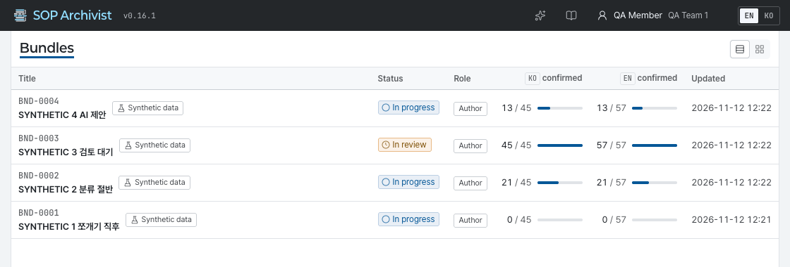

- 첫 화면 **Bundles** 에는 내가 구성원(작성자·검토자)인 Bundle만 보입니다. 줄을 누르거나 줄에 초점을 두고 <kbd>Enter</kbd>를 누르면 열립니다.
- **View** 에서 **Table** 과 **Cards** 를 바꿉니다. 고른 보기는 이 브라우저에 기억됩니다.
- **New bundle** 은 `bundle.create` 권한이 있을 때만 보입니다. 누르면 곧바로 새 Bundle이 만들어지고 **Overview** 가 열리니, 제목과 설명은 거기서 고칩니다.

### 화면 설정 {#settings}

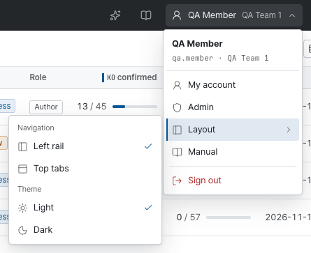

| 메뉴 | 하는 일 |
|---|---|
| **My account** | 내 정보와 권한을 본다 |
| **Admin** | 관리 화면을 연다. 관리 권한이 있을 때만 보인다 |
| **Layout** | **Navigation** 에서 단계 이동을 **Left rail** 또는 **Top tabs** 로, **Theme** 에서 **Light** 또는 **Dark** 로 바꾼다 |
| **Manual** | 이 설명서를 새 탭으로 연다 |
| **Sign out** | 로그아웃한다 |

- 화면 말은 오른쪽 위 **EN** | **KO** 로 바꿉니다. 상태 이름과 Bundle·Old·New·Unit 같은 용어는 어느 쪽에서나 영어입니다.
- 상단 막대의 책 모양 단추 **Manual** 은 지금 보고 있는 화면을 설명하는 조각을 새 탭으로 엽니다.

### 이동할 때 {#moving}

- 링크를 누르면 잠깐 뒤에 이동합니다. 그 사이 같은 링크를 다시 누르거나 <kbd>Esc</kbd>를 누르면 이동이 취소됩니다.
- 저장하지 않은 변경이 있으면 떠나기 전에 먼저 묻습니다.
- 상단 막대의 화살표 **Back to bundles** 는 Bundle 목록으로 돌아갑니다.
- 창이 떠 있을 때 <kbd>Esc</kbd>는 맨 위의 창 하나만 닫고, 초점은 그 창을 연 곳으로 돌아갑니다.

## Bundle과 Overview {#bundle}

Bundle은 함께 재구성할 문서 묶음입니다. Old SOP 여러 편과 새로 만들 SOP·WI가 한 Bundle 안에 들어가고, Bundle마다 `BND-0001` 같은 번호가 붙습니다.

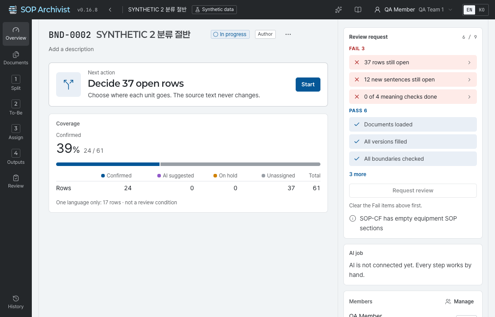

**Overview** 는 Bundle의 지금 상태를 한 화면에 모아 보여 줍니다.

| 카드 | 보는 것 |
|---|---|
| **Next action** | 지금 할 일 한 가지. **Start** 를 누르면 그 일을 하는 화면으로 간다 |
| **Coverage** | 한국어·영어별 확정 비율과 상태별 Unit 수 |
| **Review request** | 검토 요청 조건 여덟 가지. 빨간 줄을 누르면 고칠 화면으로 간다 |
| **AI job** | 진행 중인 AI 작업. **Cancel jobs** 로 멈추고 **Retry failed** 로 실패한 것만 다시 돌린다 |
| **Members** | 구성원과 역할. **Manage** 에서 추가·역할 변경·제외 |
| **Activity** | 최근 작업 기록. **View all** 은 **History** 로 간다 |

### 제목·설명·삭제 {#bundle-edit}

- 제목이나 설명에 마우스를 올리면 나오는 연필 단추를 눌러 그 자리에서 고칩니다. 제목은 <kbd>Enter</kbd>, 여러 줄인 설명은 <kbd>Ctrl</kbd>+<kbd>Enter</kbd>로 저장하고 <kbd>Esc</kbd>로 취소합니다.
- 제목 옆 **More** 메뉴의 **Mark as test data** 는 시험용 Bundle임을 표시합니다. 표시한 Bundle은 상단 막대에 **Synthetic data** 표지가 붙습니다.
- **More** 메뉴의 **Delete bundle** 은 Bundle과 그 안의 문서·판단을 모두 지웁니다. 되돌릴 수 없습니다.

### 구성원 {#members}

- **Manage** 를 누르면 **Bundle members** 창이 열립니다. **Add member** 에서 사람을 찾아 넣고 **Role** 에서 **Author** 또는 **Reviewer** 를 고릅니다.
- 사람은 이름·한글 이름·아이디로 찾습니다. 아무것도 입력하지 않으면 내 부서 사람이 먼저 나옵니다.
- 작성자는 한 명 이상 있어야 하고, 검토를 요청하려면 활동 중인 검토자가 한 명 이상 있어야 합니다.
- Bundle은 구성원에게만 보입니다. 구성원이 아닌 사람이 주소로 들어오면 **Bundle not available** 화면이 뜹니다.

## Documents {#documents}

재구성할 원문을 올리는 화면입니다. 올린 파일은 바로 읽혀 글자와 표가 추출됩니다.

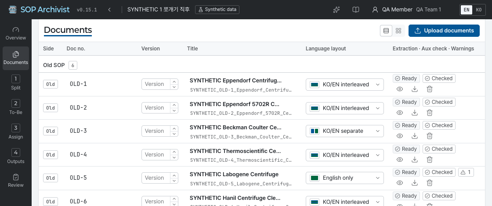

### 올리기 {#upload}

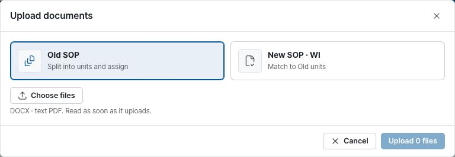

1. **Upload documents** 를 누릅니다.
2. **Upload type** 에서 종류를 고릅니다. **Old SOP** 는 쪼개서 배정할 옛 문서, **New SOP · WI** 는 이미 써 둔 새 문서입니다. 새 문서는 **Type** 을 고르고, WI라면 **Parent SOP number (WI only)** 를 적습니다.
3. **Choose files** 로 파일을 고릅니다. 여러 개를 한 번에 고를 수 있고, DOCX와 글자가 들어 있는 PDF를 받습니다.
4. 올리기 단추를 누르면 파일마다 결과가 표시됩니다. 다 올렸으면 **Go to Split** 으로 넘어갑니다.

> [!TIP]
> 파일 이름에 문서 번호와 버전이 들어 있으면 그대로 읽어 옵니다. 이름을 정리해 두고 올리면 고칠 일이 줄어듭니다.

### 목록의 열 {#document-columns}

| 열 | 뜻 |
|---|---|
| **Side** | **Old**(옛 문서) 또는 **New**(이미 쓴 새 문서) |
| **Doc no.** · **Version** · **Title** | 파일 이름과 본문에서 찾은 값. 틀리면 그 자리에서 고친다. 버전은 **Version up** · **Version down** 으로 올리고 내린다 |
| **Language layout** | **KO/EN interleaved**(한 줄씩 번갈아), **KO/EN separate**(한글 뒤 영어가 따로), **English only**, **Korean only** |
| **Extraction** | **Ready**(읽기 끝), **Rejected**(받을 수 없는 파일), **Failed**(읽다가 실패) |
| **Aux check** | 다른 방법으로 한 번 더 읽어 빠진 글이 없는지 견준 결과 |
| **Warnings** | 읽으면서 생긴 경고 수. **Split** 에서 확인한다 |

- 줄 끝의 단추로 **Preview**(읽힌 글 미리 보기), **Download original file**, **Delete document** 를 합니다. **Open in Split** 은 그 문서를 쪼개기 화면으로 엽니다.
- 판단이 이미 있는 문서를 지우려 하면 한 번 더 묻습니다. **Delete anyway** 를 누르면 그 문서의 Unit에 걸린 판단이 함께 풀립니다.
- 같은 파일을 두 번 올리면 받지 않습니다.
- AI가 켜져 있으면 규칙이 찾지 못한 문서 번호·버전을 AI가 제안합니다. 제안은 눌러야 저장됩니다.

### 받지 못한 파일 {#upload-rejected}

| 이유 | 할 일 |
|---|---|
| DOCX·PDF가 아니다 | DOCX나 PDF로 저장해 다시 올린다 |
| 파일이 너무 크다, 쪽이 너무 많다, 글이 너무 길다 | 문서를 나눠 올린다 |
| 암호가 걸려 있거나 파일이 깨졌다 | 암호를 풀거나 다시 저장해 올린다 |
| 스캔한 그림 PDF다 | 글자가 들어 있는 원본(DOCX나 글자 PDF)을 올린다 |
| 변경 내용 추적이 남아 있다 | Word에서 변경을 모두 적용하거나 취소한 뒤 올린다 |
| 다른 문서를 끼워 넣은 DOCX다 | Word에서 한 문서로 다시 저장해 올린다 |
| 글자가 없다 | 내용이 있는 파일인지 확인한다 |
| 읽는 데 너무 오래 걸렸다, 읽다가 멈췄다 | 다시 올려 보고, 되풀이되면 관리자에게 알린다 |

### 크기 한도 {#limits}

| 항목 | 기본 한도 |
|---|---|
| 파일 하나 | 25 MB |
| DOCX를 풀었을 때 | 200 MB |
| PDF 쪽수 | 500쪽 |
| 문서 하나의 글자 수 | 2,000,000자 |
| 문서 하나를 읽는 시간 | 60초 |

한도는 서버 설정에 따라 다를 수 있습니다.

### 경고 종류 {#warnings}

| 경고 | 뜻 |
|---|---|
| **Missing text** | 다시 읽은 결과와 견주니 빠진 글이 있을 수 있다. **Split** 에서 원문과 대조해 확인해야 검토를 요청할 수 있다 |
| **Reading order may differ** | PDF라서 읽는 순서가 원문과 다를 수 있다 |
| **Auto numbering** · **Clause numbers** | 자동 번호나 절 번호가 원문과 다르게 읽혔을 수 있다 |
| **Merged cells** · **Table position** | 병합된 칸이나 표의 자리가 원문과 다를 수 있다 |
| **Large image** | 큰 그림이 있는 자리. 원문과 견주어 본다 |
| **Check needed** | 그 밖에 사람이 한 번 봐야 하는 곳 |

## 1단계 Split {#split}

문서를 Unit으로 쪼개는 단계입니다. Unit은 **한곳으로 보낼 수 있는 가장 작은 조각**입니다. 올릴 때 규칙이 먼저 쪼개 두므로, 여기서는 경계가 맞는지 확인하고 틀린 곳만 고칩니다.

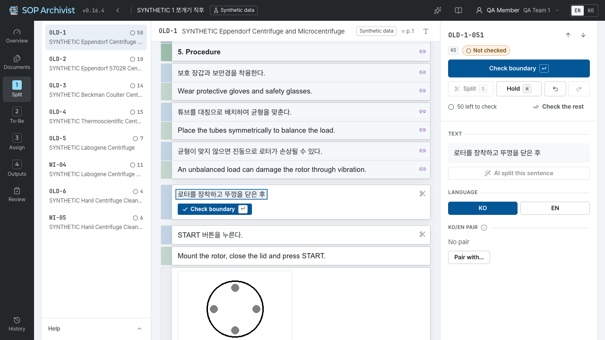

- 왼쪽: Bundle의 문서 목록과 표시 풀이.
- 가운데: 원문 종이. 줄 앞의 꼬리표는 언어, 줄 끝의 아이콘은 경계 확인·한/영 짝 같은 상태입니다. 확인을 마친 줄은 글자가 옅어집니다.
- 오른쪽: 선택한 Unit의 글·언어·짝과 할 수 있는 일.

### 경계 확인하기 {#split-check}

결과물과 Excel은 Unit이 잘린 자리를 그대로 따릅니다. 그래서 **모든 Unit의 경계를 확인해야 검토를 요청할 수 있습니다.** 표와 표의 행처럼 다른 Unit을 묶기만 하는 것은 세지 않고, 글이 있는 Unit(문장·제목·그림·칸 문장)만 셉니다.

1. Unit을 읽고 경계가 맞으면 **Check boundary** 를 누르거나 <kbd>↵</kbd>를 누릅니다. 다음 Unit으로 넘어갑니다.
2. 잘못 확인했으면 <kbd>U</kbd>(**Uncheck boundary**)로 되돌립니다.
3. 정할 수 없는 Unit은 <kbd>H</kbd>(**Hold**)를 누르고 사유를 적어 미룹니다. 미룬 Unit은 **Assign** 의 **On hold** 에 모입니다.

남은 수는 두 곳에 보입니다. 오른쪽 위에는 지금 문서에 남은 경계 수가, 왼쪽 문서 목록에는 문서마다 남은 수가 나옵니다. 다 확인한 문서는 **All boundaries checked** 로 바뀝니다.

끝까지 읽어 보고 더 고칠 곳이 없으면 **Check the rest** 를 누릅니다. 확인 창에서 한 번 더 누르면 지금 문서에 남은 Unit이 모두 확인됩니다. 하나씩 읽지 않고 넘기는 것이니, 문서를 훑어본 뒤에 씁니다. 한 번에 확인한 일은 **History** 에 남습니다.

> [!NOTE]
> 쪼개거나 합쳐서 새로 생긴 Unit은 확인하지 않은 상태로 시작합니다. **Assign** 에서 AI가 나눈 문장을 확정해 생긴 Unit도 같습니다. 검토를 요청하기 전에 **Split** 으로 돌아와 확인합니다.

### 쪼개기와 합치기 {#split-edit}

- **쪼개기**: 나눌 자리를 두 번 눌러 선을 놓고 <kbd>S</kbd>(**Split**)를 누릅니다.
- **합치기**: <kbd>Ctrl</kbd>을 누른 채 합칠 문장을 눌러 고른 뒤 **Merge** 를 누릅니다. 떨어져 있는 문장도 합칠 수 있습니다.
- **글자를 골라 새 Unit**: 글자를 끌어 고르면 **New unit from selection** 이 나옵니다. **Make unit** 을 누르면 고른 글자만 새 Unit이 됩니다.
- **표**: 표는 통째로 Unit 하나입니다. 행마다 다른 곳으로 보내야 하면 **Split into rows**, 되돌리려면 **Merge rows back** 을 누릅니다. 자리만 잡으려고 쓴 표는 **Treat as layout table** 로 바꿔 칸의 글을 보통 문장으로 다룹니다.
- **Undo** 와 **Redo**: <kbd>Ctrl</kbd>+<kbd>Z</kbd>, 다시 하기는 <kbd>Shift</kbd>를 함께 누릅니다. 되돌리기 기록은 서버에 남아 화면을 다시 열어도 이어집니다.

> [!WARNING]
> 이미 판단이 있는 Unit을 쪼개거나 합치면 그 판단이 풀립니다. **Decisions will be cleared** 창에서 **Edit anyway** 를 눌러야 진행됩니다.

### 언어와 한/영 짝 {#split-pair}

- **Language** 에서 Unit의 언어를 **KO** 또는 **EN** 으로 고칩니다.
- **KO/EN pair** 는 같은 뜻의 한글·영어 문장을 묶은 것입니다. 짝은 배정할 때 함께 움직입니다(이미 쓴 New 문장이 한 언어뿐일 때는 [확정·고쳐 쓰기·보류](#assign-confirm) 참고).
- 짝이 없으면(**No pair**) **Pair with...** 를 누르고 상대 문장을 고른 뒤 **Make pair** 를 누릅니다. 자동으로 잡힌 짝은 **Confirm pair** 로 확정하거나 **Unpair** 로 풉니다.

### 누락 의심 경고 {#split-warnings}

문서에 **Missing-text warnings** 가 있으면 경고마다 원문과 견주어 본 뒤 **Mark checked** 를 누릅니다. 확인하지 않은 경고가 남아 있으면 검토를 요청할 수 없습니다.

### 단축키 {#split-keys}

| 글쇠 | 하는 일 |
|---|---|
| <kbd>↵</kbd> | 경계를 확인하고 다음 Unit으로 |
| <kbd>↑</kbd> <kbd>↓</kbd> <kbd>J</kbd> <kbd>K</kbd> | 다음·이전 Unit |
| 두 번 누르기 | 쪼갤 자리에 선 놓기 |
| <kbd>S</kbd> | 선에서 쪼개기 |
| <kbd>U</kbd> | 경계 확인 취소 |
| <kbd>Ctrl</kbd>+누르기 | 합칠 문장 고르기 |
| <kbd>H</kbd> | 사유를 적고 보류 |
| <kbd>Ctrl</kbd>+<kbd>Z</kbd> | 되돌리기. <kbd>Shift</kbd>를 더하면 다시 하기 |

## 2단계 To-Be {#tobe}

새로 만들 SOP·WI의 목록을 적는 단계입니다. 여기 적은 문서와 그 안의 칸이 **Assign** 에서 Unit을 보낼 곳이 됩니다.

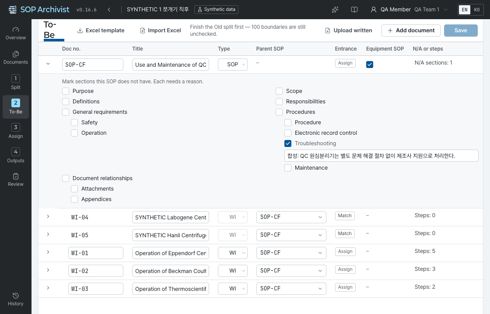

### 문서 적기 {#tobe-docs}

**Add document** 로 줄을 더하고 칸을 채웁니다.

| 열 | 뜻 |
|---|---|
| **Doc no.** · **Title** | 새 문서의 번호와 제목 |
| **Type** | SOP 또는 WI |
| **Parent SOP** | WI가 속한 SOP의 번호 |
| **Entrance** | **Assign** 은 아직 쓰지 않은 문서라 Old Unit을 칸에 보내 새 문장을 만든다. **Match** 는 이미 써서 올린 문서라 Old Unit을 그 문장에 잇는다 |
| **Equipment SOP** | 장비 SOP면 켠다. 장비 SOP에 있어야 하는 절차 칸(전자 기록 관리·문제 해결·유지 보수)이 비어 있으면 **Overview** 에 알려 준다. 검토 요청을 막지는 않는다 |
| **N/A or steps** | SOP는 쓰지 않는 칸의 수, WI는 단계의 수 |

### 칸과 단계 {#tobe-slots}

- 문서를 펼치면 **Sections and steps** 가 나옵니다.
- SOP는 칸이 정해져 있습니다. 이 SOP에 없는 칸은 N/A로 표시하고 **Reason** 을 적습니다.
- WI는 **Add step** 으로 단계를 더하고 **Step title** 을 적습니다. **Remove step** 으로 뺍니다. 단계 번호는 자동으로 다시 매기지 않습니다.
- 이미 문장을 배정한 문서·칸·단계는 뺄 수 없습니다. 먼저 **Assign** 에서 배정을 풉니다.
- **Match** 로 들어온 줄은 올린 새 문서에 묶여 있습니다. 빼려면 **Documents** 에서 그 문서를 지웁니다.

### 저장 {#tobe-save}

- 고친 뒤 **Save** 를 누르거나 <kbd>Ctrl</kbd>+<kbd>S</kbd>를 누릅니다. 저장 전에는 **Unsaved changes** 가 보이고, **Discard** 로 고친 것을 버립니다.
- 다른 사람이 먼저 저장했으면 **The To-Be list changed elsewhere** 창이 뜹니다. **Load the latest** 로 최신 목록을 받은 뒤 다시 고칩니다.

### Excel로 가져오기 {#tobe-excel}

1. **Excel template** 으로 양식을 내려받아 채웁니다.
2. **Import Excel** 로 올립니다. 목록 전체가 파일 내용으로 바뀌므로, 목록이 비어 있지 않으면 **Replace the To-Be list?** 창에서 한 번 더 묻습니다.
3. 이미 문장을 배정한 문서·칸·단계가 파일에 없으면 가져오기가 거절됩니다.

## 3단계 Assign {#assign}

Old Unit마다 새 문서의 어디로 갈지 정하고 확정하는 단계입니다. 가장 오래 머무는 화면입니다.

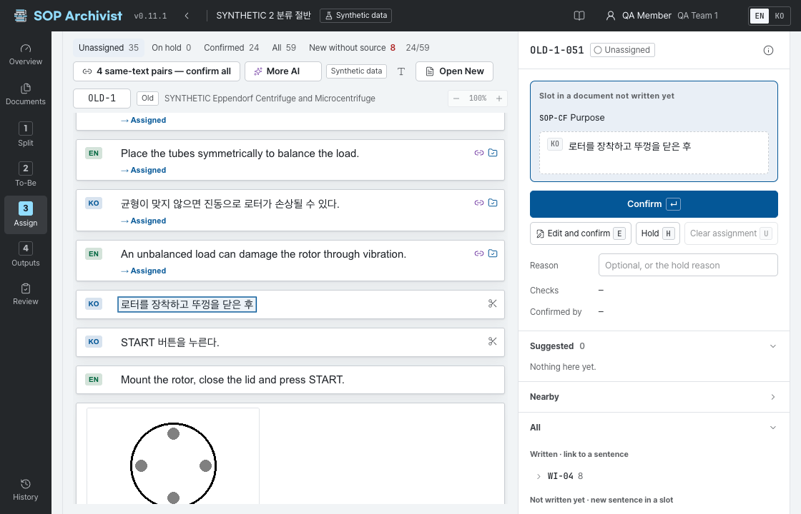

- 왼쪽: Old 원문. 원문 자체가 목록이라 문맥을 보면서 판단합니다. 배정한 줄 아래에는 표시가 붙습니다.
- 오른쪽: 선택한 Unit의 보낼 곳과 할 수 있는 일.
- **Open New** 를 누르면 이미 쓴 New 문서가 옆에 열립니다. **Close New** 로 닫습니다.

### 목록 거르기 {#assign-filters}

| 탭 | 보이는 것 |
|---|---|
| **Unassigned** | 아직 정하지 않은 Unit. 처음 열면 이 탭이다 |
| **AI suggested** | AI 제안이 있는 Unit. 제안이 있을 때만 보인다 |
| **On hold** | 미뤄 둔 Unit |
| **Confirmed** | 확정한 Unit |
| **All** | 전부 |
| **New without source** | 어느 Old Unit과도 이어지지 않은 새 문장. 남아 있으면 검토를 요청할 수 없다 |

### 보낼 곳 고르기 {#assign-destination}

오른쪽 아래 목록에서 보낼 곳을 누릅니다.

| 묶음 | 내용 |
|---|---|
| **Suggested** | 같은 글·비슷한 글·AI가 고른 후보. 후보마다 **Same text**, **Similar**, **AI** 표지가 붙는다 |
| **Nearby** | 지금 고른 곳의 바로 옆 문장이나 옆 칸 |
| **All** | To-Be의 모든 문서와 칸 |
| **Delete or move** | 새 문서로 가지 않는 처분. 지우기와 다른 문서로 옮기기 |

보낼 곳은 두 가지입니다.

- **Written sentence**: 이미 쓴 New 문서의 문장에 잇습니다. **Open New** 로 연 문서에서 문장을 눌러도 됩니다.
- **Slot in a document not written yet**: 아직 쓰지 않은 문서의 칸에 새 문장을 만듭니다. 처음 글은 Old 원문 그대로이고, 고쳐 쓰려면 **Edit and confirm** 을 씁니다.

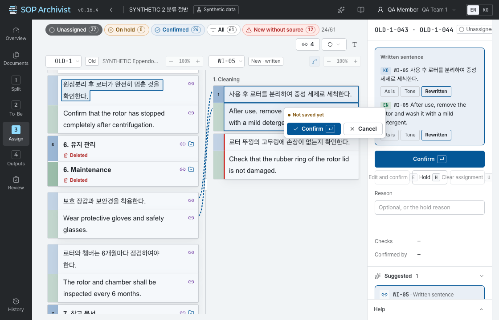

> [!NOTE]
> 보낼 곳이 하나도 없으면 **To-Be** 가 비어 있는 것입니다. **Open To-Be** 로 가서 새 문서 목록부터 적습니다.

### 확정·고쳐 쓰기·보류 {#assign-confirm}

| 단추 | 글쇠 | 하는 일 |
|---|---|---|
| **Confirm** | <kbd>↵</kbd> | 고른 보낼 곳으로 확정하고 다음 Unit으로 |
| **Edit and confirm** | <kbd>E</kbd> | 새 문장을 고쳐 쓴 뒤 확정. <kbd>Ctrl</kbd>+<kbd>↵</kbd>로 저장, <kbd>Esc</kbd>로 닫기 |
| **Hold** | <kbd>H</kbd> | 사유를 적고 미루기 |
| **Clear assignment** | <kbd>U</kbd> | 판단을 지우고 **Unassigned** 로 |

- **Reason** 은 지우기·다른 문서로 옮기기·두 문서로 보내기에 꼭 적어야 합니다. 그 밖에는 적지 않아도 됩니다.
- **Change type** 은 원문과 새 문장의 관계입니다: **As is**, **Tone**, **Rewritten**, **Merged**, **Split**, **Translated**, **Deleted**, **New**, **Table restructured**.
- **Checks** 는 원문과 새 문장을 견준 결과입니다. **Numbers differ**, **Units differ**, **Negation differs** 가 뜨면 뜻이 바뀌지 않았는지 다시 봅니다.
- 한/영 짝은 함께 확정됩니다(**Confirmed together**).
- 이미 쓴 New 문장이 한 언어로만 있으면 그 언어의 Old 문장만 이어집니다. 잇지 않는 문장은 고른 곳 아래에 알려 주고, **Confirm** 을 누르면 짝이 풀려 그 문장이 따로 줄이 됩니다(**History** 에 **Removed a KO/EN pair**). 따로 남은 줄은 **Delete or move** 의 **Deleted**(**Reason** 필수)나 **Hold** 로 마무리합니다. 흔한 경우는 아닙니다 — 보통은 Old와 New 모두 한글·영어가 함께 있어 두 문장이 같이 이어집니다.
- 고르기만 하고 확정하지 않은 채 떠나려 하면 먼저 묻습니다.

### 여럿을 한 번에 {#assign-bulk}

- **같은 글 일괄 확정**: 이미 쓴 New 문서에 글자가 똑같은 문장이 있는 Unit은 목록 위의 same-text pairs 단추로 한 번에 확정합니다. 누르면 **Confirm same-text pairs** 창에서 건수를 보여 주고 **Confirm all** 을 눌러야 진행됩니다.
- **지우기·옮기기**: <kbd>Shift</kbd>를 누른 채 Old Unit을 눌러 여럿을 고르면 **Delete picked rows** 와 **Move picked rows to another document** 가 나옵니다. 여럿을 한 번에 할 수 있는 것은 지우기와 옮기기뿐입니다.
- **합치기와 나누기**: Unit 여럿을 새 문장 하나로 보내면 합침, Unit 하나를 새 문장 여럿으로 보내면 나눔입니다. New 문서에서 <kbd>Ctrl</kbd>을 누른 채 문장을 누르면 보낼 문장이 더해집니다.

### 출처 없는 새 문장 {#assign-new}

**New without source** 탭에는 이미 쓴 New 문서의 문장 가운데 Old 출처가 없는 것이 모입니다.

- 정말 새로 쓴 문장이면 **Mark as new** 를 누릅니다.
- Old에 출처가 있으면 그 Old Unit을 골라 이 문장에 잇습니다.

### 번역 {#assign-translate}

AI가 켜져 있으면 한쪽 언어만 있는 새 문장에 **Make English** 또는 **Make Korean** 단추가 나옵니다. 누르면 AI가 다른 언어 문장을 제안하고, 사람이 확인해 확정합니다. 번역 문장의 자리는 출처 문장을 따라가며 따로 옮길 수 없습니다.

### 보기 조절 {#assign-view}

- 마우스를 올린 문서에서 <kbd>Ctrl</kbd>+휠 또는 <kbd>Ctrl</kbd>+<kbd>+</kbd> <kbd>-</kbd>로 그 문서만 확대·축소합니다.
- 두 문서 사이의 세로선을 끌어 폭을 바꿉니다. 확대와 폭은 이 브라우저에 기억됩니다.
- **Legend** 는 표시와 단축키 풀이를 엽니다.

### 단축키 {#assign-keys}

| 글쇠 | 하는 일 |
|---|---|
| <kbd>↑</kbd> <kbd>↓</kbd> <kbd>J</kbd> <kbd>K</kbd> | 다음·이전 Unit |
| <kbd>↵</kbd> | 확정하고 다음으로 |
| <kbd>E</kbd> | 고쳐 쓰기. <kbd>Ctrl</kbd>+<kbd>↵</kbd> 저장, <kbd>Esc</kbd> 닫기 |
| <kbd>H</kbd> | 보류 |
| <kbd>U</kbd> | 배정 지우기 |
| <kbd>Shift</kbd>+누르기 | Old Unit 여럿 고르기(지우기·옮기기) |
| <kbd>Ctrl</kbd>+누르기 | New 문장 더하기(나눔) |
| <kbd>Ctrl</kbd>+휠 | 마우스를 올린 문서 확대·축소 |

## 4단계 Outputs {#outputs}

배정 결과를 세 가지 모양으로 보여 주는 단계입니다. 따로 만드는 것이 아니라 **Assign** 의 판단에서 바로 나오므로, 판단을 고치면 결과물도 따라 바뀝니다.

| 탭 | 내용 |
|---|---|
| **A · Units** | Old Unit마다 어디로 갔는지 적은 표 |
| **B · Flow** | 옛 문서에서 새 문서로 가는 흐름도 |
| **C · New documents** | 새 문서별로 문장을 모은 초안 |

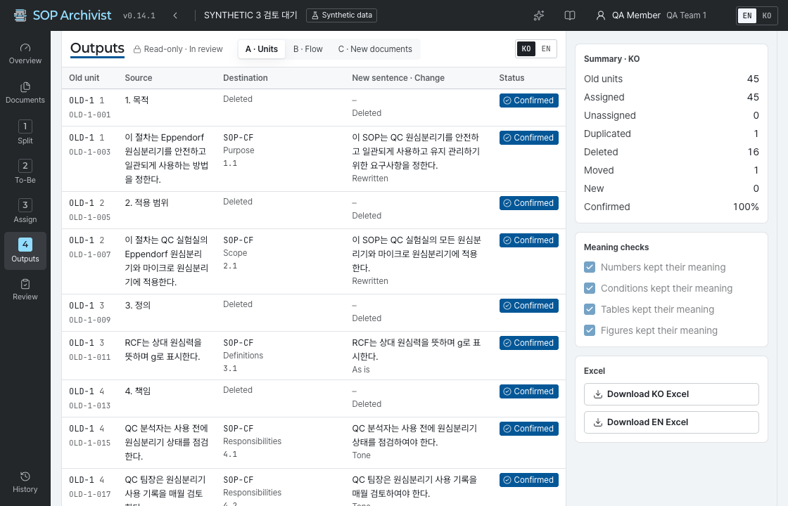

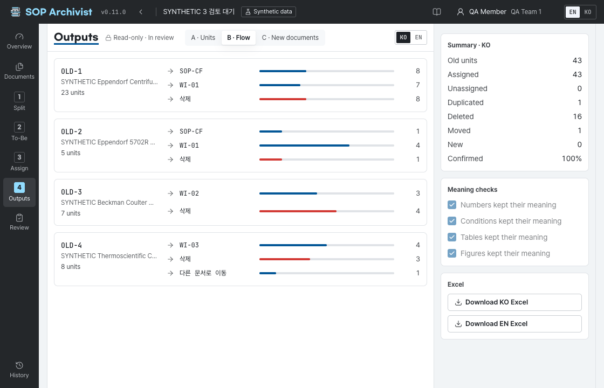

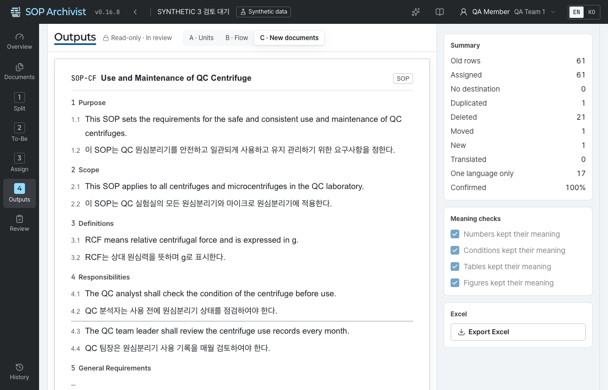

- **Output language** 에서 한국어와 영어를 바꿉니다. 고른 탭과 언어는 이 브라우저에 기억됩니다.
- **A · Units** 의 열은 **Old unit**, **Source**, **Destination**, **New sentence · Change**, **Status** 입니다. 지우거나 다른 문서로 옮긴 Unit은 **Deleted and moved** 에 따로 모입니다.
- **C · New documents** 에서는 **Move up** · **Move down** 으로 칸 안의 문장 순서를 바꿉니다. 번역 문장은 출처 문장을 따라 움직입니다. 새 문서가 없으면 **Open To-Be** 로 가서 목록부터 적습니다.

### 요약과 의미 확인 {#outputs-checks}

오른쪽 요약 칸(Summary)은 지금 고른 언어에서 Old Unit이 어떻게 처리됐는지 셉니다: **Old units**, **Assigned**, **Unassigned**, **Duplicated**, **Deleted**, **Moved**, **New**, **Confirmed**.

**Meaning checks** 는 작성자가 결과물을 읽고 직접 표시하는 네 가지 확인입니다.

- **Numbers kept their meaning**: 숫자의 뜻이 그대로다
- **Conditions kept their meaning**: 조건의 뜻이 그대로다
- **Tables kept their meaning**: 표의 뜻이 그대로다
- **Figures kept their meaning**: 그림의 뜻이 그대로다

네 가지를 모두 표시해야 검토를 요청할 수 있습니다. 검토자가 돌려보내거나 작성자가 다시 열면 표시가 지워지므로 다시 확인합니다.

### Excel {#outputs-excel}

Excel 내려받기 단추는 지금 고른 언어의 결과물 A·B·C와 Bundle 정보를 시트로 나눠 담은 파일 하나를 내려받습니다. 한국어와 영어를 각각 받습니다.

## Review {#review}

작성자가 검토를 요청하면 Bundle이 잠기고 검토자가 읽습니다.

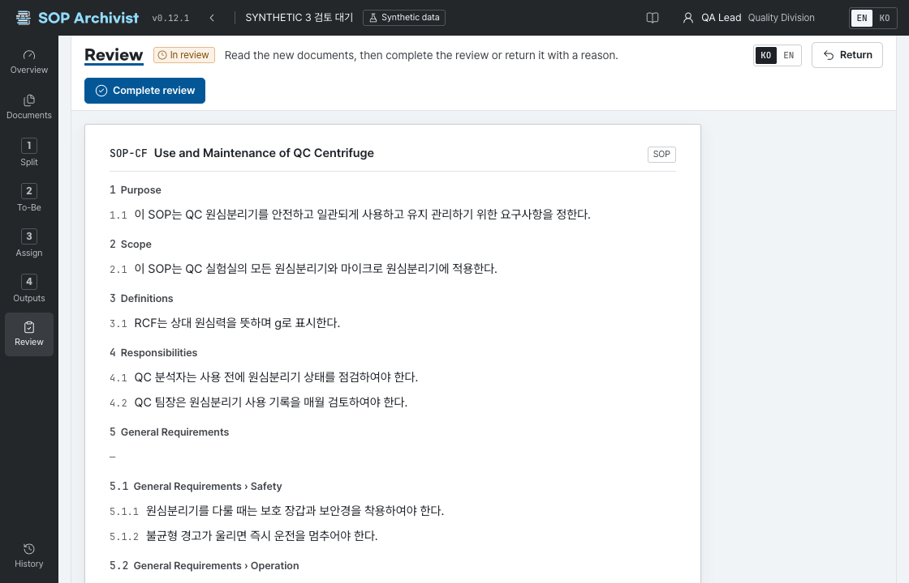

### 요청 조건 {#review-gates}

**Overview** 의 **Review request** 카드에 조건 여덟 가지가 보입니다. 모두 통과해야 **Request review** 가 켜집니다.

| 조건 | 통과하려면 |
|---|---|
| **Documents loaded** | 문서가 한 편 이상 있고 **Rejected**·**Failed** 인 문서가 없다 |
| **All boundaries checked** | **Split** 에서 모든 문서의 Unit 경계를 확인했다. 쪼개거나 합쳐 새로 생긴 Unit도 포함한다 |
| **All units decided** | 모든 Old Unit이 **Confirmed** 다. 미배정·AI 제안·보류가 남아 있지 않다 |
| **All new sentences decided** | 모든 새 문장이 확정됐다. 출처 없는 새 문장이 남아 있지 않다 |
| **Missing-text warnings closed** | **Split** 에서 누락 의심 경고를 모두 확인했다 |
| **Reasons filled** | 지우기·옮기기·두 문서로 보내기에 사유를 적었다 |
| **Meaning checks done** | **Outputs** 의 의미 확인 네 가지를 표시했다 |
| **Reviewer assigned** | 활동 중인 검토자가 한 명 이상 있다 |

### 작성자가 하는 일 {#review-author}

1. **Overview** 에서 **Request review** 를 누릅니다. 작성자만 요청할 수 있습니다.
2. Bundle이 **In review** 가 되고 모든 단계가 읽기 전용이 됩니다(**Read-only · In review**).
3. 검토자가 끝내기 전에 고칠 것이 생기면 **Overview** 의 **Review request** 카드나 **Review** 에서 **Withdraw request** 를 누릅니다. 사유는 적지 않습니다. Bundle이 **In progress** 로 돌아오고 의미 확인 표시가 지워집니다. 거두기는 작성자만 합니다.
4. 돌려받으면 **Overview** 에 **Returned by the reviewer** 와 사유가 보입니다. 고친 뒤 의미 확인을 다시 표시하고 다시 요청합니다.
5. 검토가 끝난 Bundle을 고쳐야 하면 **Review** 에서 **Reopen** 을 누르고 사유를 적습니다. Bundle이 **In progress** 로 돌아옵니다. 다시 열기는 작성자만 합니다.

### 검토자가 하는 일 {#review-reviewer}

1. Bundle 목록에서 **In review** 인 Bundle을 열어 **Review** 로 갑니다.
2. 새 문서와 결과물을 읽습니다. 검토자는 내용을 고칠 수 없습니다(**Read-only · Reviewer**).
3. 문제가 없으면 **Complete review** 를 누릅니다. Bundle이 **Review complete** 가 됩니다.
4. 고칠 것이 있으면 **Return** 을 누르고 사유를 적습니다. Bundle이 **In progress** 로 돌아가 작성자가 고칩니다.

> [!NOTE]
> **Review complete** 는 재구성 결과의 확인이 끝났다는 뜻입니다. 정식 승인은 Veeva에서 합니다.

## History {#history}

Bundle에서 일어난 일을 시간순으로 보는 화면입니다.

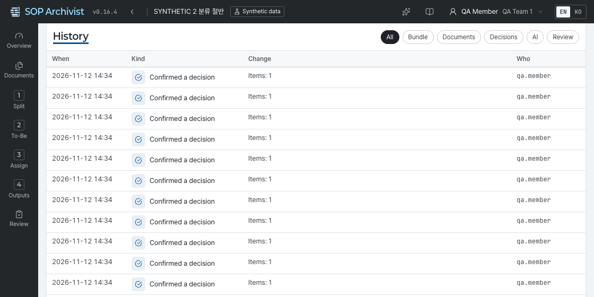

- 열은 **When**, **Kind**, **Change**, **Who** 입니다.
- 위쪽 단추로 종류를 거릅니다: **All**, **Bundle**, **Documents**, **Decisions**, **AI**, **Review**.
- 줄을 누르거나 줄에 초점을 두고 <kbd>Enter</kbd>를 누르면 자세한 내용이 열립니다.
- AI는 요청·취소·다시 시도만 기록됩니다. 제안을 확정한 것은 사람의 판단(**Decisions**)으로 남습니다.

## AI가 하는 일, 하지 않는 일 {#ai}

AI는 제안만 합니다. 사람이 줄마다 확인해 확정하기 전에는 아무것도 결정되지 않습니다.

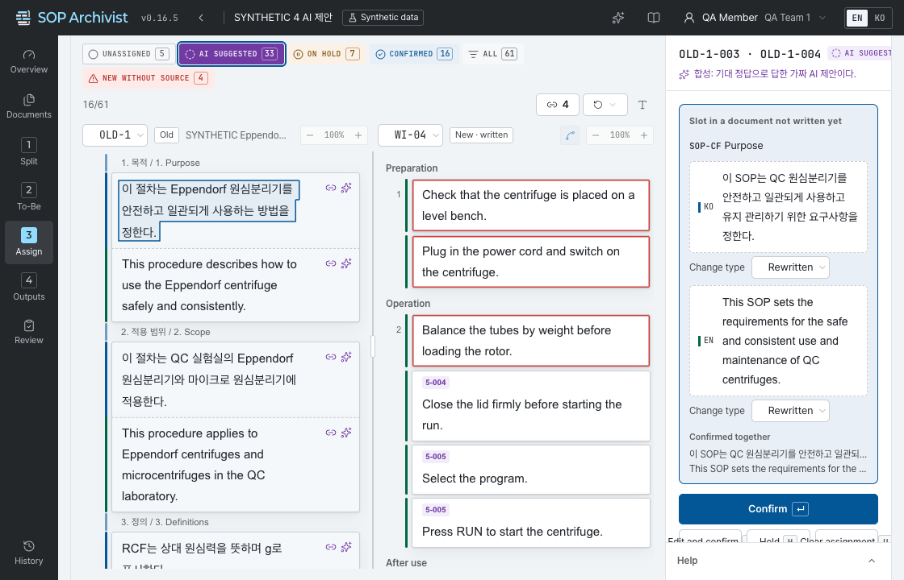

### 제안의 종류 {#ai-kinds}

| 종류 | 제안하는 것 | 요청하는 곳 |
|---|---|---|
| **Classify** | Unit을 보낼 칸과 한·영 고쳐 쓴 문장 | **Assign** 의 **Ask AI**, **More AI** → **Classify the whole document** |
| **Translate** | 한쪽 언어만 있는 새 문장의 번역 | **More AI** → **Translate to EN** · **Translate to KO** |
| **Match** | Old Unit과 이미 쓴 New 문장의 짝과 변경 종류 | **More AI** → **Ask AI to match** |
| **KO/EN pair** | 한글과 영어가 따로 있는 문서의 한/영 짝 | **Split** 의 **Ask AI to pair KO and EN** |
| **Split** | 여러 뜻이 섞인 문장을 나눌 자리 | **Split** 의 **Ask AI to split this document**, **Assign** 의 **Suggest a split for this row** |

### 요청하고 확인하기 {#ai-flow}

1. 위 단추로 요청합니다. 요청은 쌓였다가 차례로 처리되므로 기다리지 않고 다른 일을 해도 됩니다.
2. 진행 상황은 **Overview** 의 **AI job** 카드에서 봅니다.
3. 제안이 오면 **Assign** 의 **AI suggested** 탭에 모입니다. 원문과 견주어 본 뒤 **Confirm**(그대로 확정)이나 **Edit and confirm**(고쳐서 확정)을 누릅니다.
4. 나누기 제안은 **Apply split** 으로 적용하거나 **Dismiss** 로 버립니다.

> [!WARNING]
> AI 제안은 한꺼번에 확정할 수 없습니다. 틀릴 수 있으므로 줄마다 원문과 견주어 봅니다. 마지막 판단은 사람의 몫입니다.

### 지켜지는 것 {#ai-rules}

- AI는 사람이 확정했거나 보류한 줄을 덮어쓰지 않습니다.
- AI가 답하는 사이 사람이 그 Unit을 고쳤으면 그 제안은 버려집니다.
- AI의 답이 맞지 않으면 그 Unit만 **On hold** 가 되고 사유에 **The AI answer was invalid** 가 적힙니다.
- 관련된 Unit이 바뀌어 다시 봐야 하는 줄은 **A related unit changed** 사유로 보류됩니다.
- 직원의 이름은 AI로 보내지 않습니다.
- AI가 꺼져 있거나 실패해도 모든 단계는 손으로 끝까지 할 수 있습니다. 이때 **AI job** 카드에 **AI is not connected yet. Every step works by hand.** 가 보입니다.

### 실패했을 때 {#ai-errors}

| 표시 | 뜻과 할 일 |
|---|---|
| **Timed out** · **AI server error** · **Connection failed** | AI 서버 쪽 문제. 잠시 뒤 **Retry failed** 를 누른다 |
| **AI not configured** | AI가 꺼져 있다. 관리자에게 알린다 |
| **Interrupted** | 서버가 다시 시작돼 작업이 끊겼다. **Retry failed** 를 누른다 |
| **No candidates** | 보낼 곳 후보가 없다. **To-Be** 를 먼저 채운다 |
| **Request rejected** · **Internal error** | 되풀이되면 관리자에게 알린다 |

## 계정, 권한, 관리 {#account}

### 내 계정 {#my-account}

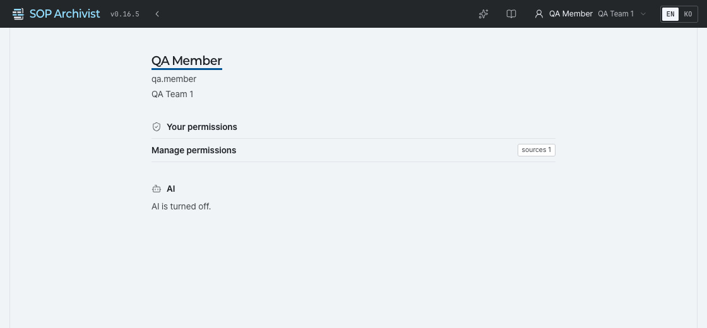

**My account** 에서 이름·아이디·부서와 **Your permissions** 를 봅니다. 권한마다 나에게 직접 준 것인지 부서에 준 것인지가 함께 보입니다. **AI** 칸은 지금 AI를 쓸 수 있는지 알려 줍니다.

### 권한 {#permissions}

| 권한 | 키 | 할 수 있는 일 |
|---|---|---|
| **Create bundles** | `bundle.create` | 새 Bundle을 만든다 |
| **Manage all bundles** | `bundle.admin` | 구성원이 아닌 Bundle도 관리한다 |
| **Manage AI guidelines** | `guideline.manage` | AI 지침을 고치고 켠다 |
| **Manage AI** | `ai.admin` | AI 연결을 시험하고 사용량을 본다 |
| **Manage permissions** | `permission.manage` | 역할과 권한을 준다 |
| **Run directory sync** | `directory.sync` | 직원·부서 정보를 다시 받아 온다 |
| **View system status** | `system.view` | 배치 작업과 시스템 상태를 본다 |

- 권한은 사람이나 부서에 줍니다. 부서에 주면 그 아래 부서까지 내려갑니다.
- 권한은 더하기만 있습니다. 한 사람의 권한은 직접 받은 것과 소속 부서가 받은 것을 합친 것입니다.
- Bundle을 보고 고치는 것은 권한이 아니라 구성원 여부로 정해집니다. 권한이 필요하면 관리자에게 요청합니다.

### 관리 화면 {#admin}

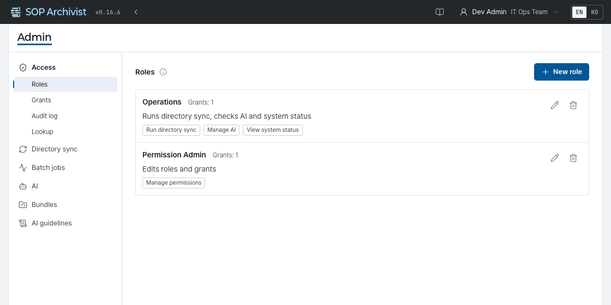

| 메뉴 | 하는 일 |
|---|---|
| **Access** | **Roles**(권한 묶음), **Grants**(사람·부서에 주기), **Audit log**(바꾼 기록), **Lookup**(한 사람의 실제 권한 보기) |
| **Directory sync** | 직원·부서 정보 동기화 기록과 바로 실행 |
| **Batch jobs** | 백업 같은 정기 작업의 결과 |
| **AI** | **Test connection** 으로 연결을 시험하고 **Daily usage** 로 사용량을 본다 |
| **Bundles** | 모든 Bundle의 목록과 관리 |
| **AI guidelines** | AI에 주는 지침. **Edit as a new version** 으로 고쳐 **Save version** 으로 저장한다 |

> [!WARNING]
> AI 지침은 저장만으로는 바뀌지 않습니다. **Activate** 를 눌러야 그 버전을 AI가 씁니다.

## 문제 해결 {#faq}

| 증상 | 까닭 | 할 일 |
|---|---|---|
| Bundle이 목록에 없다 | 구성원이 아니다 | 작성자에게 구성원으로 넣어 달라고 한다 |
| **New bundle** 이 보이지 않는다 | `bundle.create` 권한이 없다 | 관리자에게 권한을 요청한다 |
| 단계가 잠겨 있다 | 올린 문서가 없다 | **Documents** 에서 문서를 올린다 |
| 문서가 **Rejected** 또는 **Failed** 다 | 받을 수 없는 파일이거나 읽다가 실패했다 | [받지 못한 파일](#upload-rejected)을 보고 고쳐 다시 올린다. 남겨 두면 검토를 요청할 수 없으니 지운다 |
| 고칠 수 없고 읽기 전용이다 | 검토 중이거나 검토가 끝났거나 내가 검토자다 | 검토 중이면 작성자가 **Withdraw request** 로 요청을 거두거나 검토자가 돌려줘야 하고, 검토가 끝났으면 작성자가 **Reopen** 해야 고칠 수 있다 |
| **Request review** 가 꺼져 있다 | 조건이 남아 있거나 내가 작성자가 아니다 | **Review request** 카드의 빨간 줄을 눌러 하나씩 푼다 |
| 저장하면 충돌이라고 나온다 | 다른 사람이 먼저 바꿨다 | 화면을 새로 받아 다시 한다. To-Be는 **Load the latest** |
| AI 단추가 없거나 눌러도 안 된다 | AI가 꺼져 있다 | 손으로 진행한다. **My account** 의 **AI** 칸에서 상태를 본다 |
| 다시 로그인하라고 나온다 | 세션이 끝났다 | 로그인하면 보던 화면으로 돌아온다 |
| 서버에 닿지 않는다고 나온다 | 연결이 끊겼다 | 연결을 확인하고 다시 한다 |

### 알아 둘 한계 {#limits-known}

- 스캔한 그림 PDF는 읽지 못합니다. 글자가 들어 있는 원본이 필요합니다.
- 창 너비가 1120px보다 좁으면 가로로 밀어 봐야 합니다. 넓은 화면에서 쓰는 것을 권합니다.
- AI 제안의 정확도는 아직 실제 SOP로 검증되지 않았습니다. 반드시 원문과 견주어 확인합니다.
- 정식 승인은 Veeva에서 합니다.

## 용어와 단축키 {#glossary}

### 용어 {#terms}

| 용어 | 뜻 |
|---|---|
| Bundle | 함께 재구성하는 문서 묶음. 번호는 `BND-0001` 모양 |
| Old | 옛 SOP. 쪼개서 배정하는 쪽 |
| New | 새 SOP·WI. Unit을 받는 쪽 |
| Unit | 한곳으로 보낼 수 있는 가장 작은 조각. 문장·표·그림 |
| SOP · WI | 표준 작업 절차서와 작업 지침서. WI는 SOP 아래에 속한다 |
| To-Be | 새로 만들 SOP·WI의 목록과 그 안의 칸 |
| 칸 | 새 문서 안에서 문장이 들어가는 자리. SOP의 절, WI의 단계 |
| 새 문장 | 새 문서에 들어가는 문장. Old Unit을 칸에 보내 만들거나 이미 쓴 New 문서에서 온다 |
| KO/EN pair | 같은 뜻의 한글·영어 문장 짝 |
| Entrance | 새 문서를 채우는 길. 아직 쓰지 않았으면 **Assign**, 이미 써서 올렸으면 **Match** |
| Coverage | 확정된 Unit의 비율 |
| Hold | 사유를 적고 판단을 미루는 것 |
| Meaning checks | 숫자·조건·표·그림의 뜻이 유지됐는지 작성자가 하는 확인 |

### 단축키 모아 보기 {#keys}

| 화면 | 글쇠 |
|---|---|
| **Split** | <kbd>↵</kbd> 경계 확인, <kbd>J</kbd> <kbd>K</kbd> 이동, <kbd>S</kbd> 쪼개기, <kbd>U</kbd> 확인 취소, <kbd>H</kbd> 보류, <kbd>Ctrl</kbd>+<kbd>Z</kbd> 되돌리기 |
| **To-Be** | <kbd>Ctrl</kbd>+<kbd>S</kbd> 저장 |
| **Assign** | <kbd>↵</kbd> 확정, <kbd>J</kbd> <kbd>K</kbd> 이동, <kbd>E</kbd> 고쳐 쓰기, <kbd>H</kbd> 보류, <kbd>U</kbd> 배정 지우기 |
| 어디서나 | <kbd>Esc</kbd> 맨 위 창 닫기, 이동 취소 |

Mac에서는 <kbd>Ctrl</kbd> 대신 <kbd>⌘</kbd>를 씁니다.

### 이 설명서 읽는 법 {#how-to-read}

이 설명서도 서비스와 같은 방식으로 움직입니다. 조각 하나가 Unit 하나입니다.

- 읽지 않은 조각은 점선(**Unread**), 읽었다고 표시한 조각은 실선(**Read**)입니다.
- <kbd>J</kbd> <kbd>K</kbd>로 조각 사이를 옮기고 <kbd>↵</kbd>로 읽음 표시, <kbd>U</kbd>로 표시를 지웁니다.
- 읽은 뒤 내용이 바뀐 조각은 **Updated** 로 돌아옵니다. 서비스가 바뀌면 바뀐 조각만 다시 읽으면 됩니다.
- 왼쪽 찾기 칸에 낱말을 넣으면 그 낱말이 든 조각만 남습니다.
- 읽음 표시는 이 브라우저에만 기억됩니다.
